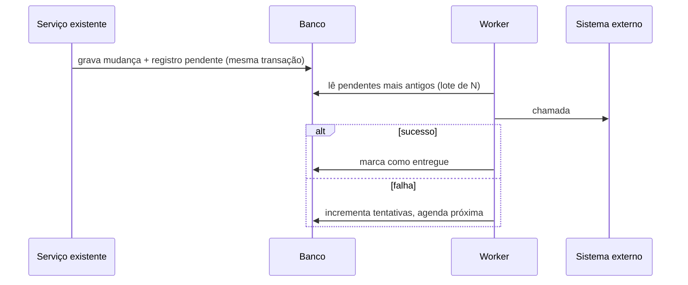

# Template do FDD

Estrutura em português do Brasil. Cada parágrafo, item e célula em uma única linha na fonte. Identificadores, caminhos, endpoints e campos no original.

## Sumário

- [Cabeçalho](#cabeçalho)
- [1. Contexto e motivação técnica](#1-contexto-e-motivação-técnica)
- [2. Objetivos técnicos](#2-objetivos-técnicos)
- [3. Escopo e exclusões](#3-escopo-e-exclusões)
- [4. Visão da solução](#4-visão-da-solução)
- [5. Modelo de dados](#5-modelo-de-dados)
- [6. Fluxos detalhados](#6-fluxos-detalhados)
- [7. Contratos públicos](#7-contratos-públicos)
- [8. Matriz de erros](#8-matriz-de-erros)
- [9. Resiliência](#9-resiliência)
- [10. Segurança](#10-segurança)
- [11. Observabilidade](#11-observabilidade)
- [12. Configuração](#12-configuração)
- [13. Integração com o sistema existente](#13-integração-com-o-sistema-existente)
- [14. Dependências e compatibilidade](#14-dependências-e-compatibilidade)
- [15. Estratégia de testes](#15-estratégia-de-testes)
- [16. Critérios de aceite técnicos](#16-critérios-de-aceite-técnicos)
- [17. Riscos e mitigação](#17-riscos-e-mitigação)
- [18. Questões em aberto](#18-questões-em-aberto)
- [19. Histórico de revisão](#19-histórico-de-revisão)
- [20. Origem](#20-origem)

## Cabeçalho

```markdown
# FDD — <Nome da feature>

**Status:** Rascunho | Em revisão | Aprovado · **Data:** AAAA-MM-DD · **Autor:** <nome> · **Revisores:** <nomes> · **Documentos relacionados:** [PRD](PRD.md) · [RFC](RFC.md) · [ADRs](adrs/README.md)
```

## 1. Contexto e motivação técnica

Um ou dois parágrafos: o que o sistema faz hoje no ponto onde a feature entra, com os arquivos envolvidos, e por que a implementação atual não atende. Referencie o PRD para o problema de negócio e o RFC para a abordagem; não os repita.

## 2. Objetivos técnicos

Lista de objetivos verificáveis em termos de implementação, cada um ligado a um requisito do PRD ou decisão de ADR quando houver: "Garantir que X aconteça na mesma transação de Y (ADR-002, RNF-01)".

## 3. Escopo e exclusões

**Inclui:** componentes, contratos e mudanças que este FDD cobre.
**Exclui:** o que fica fora, com referência ao PRD (itens `FE-xx`) ou ao RFC (não objetivos). Itens adiados não recebem desenho aqui, nem "para o futuro".

## 4. Visão da solução

Componentes com responsabilidade e localização proposta no repositório. Diagrama de componentes só se o RFC não tiver um. Tabela:

| Componente | Responsabilidade | Localização | Novo ou alterado |
| --- | --- | --- | --- |
| <nome> | <uma linha> | `src/.../arquivo.ext` | Novo \| Alterado |

## 5. Modelo de dados

Para cada entidade nova ou alterada: nome da tabela conforme a convenção do projeto, campos com tipo, nulidade, padrão e propósito, chaves, índices com justificativa (qual consulta atende), enums com valores e significado. Mudanças em entidades existentes destacadas. Estratégia de migração (ferramenta do projeto, ordem, reversibilidade). Retenção e limpeza quando aplicável.

```markdown
### Tabela `nome_da_tabela` (nova)

| Campo | Tipo | Nulo | Padrão | Descrição |
| --- | --- | --- | --- | --- |
| id | CHAR(36) | não | uuid | identificador |

**Índices:** `(status, created_at)` para a leitura do worker em lote.
**Enum `status`:** `PENDING` (aguardando), `PROCESSING` (em processamento), `DELIVERED` (entregue), `FAILED` (falha definitiva).
```

## 6. Fluxos detalhados

Um subitem por fluxo, no mínimo: criação ou registro, processamento, falha e nova tentativa, falha definitiva, e qualquer operação manual (reprocessar, cancelar). Cada fluxo tem:

- **Gatilho**: o que inicia.
- **Pré-condições**.
- **Passos numerados**, com o componente responsável em cada um, as leituras e escritas, e os limites de transação marcados explicitamente ("passos 2 a 5 na mesma transação").
- **Pós-condições**: estado final dos dados.
- **Falhas em cada passo**: o que acontece se o passo N falhar, incluindo efeito sobre a transação e sobre o estado.
- **Diagrama de sequência Mermaid** para o fluxo principal e o fluxo de falha mais relevante.
- **Diagrama de estados** quando há máquina de estados.



## 7. Contratos públicos

Um bloco por endpoint, evento ou mensagem. Para HTTP:

```markdown
### `POST /api/v1/recurso`

**Propósito:** <uma linha>. **Autenticação:** <mecanismo do projeto, papéis permitidos>. **Idempotência:** <sim/não, chave>.

**Cabeçalhos de requisição:** `Authorization: Bearer <token>`, `Content-Type: application/json`

**Requisição:**
```json
{ "campo": "valor" }
```

| Campo | Tipo | Obrigatório | Regras |
| --- | --- | --- | --- |
| campo | string | sim | <formato, tamanho, valores> |

**Resposta 201:**
```json
{ "id": "...", "campo": "valor", "createdAt": "..." }
```

**Status codes:**

| Código | Quando |
| --- | --- |
| 201 | criado |
| 400 | validação falhou (`VALIDATION_ERROR`, formato existente do projeto) |
| 401 | sem token válido |
| 404 | recurso pai não existe |
| 409 | <conflito específico, código da matriz de erros> |
```

Para chamadas de saída (webhooks, mensagens), descreva o contrato que o destinatário recebe: cabeçalhos, assinatura, corpo, semântica de resposta esperada e tempo limite. Inclua um exemplo completo.

## 8. Matriz de erros

Todos os erros da feature, com o prefixo definido, no formato de resposta de erro do projeto:

| Código | HTTP | Condição | Mensagem | Ação esperada do cliente | Classe reusada ou nova |
| --- | --- | --- | --- | --- | --- |
| `PREFIXO_ALGO_INVALIDO` | 400 | <condição precisa> | <texto> | <corrigir e reenviar> | `ValidationError` existente |

Erros internos (falhas de entrega, falha definitiva) também entram, com HTTP vazio e a coluna "Como é exposto" (log, métrica, status do registro).

## 9. Resiliência

Para cada chamada externa ou operação assíncrona: tempo limite (conexão e total), número de tentativas, intervalo entre tentativas com fórmula e teto, condições que contam como falha (status, timeout, erro de rede), quando a falha vira definitiva, para onde vai o registro definitivo (DLQ, status, tabela), como reprocessar manualmente, idempotência e como o destinatário deduplica, proteção contra sobrecarga (tamanho de lote, concorrência, circuit breaker se houver). Números da fonte com localização; números seus marcados como `AUTOR`.

Tabela de tentativas quando houver retry com backoff:

| Tentativa | Intervalo após falha | Acumulado |
| --- | --- | --- |
| 1 | 0 | 0 |
| 2 | <valor> | <valor> |

## 10. Segurança

Autenticação e autorização de cada contrato; geração, armazenamento e rotação de segredos; assinatura ou verificação de origem; o que nunca aparece em logs; validação de destinos (ex.: exigir HTTPS, bloquear endereços internos); limites de tamanho; superfície nova exposta.

## 11. Observabilidade

**Métricas:** nome conforme convenção do projeto, tipo (contador, histograma, gauge), rótulos, o que indica. Inclua as que sustentam os RNFs do PRD.

| Métrica | Tipo | Rótulos | Para quê |
| --- | --- | --- | --- |

**Logs:** eventos logados com nível e campos, no formato do logger do projeto. O que é redigido.

**Tracing:** como a correlação existente (request id, trace id) se propaga para o processamento assíncrono e para chamadas de saída.

**Alertas sugeridos:** condição e limiar, ligados às métricas.

## 12. Configuração

Variáveis de ambiente novas: nome, tipo, padrão, obrigatória ou não, validação no mecanismo do projeto, onde são lidas.

| Variável | Tipo | Padrão | Obrigatória | Uso |
| --- | --- | --- | --- | --- |

## 13. Integração com o sistema existente

Seção obrigatória. Uma entrada por arquivo real, mínimo de quatro em projeto existente. Para cada um: o que ele faz hoje, o que muda ou como é reusado, e o cuidado necessário.

```markdown
### `src/modulo/arquivo.service.ts` (alterado)

**Hoje:** <o que a função relevante faz, em uma ou duas linhas>.
**Mudança:** <o que entra, onde exatamente na função, dentro de qual transação>.
**Cuidado:** <efeito em testes existentes, em performance, em outros chamadores>.

### `src/shared/errors.ts` (reusado)

**Hoje:** <hierarquia existente>.
**Uso:** <quais classes a feature estende ou instancia, para quais erros da matriz>.
```

Arquivos novos propostos entram com "(novo)" e a localização, seguindo a organização do módulo molde.

## 14. Dependências e compatibilidade

Bibliotecas novas com versão e motivo; versões mínimas de runtime; mudanças de banco e sua reversibilidade; compatibilidade de contratos existentes (nada que já é exposto muda sem versionamento); dependências de outros times ou sistemas.

## 15. Estratégia de testes

No estilo do projeto (framework, helpers, fábricas, banco de teste): testes unitários (o quê), de integração (quais fluxos, incluindo falha), de contrato (para chamadas de saída, um receptor falso), de carga quando um RNF exigir. Lista dos cenários de teste obrigatórios, cada um ligado a um fluxo ou erro da matriz.

## 16. Critérios de aceite técnicos

Checklist verificável por um revisor, no formato "dado, quando, então" ou afirmativo direto, cobrindo cada fluxo, cada contrato, cada erro crítico e cada RNF, com os mesmos números do PRD e ADRs.

## 17. Riscos e mitigação

| Risco | Probabilidade | Impacto | Mitigação | Origem |
| --- | --- | --- | --- | --- |

Riscos de implementação e operação: migração, performance da função alterada, crescimento de tabela, dependência externa, concorrência.

## 18. Questões em aberto

| # | Questão | Efeito na implementação | Quem decide | Proposta provisória |
| --- | --- | --- | --- | --- |

Toda proposta do autor em ponto crítico aparece aqui com a proposta provisória, para que a implementação não trave esperando.

## 19. Histórico de revisão

| Data | Autor | Mudança |
| --- | --- | --- |

## 20. Origem

| Item | Fonte | Localização |
| --- | --- | --- |
| <fluxo, contrato, número, decisão> | TRANSCRICAO \| CODIGO \| DOCUMENTO \| AUTOR | <localização> |

Obrigatória em Modo Fontes. Com tracker externo, pode ser reduzida a uma linha apontando para ele. Itens `AUTOR` ficam listados para que o revisor saiba o que não veio de fonte.
