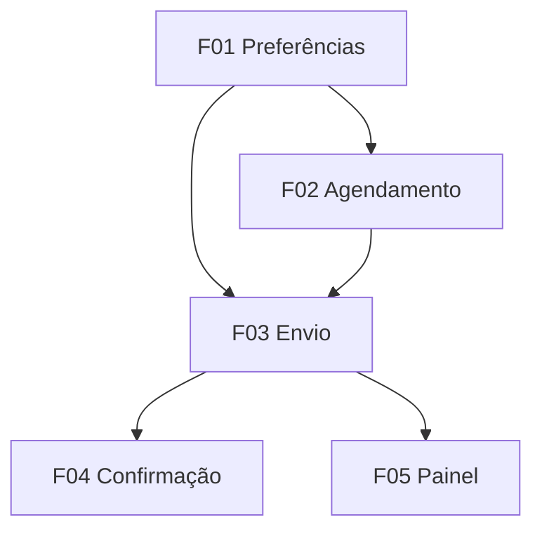

# Template do PRD

Especificação de cada uma das 14 seções e um esqueleto de exemplo. Todo o conteúdo em português do Brasil. A qualidade do texto dentro de cada seção está em `escrita-de-requisitos.md`.

## Sumário

- [Cabeçalho](#cabeçalho)
- [Seção 1: Resumo e Contexto](#seção-1-resumo-e-contexto)
- [Seção 2: Problema e Oportunidade](#seção-2-problema-e-oportunidade)
- [Seção 3: Público-alvo e Cenários de Uso](#seção-3-público-alvo-e-cenários-de-uso)
- [Seção 4: Objetivos e Métricas de Sucesso](#seção-4-objetivos-e-métricas-de-sucesso)
- [Seção 5: Escopo](#seção-5-escopo)
- [Seção 6: Histórias de Usuário](#seção-6-histórias-de-usuário)
- [Seção 7: Requisitos Funcionais](#seção-7-requisitos-funcionais)
- [Seção 8: Requisitos Não Funcionais](#seção-8-requisitos-não-funcionais)
- [Seção 9: Decisões, Trade-offs e Questões em Aberto](#seção-9-decisões-trade-offs-e-questões-em-aberto)
- [Seção 10: Dependências](#seção-10-dependências)
- [Seção 11: Riscos e Mitigação](#seção-11-riscos-e-mitigação)
- [Seção 12: Critérios de Aceitação](#seção-12-critérios-de-aceitação)
- [Seção 13: Estratégia de Testes e Validação](#seção-13-estratégia-de-testes-e-validação)
- [Seção 14: Rastreabilidade](#seção-14-rastreabilidade-modo-fontes)
- [Esqueleto de exemplo](#esqueleto-de-exemplo)

## Cabeçalho

O PRD começa com o título em H1 e uma linha de metadados. Em Modo Revisão, acrescente um histórico de revisões curto logo abaixo.

```markdown
# PRD — <Nome do produto ou feature>

**Status:** Rascunho | Em revisão | Aprovado · **Data:** AAAA-MM-DD · **Autor:** <nome> · **Fontes:** <lista curta das fontes, ou "Entrevista com o usuário">

| Versão | Data | Mudança |
| --- | --- | --- |
| 1.1 | AAAA-MM-DD | F06 adicionada a partir da reunião de DD/MM; RNF-03 ajustado de 15 s para 10 s |
```

O histórico de revisões só aparece a partir da primeira revisão.

---

## Seção 1: Resumo e Contexto

Dois ou três parágrafos:
- O que é o produto ou a feature.
- Para quem.
- Qual o valor central.
- Como funciona em alto nível, na linguagem do usuário.
- Em projeto existente: em que parte do sistema atual a feature se apoia (fluxo, entidade, módulo), sem detalhe de implementação.

## Seção 2: Problema e Oportunidade

**O Problema**: de 2 a 5 categorias de dor, cada uma com título em negrito e de 2 a 4 bullets. Quantifique o impacto sempre que a fonte permitir (custo, tempo, volume, risco comercial, prazo).

**A Oportunidade**: como o produto resolve. Ligue cada problema à solução correspondente e explicite o diferencial.

## Seção 3: Público-alvo e Cenários de Uso

**Usuários**: perfis distintos conforme a diversidade real de uso. Nome em negrito e 3 bullets de características e necessidades. Não force número fixo: público homogêneo pede 1 ou 2 perfis. Inclua atores internos (operação, suporte, segurança) quando forem usuários reais da feature.

**Perfil comportamental**: características comuns a todos. Omita quando houver só 1 perfil.

**Cenários de uso**: de 2 a 5 cenários concretos, cada um com ator, gatilho, ação e resultado esperado. Inclua pelo menos um cenário de falha ou exceção relevante para o usuário.

## Seção 4: Objetivos e Métricas de Sucesso

Tabela com de 3 a 5 objetivos:

| ID | Objetivo | Métrica | Meta | Como medir |
| --- | --- | --- | --- | --- |
| OBJ-01 | **Verbo de ação** + resultado verificável | indicador | número com unidade e prazo | fonte do dado e condição de medição |

Pelo menos um objetivo deve ter meta quantitativa. No Modo Fontes, a meta vem da fonte; se a fonte não der número, registre a meta como `PREM-xx` e sinalize ao usuário.

## Seção 5: Escopo

**5.1 Incluso**: lista curta das capacidades desta versão, apontando para os IDs `Fxx` da seção 7.

**5.2 Fora de escopo**: tabela obrigatória.

| ID | Item | Tipo | Motivo | Origem |
| --- | --- | --- | --- | --- |
| FE-01 | o que não será feito | Descartado ou Adiado | por que, em uma frase | localização na fonte |

- **Descartado**: rejeitado, não está planejado.
- **Adiado**: reconhecido como válido, fica para fase futura.
- Inclua também limites óbvios para quem lê (ex.: "somente saída, sem receber chamadas de terceiros") quando a fonte os estabelecer.

**5.3 Premissas e restrições**: `PREM-xx` com o que está sendo assumido e o que restringe a solução (prazo comercial, tamanho do time, infraestrutura disponível, compliance). Cada uma com origem ou com a marca "Premissa a validar".

## Seção 6: Histórias de Usuário

Agrupadas por funcionalidade, com o ID:

```markdown
### F01. Nome da funcionalidade
- Como <ator>, quero <ação concreta> para <benefício>
```

- Quantas histórias a funcionalidade exigir, sem faixa fixa.
- Histórias descrevem interações concretas, não metas abstratas.
- Agrupe por funcionalidade, não por persona.
- Para funcionalidades sem interação direta, escreva da perspectiva do sistema ou do integrador ("Como o sistema, quero ... para que ...").

## Seção 7: Requisitos Funcionais

Uma subseção por funcionalidade (`### F01. Nome`). Toda funcionalidade tem obrigatoriamente **Capacidades** e **Experiência**. Os demais blocos são condicionais e omitidos quando não se aplicam. Ordem dos blocos:

1. **Consome** (omitir se não houver dependência de dados de outras funcionalidades): dados que esta funcionalidade precisa, citando a funcionalidade fornecedora pelo ID. Nível semitécnico: objetos de negócio e campos principais (ex.: "identificador da consulta, data e hora, canal preferido do paciente"), sem tipos de programação. Não liste autenticação ou sessão, que são assumidas.
2. **Fornece** (omitir se ninguém consome): dados disponibilizados, com os consumidores entre parênteses. Mesmo dado para várias funcionalidades fica em uma entrada `(usado por F04, F06)`; dados diferentes ficam em entradas separadas.
3. **Escopo essencial** (omitir se todas as capacidades têm a mesma prioridade): o mínimo para a funcionalidade cumprir seu propósito.
4. **Escopo completo** (omitir se não houver Escopo essencial): incrementos desta mesma versão, implementados depois do essencial. Itens adiados para fases futuras **não** entram aqui, vão para Fora de escopo.
5. **Capacidades**: limites ESPECÍFICOS (tamanhos, quantidades, prazos, número de tentativas), formatos e regras de negócio.
6. **Experiência**: fluxo detalhado na ordem em que acontece, com campos, validações, mensagens, estados e feedback. Para funcionalidades de sistema sem tela, o bloco pode se chamar **Comportamento observável** e descreve o que o integrador ou operador recebe, em que ordem e o que vê quando falha.
7. **Tratamento de erros** (somente funcionalidades críticas): de 3 a 5 cenários de falha com o comportamento e a mensagem esperados. Inclua quando a funcionalidade envolver pelo menos um de: (a) autenticação ou autorização, (b) operação financeira, (c) risco de perda de dados (criar, enviar, excluir, alterar estado persistente), (d) operação sensível à segurança, (e) operação longa ou irreversível com falha parcial possível. Omita em leitura e exibição onde a falha se resolve recarregando. Na dúvida: "se falhar em silêncio, o usuário perde dados, dinheiro ou segurança?". Se sim, inclua.

No Modo Fontes, acrescente ao fim de cada funcionalidade uma linha `*Origem:* [hh:mm] Nome; caminho/do/arquivo`.

## Seção 8: Requisitos Não Funcionais

Tabela agrupada por categoria (desempenho e latência, confiabilidade e disponibilidade, segurança, observabilidade e auditoria, escalabilidade e volume, compatibilidade, retenção de dados, operação):

| ID | Categoria | Requisito | Critério mensurável | Origem |
| --- | --- | --- | --- | --- |
| RNF-01 | Desempenho | o que deve ser garantido | número com unidade e condição (ex.: p95 abaixo de 10 s) | localização |

Todo RNF precisa de critério mensurável. "Seguro", "rápido" ou "escalável" sem número não é requisito.

## Seção 9: Decisões, Trade-offs e Questões em Aberto

**9.1 Decisões e trade-offs**: tabela curta, uma linha por decisão que afeta o produto.

| ID | Decisão | Ganho | Custo aceito | Referência |
| --- | --- | --- | --- | --- |
| DEC-01 | o que foi decidido, em uma frase | o que o produto ganha | o que se abre mão | origem e link para ADR/RFC se existir |

Não repita a argumentação técnica do ADR. Registre o efeito para o produto e aponte para onde está o detalhe.

**9.2 Questões em aberto**: `QA-xx` com a pergunta, por que importa, quem decide (se a fonte disser) e a origem.

## Seção 10: Dependências

**10.1 Dependências externas**: sistemas, times, fornecedores, contratos, infraestrutura e decisões pendentes de que a entrega depende.

| ID | Dependência | Tipo | Impacto se indisponível | Origem |
| --- | --- | --- | --- | --- |

**10.2 Grafo de dependências entre funcionalidades**: até cinco partes com numeração estável. Quando a Parte 2 não se aplica, ela é omitida e as demais mantêm seus números (Parte 1, 3, 4, 5).

**Parte 1: Tabela de dependências**

| # | Funcionalidade | Prioridade | Dependências |
| --- | --- | --- | --- |

- Toda funcionalidade da seção 7 aparece exatamente uma vez.
- **Ordem topológica**: toda dependência citada aparece em uma linha ACIMA. Nunca há referência adiante.
- Dependências: IDs separados por vírgula, sempre com semântica E. Use "Nenhuma" para raízes.
- Existe dependência quando B não funciona sem A implementada antes. Inclui dependências de dados (as do bloco Consome) e de infraestrutura. Dependências é sempre um superconjunto de Consome.
- Prioridade de 1 a 3, refletindo a versão mínima (Escopo essencial, se houver).
- Desempate topológico pelo ID menor.
- Se a funcionalidade aceita uma de duas dependências alternativas (semântica OU), escolha a principal e cite a alternativa na seção 7.

**Parte 2: Funcionalidades de fundação** (somente quando alguma funcionalidade monta infraestrutura compartilhada)

Uma funcionalidade é de fundação quando seu **propósito principal** é montar infraestrutura compartilhada: scaffolding, layout e roteamento base, banco e ORM, middleware transversal (autenticação, logging), CI. Teste útil: se implementá-la exige comandos de bootstrap do projeto ou configura uma biblioteca central que as próximas usam sem citá-la em Consome, é fundação. Uma capacidade de domínio voltada ao usuário não é fundação, mesmo que crie estrutura. Em feature sobre sistema existente, normalmente não há fundação.

```markdown
### Funcionalidades de fundação
Estas funcionalidades montam infraestrutura compartilhada. Em projeto novo, devem ser implementadas em sequência antes ou junto de qualquer funcionalidade que dependa delas:
- **F<ID> <Nome>**: o que contribui para a infraestrutura compartilhada
```

Liste na mesma ordem topológica da tabela.

**Parte 3: Ondas de execução**

Cálculo mecânico a partir da tabela:
- **Onda 1**: toda funcionalidade com "Nenhuma".
- **Onda N**: `onda(f) = max(onda(dependência)) + 1`.
- Dentro de uma onda: prioridade crescente (1, 2, 3), desempate pelo ID menor.

```markdown
### Ondas de execução
Funcionalidades da mesma onda podem ser construídas em paralelo. Uma onda só começa quando todas as das ondas anteriores estiverem concluídas.

- **Onda 1**: F01
- **Onda 2**: F02, F03
```

Quando a Parte 2 existir, acrescente antes da lista: "**Nota:** funcionalidades de fundação não podem rodar em paralelo em projeto novo, mesmo que estejam na mesma onda, pois compartilham arquivos de scaffolding."

**Parte 4: Legenda de prioridade** (sempre)

```markdown
### Níveis de prioridade
- **1** = Essencial: o produto não funciona sem ela
- **2** = Importante: agrega valor significativo
- **3** = Desejável: melhoria incremental
```

**Parte 5: Diagrama Mermaid**

- `graph TD`, rótulos com ID e nome curto (1 ou 2 palavras).
- `A --> B` significa "A é pré-requisito de B".
- As arestas correspondem exatamente à coluna Dependências. A tabela é a fonte da verdade.

## Seção 11: Riscos e Mitigação

| ID | Risco | Probabilidade | Impacto | Mitigação | Origem |
| --- | --- | --- | --- | --- | --- |
| RISCO-01 | evento e consequência | Alta, Média ou Baixa | Alto, Médio ou Baixo | ação concreta, com responsável se a fonte disser | localização |

Pelo menos 2 riscos. Cubra os tipos que se aplicarem: técnico, segurança, operacional, prazo ou comercial, adoção pelo usuário. Mitigação genérica ("monitorar") não basta: diga o quê, como e com qual gatilho.

## Seção 12: Critérios de Aceitação

Por funcionalidade (`### F01. Nome`), em checklist:
- Verificáveis: passa ou não passa.
- Específicos: com números e estados concretos.
- Cobrem sucesso E falha.

Ao final, o bloco **Integração entre funcionalidades**: um ou mais critérios derivados de cada declaração Consome da seção 7, testando que o dado flui entre as funcionalidades como declarado. Funcionalidade sem Consome não gera critério de integração.

Opcionalmente, um bloco **Critérios não funcionais** com a verificação dos RNFs mais críticos.

## Seção 13: Estratégia de Testes e Validação

- **Níveis de teste**: o que cada nível cobre (unitário, integração, ponta a ponta, contrato), alinhado às convenções do projeto existente quando houver.
- **Cenários críticos**: os fluxos de falha e de borda que precisam de teste explícito (ex.: indisponibilidade de dependência, duplicidade, concorrência, segurança).
- **Validação de RNFs**: como cada RNF crítico será medido (teste de carga, injeção de falha, auditoria de logs).
- **Validação com usuários ou clientes**: piloto, beta, homologação com clientes-alvo, quando a fonte mencionar.
- **Critério de pronto para lançamento**: condições objetivas para liberar.

## Seção 14: Rastreabilidade (Modo Fontes)

Tabela única que mapeia cada item com ID do PRD à origem:

| ID | Tipo | Conteúdo (resumo) | Fonte | Localização |
| --- | --- | --- | --- | --- |
| F01 | Requisito funcional | resumo em uma linha | TRANSCRICAO | [hh:mm] Nome |
| RNF-02 | Requisito não funcional | ... | CODIGO | caminho/do/arquivo |

- Cubra pelo menos 80% dos itens com ID. Item sem localização possível é sinal de invenção: remova ou converta em premissa ou questão em aberto.
- `Fonte` usa os rótulos de `extracao-de-fontes.md`.
- Quando existir um tracker externo (`CAMINHO_TRACKER`), esta seção vira uma frase apontando para ele, para não manter a mesma tabela em dois lugares. As colunas "Origem" das outras seções continuam, porque dão contexto local a quem lê a seção.

---

## Esqueleto de exemplo

Ilustrativo. Domínio fictício escolhido para não se confundir com nenhum projeto real; use apenas a estrutura.

````markdown
# PRD — Lembretes de Consulta

**Status:** Em revisão · **Data:** 2026-03-10 · **Autor:** Time de Agendamento · **Fontes:** ata da reunião de 2026-03-05, código do módulo de agendamento

## 1. Resumo e Contexto

[2 a 3 parágrafos...]

## 2. Problema e Oportunidade

### O Problema

**Faltas não avisadas**
- [bullet quantificado]

### A Oportunidade

[problema -> solução...]

## 3. Público-alvo e Cenários de Uso

### Usuários

**Paciente**
- [característica]

**Recepção da clínica**
- [característica]

### Perfil comportamental

[...]

### Cenários de uso

1. **Lembrete padrão**: paciente com consulta confirmada recebe lembrete 24 h antes e confirma presença.
2. **Canal indisponível**: [cenário de falha...]

## 4. Objetivos e Métricas de Sucesso

| ID | Objetivo | Métrica | Meta | Como medir |
| --- | --- | --- | --- | --- |
| OBJ-01 | **Reduzir** faltas não avisadas | taxa de faltas sem aviso | de 18% para 10% em 3 meses | relatório mensal de consultas |

## 5. Escopo

### 5.1 Incluso
- Preferências de contato do paciente (F01) ...

### 5.2 Fora de escopo

| ID | Item | Tipo | Motivo | Origem |
| --- | --- | --- | --- | --- |
| FE-01 | Lembrete por ligação automática | Descartado | custo por ligação inviável | [14:05] Paulo |
| FE-02 | Reagendamento pelo paciente | Adiado | depende da nova agenda online | [14:31] Ana |

### 5.3 Premissas e restrições
- **PREM-01**: [...]

## 6. Histórias de Usuário

### F01. Preferências de contato
- Como paciente, quero escolher entre e-mail e SMS para receber lembretes no canal que uso

### F02. Agendamento de lembretes
- Como o sistema, quero programar o lembrete quando a consulta é confirmada para que ele saia 24 h antes

### F03. Envio de lembretes
- [...]

### F04. Confirmação de presença
- [...]

### F05. Painel da recepção
- [...]

## 7. Requisitos Funcionais

### F01. Preferências de contato

**Fornece:**
- Canal preferido e endereço de contato do paciente (usado por F02, F03)

**Capacidades:** [limites, formatos, regras]

**Experiência:** [fluxo detalhado]

**Tratamento de erros:** [3 a 5 cenários]

*Origem:* [14:12] Ana

### F02. Agendamento de lembretes

**Consome:**
- F01: canal preferido do paciente

**Fornece:**
- Lembrete programado com horário de envio e canal (usado por F03)

**Capacidades:** [...]

**Experiência:** [...]

### F03. Envio de lembretes

**Consome:**
- F01: endereço de contato do paciente
- F02: lembrete programado com horário de envio e canal

**Fornece:**
- Resultado de envio por lembrete: entregue, falhou, tentativas (usado por F04, F05)

**Escopo essencial:**
- [...]

**Escopo completo:**
- [...]

**Capacidades:** [...]

**Experiência:** [...]

**Tratamento de erros:** [...]

### F04. Confirmação de presença

**Consome:**
- F03: resultado de envio por lembrete

**Capacidades:** [...]

**Experiência:** [...]

### F05. Painel da recepção

**Consome:**
- F03: resultado de envio por lembrete

**Capacidades:** [...]

**Experiência:** [...]

## 8. Requisitos Não Funcionais

| ID | Categoria | Requisito | Critério mensurável | Origem |
| --- | --- | --- | --- | --- |
| RNF-01 | Confiabilidade | lembrete não se perde se o provedor de SMS cair | 100% dos lembretes reenviados ou marcados como falha em até 2 h | [14:20] Júlia |

## 9. Decisões, Trade-offs e Questões em Aberto

### 9.1 Decisões e trade-offs

| ID | Decisão | Ganho | Custo aceito | Referência |
| --- | --- | --- | --- | --- |
| DEC-01 | [...] | [...] | [...] | [ADR-001](adrs/ADR-001-...md) |

### 9.2 Questões em aberto
- **QA-01**: [pergunta]. Importa porque [...]. Origem: [14:40] Júlia.

## 10. Dependências

### 10.1 Dependências externas

| ID | Dependência | Tipo | Impacto se indisponível | Origem |
| --- | --- | --- | --- | --- |
| DEP-01 | Provedor de SMS | Fornecedor | lembretes por SMS não saem | [...] |

### 10.2 Grafo de dependências entre funcionalidades

| # | Funcionalidade | Prioridade | Dependências |
| --- | --- | --- | --- |
| F01 | Preferências de contato | 1 | Nenhuma |
| F02 | Agendamento de lembretes | 1 | F01 |
| F03 | Envio de lembretes | 1 | F01, F02 |
| F04 | Confirmação de presença | 2 | F03 |
| F05 | Painel da recepção | 3 | F03 |

### Ondas de execução
Funcionalidades da mesma onda podem ser construídas em paralelo. Uma onda só começa quando todas as das ondas anteriores estiverem concluídas.

- **Onda 1**: F01
- **Onda 2**: F02
- **Onda 3**: F03
- **Onda 4**: F04, F05

### Níveis de prioridade
- **1** = Essencial: o produto não funciona sem ela
- **2** = Importante: agrega valor significativo
- **3** = Desejável: melhoria incremental



## 11. Riscos e Mitigação

| ID | Risco | Probabilidade | Impacto | Mitigação | Origem |
| --- | --- | --- | --- | --- | --- |
| RISCO-01 | [...] | Média | Alto | [...] | [...] |

## 12. Critérios de Aceitação

### F01. Preferências de contato
- [ ] [critério de sucesso]
- [ ] [critério de falha]

[... F02 a F05 ...]

### Integração entre funcionalidades
- [ ] Canal preferido definido em F01 é o usado no lembrete programado por F02
- [ ] Endereço de contato de F01 e lembrete programado de F02 são os usados no envio de F03
- [ ] Resultado de envio de F03 aparece na confirmação de F04
- [ ] Resultado de envio de F03 aparece no painel de F05

## 13. Estratégia de Testes e Validação

[níveis, cenários críticos, validação de RNFs, validação com usuários, critério de pronto]

## 14. Rastreabilidade

| ID | Tipo | Conteúdo (resumo) | Fonte | Localização |
| --- | --- | --- | --- | --- |
| F01 | Requisito funcional | paciente escolhe canal do lembrete | TRANSCRICAO | [14:12] Ana |
````

No exemplo não há funcionalidade de fundação, pois a feature é construída sobre um sistema existente. Por isso a Parte 2 e a nota das ondas estão ausentes.
