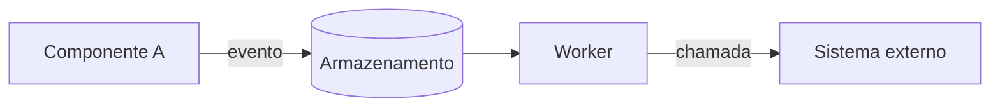

# Template do RFC

Estrutura em português do Brasil, 2 a 4 páginas. Cada parágrafo, item e célula em uma única linha na fonte.

## Estrutura

```markdown
# RFC: <Título que diz a proposta>

| Campo | Valor |
| --- | --- |
| **Autor** | <nome e papel> |
| **Status** | Rascunho \| Em revisão \| Aceito \| Rejeitado \| Retirado |
| **Data** | AAAA-MM-DD |
| **Revisores** | <nome (papel), nome (papel)> |
| **Prazo para comentários** | AAAA-MM-DD <opcional> |
| **Documentos relacionados** | [PRD](PRD.md) · [FDD](FDD.md) · [ADRs](adrs/README.md) |

## 1. Resumo executivo (TL;DR)

<3 a 5 frases: o problema, a abordagem proposta, o principal trade-off aceito e o que precisa de decisão dos revisores.>

## 2. Contexto e problema

<1 a 3 parágrafos. O problema em nível técnico e de negócio, o estado atual do sistema, as restrições que moldam a solução (time, prazo, infraestrutura, RNFs). Aponte para o PRD em vez de repetir requisitos.>

## 3. Objetivos e não objetivos

**Objetivos**
- <o que esta proposta precisa alcançar, verificável>

**Não objetivos**
- <o que esta proposta deliberadamente não resolve, com o motivo em poucas palavras>

## 4. Proposta técnica

### 4.1 Visão geral

<1 a 2 parágrafos descrevendo a solução como um todo, pelo papel de cada componente.>



### 4.2 Componentes e responsabilidades

| Componente | Responsabilidade | Novo ou existente |
| --- | --- | --- |
| <nome pelo papel> | <o que faz, em uma linha> | Novo \| Existente: `caminho/do/modulo` |

### 4.3 Fluxo principal

<Passos numerados do fluxo feliz, do gatilho ao resultado, sem payloads. Mencione o comportamento em falha em uma linha por ponto crítico, referenciando o FDD para o detalhe.>

### 4.4 Garantias e limites

- <garantias que a solução oferece: ex. "nenhum evento confirmado se perde", "entrega pelo menos uma vez">
- <limites conhecidos: ex. "latência alvo de X s", "volume suportado de Y por hora">

## 5. Alternativas consideradas

### 5.1 <Alternativa A>

**O que era:** <uma ou duas frases>
**Pontos a favor:** <o que teria de bom>
**Por que descartada:** <o trade-off em termos dos fatores deste projeto>
**Referência:** [ADR-NNN](adrs/ADR-NNN-....md) <se houver> · Origem: [hh:mm] Nome

### 5.2 <Alternativa B>

<mesma estrutura>

## 6. Impacto e riscos

### 6.1 Impacto

| Área | Impacto | Módulos ou arquivos afetados |
| --- | --- | --- |
| Código existente | <o que muda> | `caminho/...` |
| Dados | <novas tabelas, migrações, retenção> | |
| Operação | <processos novos, monitoramento, implantação> | |
| Segurança | <superfície nova, segredos, autenticação> | |
| Clientes ou integradores | <o que percebem, compatibilidade> | |
| Custo | <infraestrutura, licenças, esforço> | |

### 6.2 Riscos

| Risco | Probabilidade | Impacto | Mitigação |
| --- | --- | --- | --- |
| <evento e consequência> | Alta \| Média \| Baixa | Alto \| Médio \| Baixo | <ação concreta> |

## 7. Plano de entrega (opcional)

<Fases ou marcos em alto nível, se a fonte discutiu. Sem cronograma detalhado.>

## 8. Questões em aberto

| # | Questão | Por que importa | Quem decide | Até quando |
| --- | --- | --- | --- | --- |
| QA-01 | <pergunta> | <efeito na proposta> | <papel ou nome> | <data ou marco> |

## 9. Decisões relacionadas

- [ADR-001: <título>](adrs/ADR-001-....md): <relação com esta proposta em uma linha>
- [ADR-002: <título>](adrs/ADR-002-....md): <...>
- <ADR a criar: "<decisão>" (ainda não registrado)>

## 10. Histórico de revisão

| Data | Autor | Mudança |
| --- | --- | --- |
| AAAA-MM-DD | <nome> | Versão inicial |

## 11. Origem

| Item | Fonte | Localização |
| --- | --- | --- |
| Abordagem proposta | TRANSCRICAO | [hh:mm] Nome |
| Alternativa A | TRANSCRICAO | [hh:mm] Nome |
| Módulo afetado | CODIGO | caminho/do/arquivo |
```

A seção **Origem** é obrigatória em Modo Fontes; em Modo Descoberta é omitida. Com tracker externo, pode ser reduzida a uma linha apontando para ele.

## Orientações por seção

**Título.** Diz a proposta: "Notificação de mudanças de consulta por fila persistente e worker" e não "Proposta de notificações".

**TL;DR.** Escreva por último, quando o resto estiver pronto. Um revisor deve conseguir decidir se precisa ler o restante.

**Contexto.** Resuma o PRD, não o copie. O que o revisor técnico precisa saber do negócio cabe em um parágrafo. Inclua o estado atual do sistema que a proposta toca.

**Não objetivos.** Protegem a revisão de derivar para o que não está sendo proposto. Itens adiados ou descartados pela fonte entram aqui, com o motivo.

**Proposta técnica.** Componentes pelo papel, não por nome de classe. O diagrama mostra quem fala com quem; não é diagrama de sequência detalhado (isso é FDD). Garantias e limites são a parte que mais gera comentário útil; escreva com números quando a fonte os deu.

**Alternativas.** Pelo menos duas reais. Cada descarte em termos de fatores: time, prazo, infraestrutura, requisitos não funcionais, custo. Se a fonte não discutiu alternativas, marque como "não discutida" e abra uma questão pedindo confirmação.

**Impacto.** Em projeto existente, cite módulos ou arquivos reais que mudam. É o que permite ao revisor avaliar o tamanho da mudança.

**Questões em aberto.** Pelo menos duas. Perguntas concretas que os revisores podem responder, não "a definir". Inclua o que a fonte adiou sem decidir.

**Decisões relacionadas.** Um link por ADR com a relação em uma linha. Se um ADR deveria existir e não existe, diga.

**Histórico de revisão.** Cada rodada de comentários que alterou o texto ganha uma linha. Mudança de status também.

## Exemplo de TL;DR

Ilustrativo, domínio fictício:

> Pacientes faltam a consultas por esquecimento e a recepção gasta a manhã ligando para confirmar. Propomos programar lembretes automáticos no momento da confirmação da consulta, gravados em uma tabela de pendentes no banco atual e enviados por um worker separado via SMS ou e-mail conforme preferência do paciente. Aceitamos operar um processo a mais em troca de não introduzir mensageria nova para um time de três pessoas. Precisamos decidir se o paciente pode desativar lembretes sozinho (QA-01) e quem é dono da limpeza da tabela de pendentes (QA-02).
