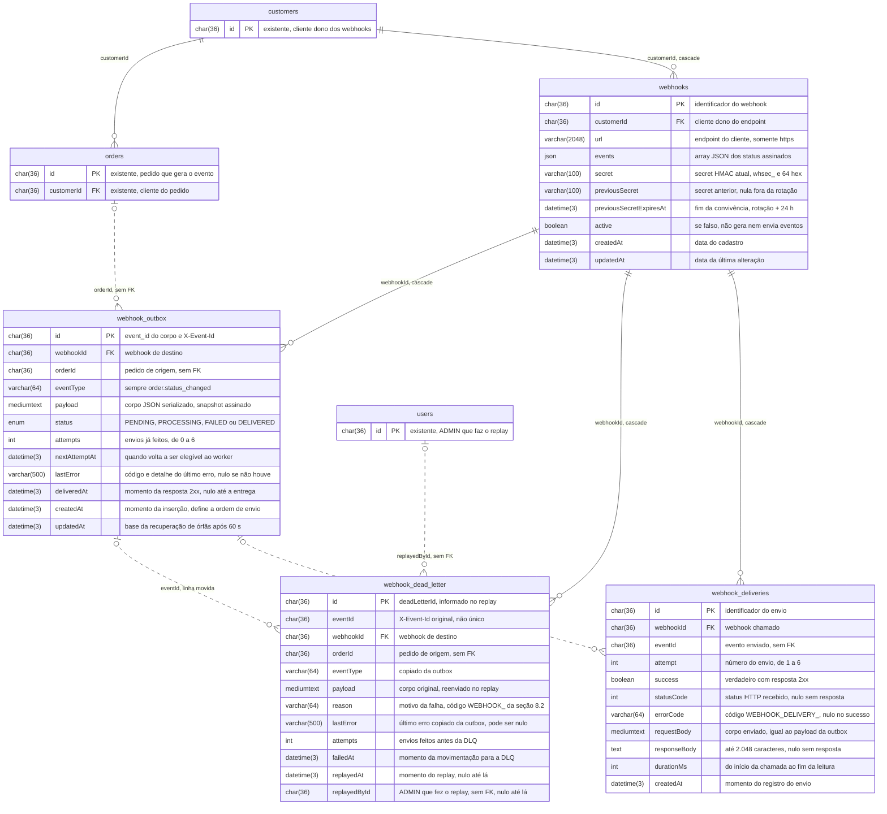
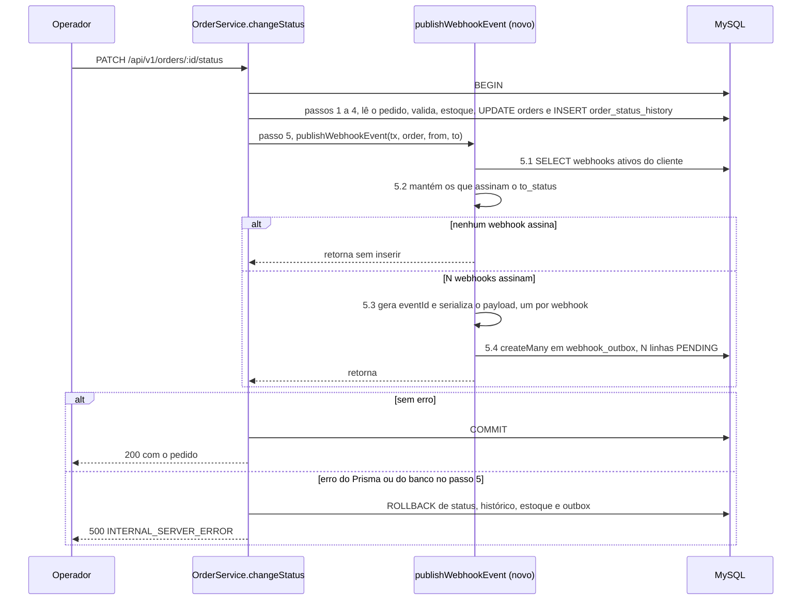
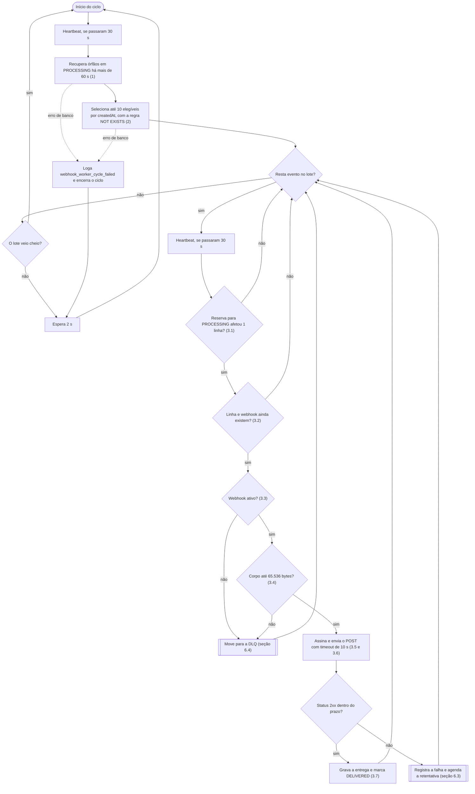
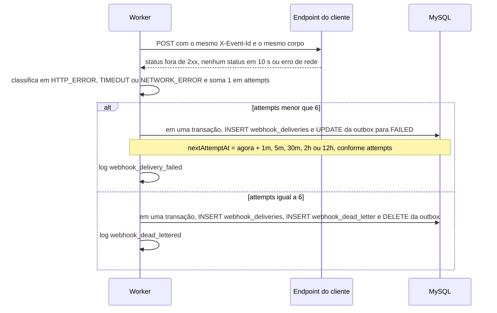
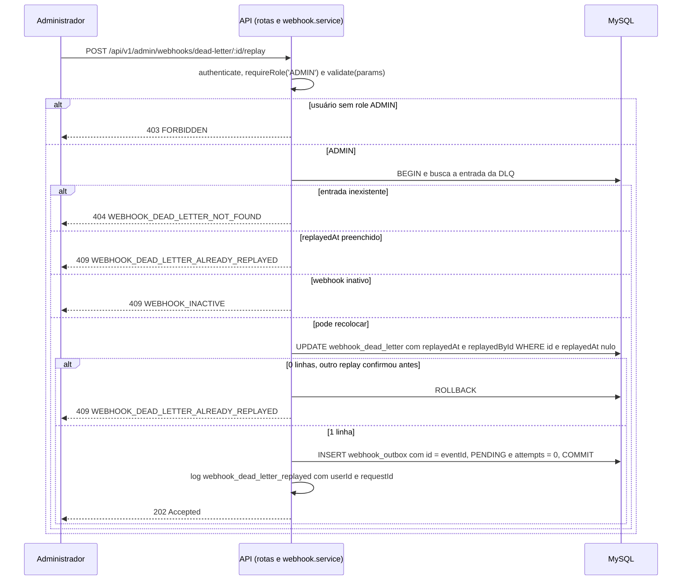
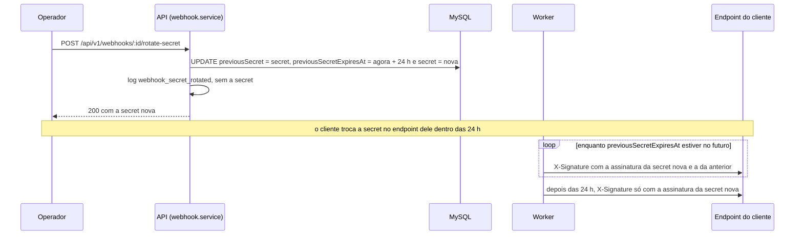
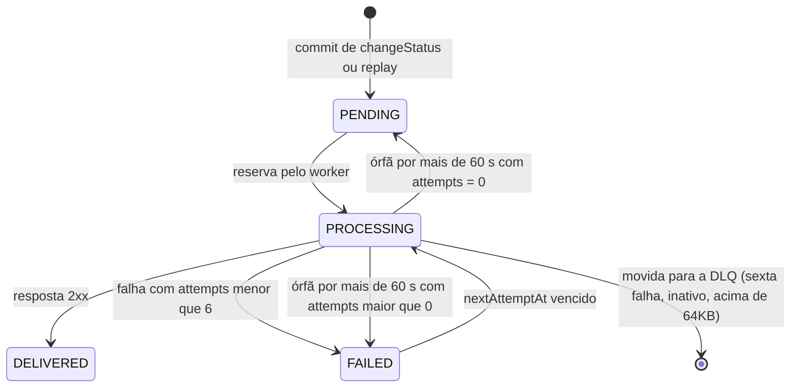
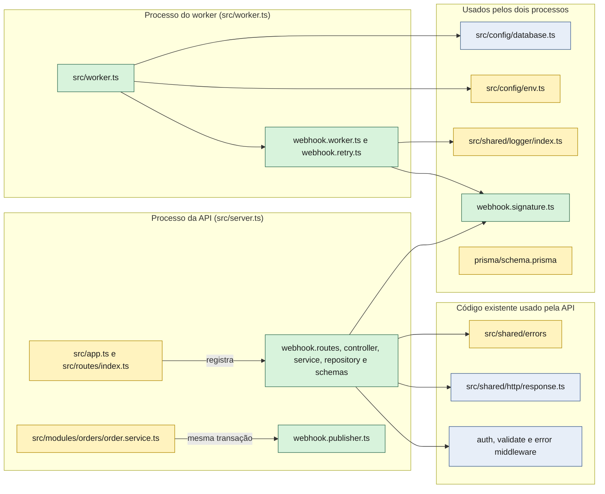

# FDD — Webhooks de notificação de mudança de status de pedidos

**Status:** Em revisão · **Data:** 2026-11-08 · **Autor:** Consolidado com IA a partir da reunião técnica conduzida por Larissa (Tech Lead) · **Revisores:** Bruno (Pedidos), Diego (Plataforma), Sofia (Segurança) · **Documentos relacionados:** [PRD](PRD.md) · [RFC](RFC.md) · [ADRs](adrs/README.md) · [Tracker](TRACKER.md) · [Spec OpenAPI](openapi/webhooks.openapi.yaml) e [manual da spec](openapi/README.md)

Convenção deste documento: valores e comportamentos fixados na reunião trazem a localização `[hh:mm] Nome`. O que a reunião não fixou, mas é necessário para implementar, está marcado como **(AUTOR)** e listado em [18.2](#182-propostas-do-autor-a-validar-na-revisão) para validação na sessão de revisão. Arquivos marcados **(novo)** ainda não existem no repositório: são propostos por este FDD e aparecem na [seção 4](#4-visão-da-solução). São eles `src/worker.ts`, os arquivos de `src/modules/webhooks/` (`webhook.publisher.ts`, `webhook.routes.ts`, `webhook.controller.ts`, `webhook.service.ts`, `webhook.repository.ts`, `webhook.schemas.ts`, `webhook.signature.ts`, `webhook.retry.ts` e `webhook.worker.ts`), os testes `tests/webhooks.test.ts`, `tests/webhook-worker.test.ts` e `tests/webhook-publisher.test.ts`, a migração `prisma/migrations/<timestamp>_add_webhooks/` e o artefato de build `dist/worker.js`. Todos os demais caminhos citados existem no código atual.

## 1. Contexto e motivação técnica

A mudança de status acontece em `OrderService.changeStatus` (`src/modules/orders/order.service.ts`). Dentro de um `prisma.$transaction` interativo, o método lê o pedido com os itens, rejeita `from === to`, valida a transição com `canTransition` (`src/modules/orders/order.status.ts`), debita estoque em `PENDING → PAID` ou repõe em cancelamentos a partir de `PAID`/`PROCESSING`, atualiza `orders` e insere em `order_status_history`. Nada sai do sistema: não há eventos, filas, jobs nem processo além de `src/server.ts`, e os clientes descobrem mudanças fazendo polling em `GET /api/v1/orders`.

Este FDD detalha como construir a proposta do [RFC](RFC.md): o evento é gravado numa outbox dentro dessa transação, entregue por um worker em processo separado, e a configuração dos webhooks é exposta pela API. O problema de negócio está no [PRD](PRD.md), e as justificativas estão nos ADRs 001 a 008, que este documento não repete.

## 2. Objetivos técnicos

| # | Objetivo verificável | Referência |
| --- | --- | --- |
| OBJ-01 | Gravar os eventos em `webhook_outbox` na mesma transação de `changeStatus`; falha na gravação reverte a mudança de status | [ADR-001](adrs/ADR-001-outbox-no-mysql-na-transacao-de-mudanca-de-status.md), [09:40] Bruno |
| OBJ-02 | Primeiro envio em menos de 10 s após o commit, com polling de 2 s e timeout de 10 s por chamada | [ADR-002](adrs/ADR-002-worker-em-processo-separado-com-polling-de-2-segundos.md), [09:02] Marcos |
| OBJ-03 | Retentar com intervalos de 1m, 5m, 30m, 2h e 12h e mover para `webhook_dead_letter` ao esgotar | [ADR-003](adrs/ADR-003-retry-com-backoff-exponencial-em-5-tentativas.md), [ADR-004](adrs/ADR-004-dlq-em-tabela-separada-com-replay-manual-por-admin.md) |
| OBJ-04 | Assinar todo envio com HMAC-SHA256 da secret do endpoint, mantendo a secret anterior válida por 24 h após a rotação | [ADR-005](adrs/ADR-005-assinatura-hmac-sha256-com-secret-por-endpoint-e-rotacao.md) |
| OBJ-05 | Manter o mesmo `X-Event-Id` e o mesmo corpo em retentativas e replay | [ADR-006](adrs/ADR-006-entrega-at-least-once-com-x-event-id.md), [ADR-008](adrs/ADR-008-payload-do-evento-como-snapshot-na-insercao-da-outbox.md) |
| OBJ-06 | Reusar `AppError`, `validate`, `authenticate`, `requireRole`, error middleware, Pino e `paginated()` sem alterar o comportamento deles; no código compartilhado há só acréscimos (três classes de erro em `src/shared/errors/`, variáveis em `src/config/env.ts` e o registro do módulo em `src/app.ts` e `src/routes/index.ts`) e uma única mudança de comportamento, a inclusão dos caminhos da secret no `redactPaths` do logger (seção 10.4, P-24) | [ADR-007](adrs/ADR-007-reuso-dos-padroes-existentes-do-projeto-no-modulo-de-webhooks.md) |
| OBJ-07 | Expor cadastro, edição, remoção, listagem, rotação de secret, histórico de entregas e replay administrativo | [09:21] Sofia, [09:31] Marcos, [09:33] Bruno, [09:34] Marcos, [09:35] Diego |

## 3. Escopo e exclusões

**Inclui**
- Quatro tabelas novas (`webhooks`, `webhook_outbox`, `webhook_dead_letter`, `webhook_deliveries`) e a migração Prisma correspondente
- A função `publishWebhookEvent`, chamada dentro de `changeStatus`
- O worker de entrega, com o entry-point `src/worker.ts` (novo) e o script `npm run worker`, com retry, DLQ e recuperação de eventos órfãos
- Sete endpoints HTTP (CRUD, rotação de secret, histórico de entregas, replay) e o contrato do POST enviado ao cliente
- Erros `WEBHOOK_*`, logs, métricas, variáveis de ambiente e testes

**Exclui** (sem desenho neste documento)
- Itens que a reunião adiou ou descartou, listados no RFC e citados aqui com a numeração dele: limite de taxa por cliente (QA-01), múltiplos workers (QA-02), role específica no CRUD (QA-03), aviso por e-mail (QA-04), painel visual, arquivamento das linhas entregues, webhooks de entrada, ordem global e exactly-once
- Evento na criação do pedido: a reunião tratou só da mudança de status, e o ponto de integração é `changeStatus` ([09:40] Bruno)
- Listagem da DLQ pela API: não foi discutida; o `id` usado no replay vem do log `webhook_dead_lettered` ou de consulta direta ao banco

## 4. Visão da solução

O diagrama de componentes está no [RFC, seção 4.1](RFC.md#41-visão-geral). A tabela abaixo diz onde cada parte fica no repositório.

| Componente | Responsabilidade | Localização | Novo ou alterado |
| --- | --- | --- | --- |
| Serviço de pedidos | Chamar `publishWebhookEvent` dentro da transação de `changeStatus` | `src/modules/orders/order.service.ts` | Alterado |
| Publicador | Selecionar os webhooks ativos do cliente que assinam o `to_status`, montar o snapshot e inserir na outbox | `src/modules/webhooks/webhook.publisher.ts` | Novo |
| API do módulo | CRUD, rotação, histórico e replay, no molde de `src/modules/customers/` | `src/modules/webhooks/webhook.{routes,controller,service,repository,schemas}.ts` | Novo |
| Assinatura | Gerar secret e calcular `X-Signature` | `src/modules/webhooks/webhook.signature.ts` | Novo |
| Política de retry | Tabela de intervalos e decisão de mover para a DLQ | `src/modules/webhooks/webhook.retry.ts` | Novo |
| Worker de entrega | Loop de polling, envio, registro de entrega, retry, DLQ e heartbeat | `src/modules/webhooks/webhook.worker.ts` | Novo |
| Entry-point do worker | Subir o loop e encerrar com sinal, no padrão de `src/server.ts` | `src/worker.ts` | Novo |
| Erros | Classes e códigos `WEBHOOK_*` | `src/shared/errors/http-errors.ts`, `src/shared/errors/index.ts` | Alterado |
| Configuração | Variáveis `WEBHOOK_*` | `src/config/env.ts` | Alterado |
| Composição e rotas | Registrar o módulo | `src/app.ts`, `src/routes/index.ts` | Alterado |
| Modelo de dados | Quatro modelos, um enum e a relação em `Customer` | `prisma/schema.prisma` | Alterado |

## 5. Modelo de dados

Convenções seguidas, observadas em `prisma/schema.prisma`: ids `CHAR(36)` com UUID ([09:51] Larissa: "Tudo é uuid"), com exceção de `OrderNumberSequence`, que tem `id` inteiro, colunas em camelCase sem `@map`, tabelas em snake_case com `@@map`, e `DateTime` como `DATETIME(3)`. Os nomes `webhook_outbox` e `webhook_dead_letter` vêm da reunião ([09:06] Diego, [09:18] Diego). Os nomes `webhooks` e `webhook_deliveries` são **(AUTOR, P-23)**.

O diagrama mostra as quatro tabelas novas e como se ligam às tabelas existentes `customers`, `orders` e `users`. Entre as tabelas novas, linhas contínuas são chaves estrangeiras com exclusão em cascata **(AUTOR, P-13)**; a relação existente entre `customers` e `orders` também aparece contínua, mas não tem cascata. Linhas tracejadas são referências sem chave estrangeira **(AUTOR, P-13 e P-23)**, explicadas nas seções 5.2 a 5.4. Cada coluna traz uma descrição curta. Como o diagrama não marca nulidade, a descrição das colunas opcionais diz quando ficam nulas; o tipo e o padrão exatos estão no schema Prisma logo abaixo.



O schema Prisma correspondente, a ser acrescentado em `prisma/schema.prisma`:

```prisma
enum WebhookOutboxStatus {
  PENDING
  PROCESSING
  FAILED
  DELIVERED
}

model Webhook {
  id                      String    @id @default(uuid()) @db.Char(36)
  customerId              String    @db.Char(36)
  url                     String    @db.VarChar(2048)
  events                  Json
  secret                  String    @db.VarChar(100)
  previousSecret          String?   @db.VarChar(100)
  previousSecretExpiresAt DateTime?
  active                  Boolean   @default(true)
  createdAt               DateTime  @default(now())
  updatedAt               DateTime  @updatedAt

  customer    Customer            @relation(fields: [customerId], references: [id], onDelete: Cascade)
  outbox      WebhookOutbox[]
  deadLetters WebhookDeadLetter[]
  deliveries  WebhookDelivery[]

  @@index([customerId, active])
  @@map("webhooks")
}

model WebhookOutbox {
  id            String              @id @db.Char(36)
  webhookId     String              @db.Char(36)
  orderId       String              @db.Char(36)
  eventType     String              @db.VarChar(64)
  payload       String              @db.MediumText
  status        WebhookOutboxStatus @default(PENDING)
  attempts      Int                 @default(0)
  nextAttemptAt DateTime            @default(now())
  lastError     String?             @db.VarChar(500)
  deliveredAt   DateTime?
  createdAt     DateTime            @default(now())
  updatedAt     DateTime            @updatedAt

  webhook Webhook @relation(fields: [webhookId], references: [id], onDelete: Cascade)

  @@index([status, createdAt])
  @@index([status, nextAttemptAt])
  @@index([webhookId, orderId, createdAt])
  @@map("webhook_outbox")
}

model WebhookDeadLetter {
  id           String    @id @default(uuid()) @db.Char(36)
  eventId      String    @db.Char(36)
  webhookId    String    @db.Char(36)
  orderId      String    @db.Char(36)
  eventType    String    @db.VarChar(64)
  payload      String    @db.MediumText
  reason       String    @db.VarChar(64)
  lastError    String?   @db.VarChar(500)
  attempts     Int
  failedAt     DateTime  @default(now())
  replayedAt   DateTime?
  replayedById String?   @db.Char(36)

  webhook Webhook @relation(fields: [webhookId], references: [id], onDelete: Cascade)

  @@index([eventId])
  @@index([webhookId, failedAt])
  @@map("webhook_dead_letter")
}

model WebhookDelivery {
  id           String   @id @default(uuid()) @db.Char(36)
  webhookId    String   @db.Char(36)
  eventId      String   @db.Char(36)
  attempt      Int
  success      Boolean
  statusCode   Int?
  errorCode    String?  @db.VarChar(64)
  requestBody  String   @db.MediumText
  responseBody String?  @db.Text
  durationMs   Int
  createdAt    DateTime @default(now())

  webhook Webhook @relation(fields: [webhookId], references: [id], onDelete: Cascade)

  @@index([webhookId, createdAt])
  @@index([eventId])
  @@map("webhook_deliveries")
}
```

No modelo `Customer` existente entra apenas o campo de relação `webhooks Webhook[]`, sem coluna nova em `customers`.

### 5.1 Tabela `webhooks` (nova)

Guarda URL, secret, `customerId` e estado ativo ([09:21] Bruno, [09:21] Sofia), além do filtro de status ([09:33] Marcos). `events` é um array JSON de valores de `OrderStatus`, porque o conector MySQL do Prisma não suporta listas escalares. O filtro por status é aplicado em memória no publicador, já que cada cliente tem poucos webhooks. `previousSecret` e `previousSecretExpiresAt` guardam a secret anterior durante as 24 h de convivência ([09:21] Sofia). O índice `(customerId, active)` atende a consulta do publicador dentro de `changeStatus`.

### 5.2 Tabela `webhook_outbox` (nova)

Cada linha é um evento destinado a **um** webhook **(AUTOR, P-05)**: uma mudança de status gera uma linha por webhook ativo do cliente que assina aquele status, porque filtro, retry e DLQ são por endpoint. O `id` é o próprio `event_id`, gerado pelo publicador com `uuid` v4 e enviado em `X-Event-Id` ([09:25] Diego). `payload` guarda o JSON já serializado (snapshot, [ADR-008](adrs/ADR-008-payload-do-evento-como-snapshot-na-insercao-da-outbox.md)) como texto, e não em coluna `JSON`, porque o MySQL reordena as chaves de colunas `JSON`; guardar o texto garante que o corpo assinado seja byte a byte igual em todos os envios **(AUTOR, P-23)**. `orderId` não tem chave estrangeira **(AUTOR, P-13)**, para não bloquear `OrderService.delete`, que remove pedidos `PENDING` ou `CANCELLED`. `attempts` conta os envios já feitos.

| Status | Significado |
| --- | --- |
| `PENDING` | Aguardando o primeiro envio, ou recolocado por replay |
| `PROCESSING` | Reservado pelo worker, envio em andamento |
| `FAILED` | O último envio falhou e a linha aguarda `nextAttemptAt` para a próxima tentativa **(AUTOR)** |
| `DELIVERED` | Entregue com resposta 2xx; permanece até o arquivamento, que está fora do escopo ([09:08] Diego) |

Os quatro status são os listados em [09:08] Diego (pendente, processando, falhou, entregue). O significado de `FAILED` como "aguardando retentativa" é a proposta que resolve a ambiguidade do [ADR-004](adrs/ADR-004-dlq-em-tabela-separada-com-replay-manual-por-admin.md): na falha definitiva, a linha é **movida** para a DLQ (seção 6.4). Índices: `(status, createdAt)` atende o índice em status e em `created_at` citado em [09:08] Diego, combinado num índice composto **(AUTOR, P-23)**; `(status, nextAttemptAt)` atende a seleção de retentativas; `(webhookId, orderId, createdAt)` atende a regra de ordem da seção 6.2.

### 5.3 Tabela `webhook_dead_letter` (nova)

Guarda payload, motivo da falha e timestamp ([09:18] Diego). `eventId` preserva o `X-Event-Id` original para o replay. `eventId` não é único, porque um evento recolocado pode falhar de novo e gerar outra entrada. `replayedAt` e `replayedById` registram o replay (auditoria pedida em [09:36] Sofia), e `replayedById` não tem chave estrangeira **(AUTOR, P-23)**.

### 5.4 Tabela `webhook_deliveries` (nova)

Uma linha por envio, com sucesso ou falha, payload, resposta e tempo de resposta ([09:34] Marcos). `responseBody` guarda até 2.048 caracteres **(AUTOR)**. `eventId` não tem chave estrangeira, porque a linha da outbox pode ter sido movida para a DLQ.

### 5.5 Migração e retenção

A migração é gerada com `npx prisma migrate dev --name add_webhooks`, que cria `prisma/migrations/<timestamp>_add_webhooks/migration.sql` (novo). Ela só cria tabelas, índices e chaves estrangeiras e não altera colunas existentes. O Prisma não gera migração de descida; a reversão manual é `DROP TABLE` das quatro tabelas, na ordem `webhook_deliveries`, `webhook_dead_letter`, `webhook_outbox`, `webhooks`. Não há rotina de limpeza nesta feature: o arquivamento das linhas entregues ficou fora do escopo ([09:08] Diego), e o crescimento das tabelas está em Riscos.

Exclusões em cascata **(AUTOR)**: remover um webhook remove suas linhas de outbox, DLQ e histórico. Remover um cliente remove seus webhooks.

## 6. Fluxos detalhados

### 6.1 Criação do evento na outbox (dentro de `changeStatus`)

**Gatilho:** `PATCH /api/v1/orders/:id/status` com transição válida. **Pré-condições:** pedido existe e `canTransition(from, to)` é verdadeiro.

Os passos 1 a 6 rodam no mesmo `prisma.$transaction` que já existe em `changeStatus`.

1. (existente) Lê o pedido com itens, rejeita `from === to` com 409 e transição inválida com `InvalidStatusTransitionError`.
2. (existente) Debita ou repõe estoque conforme `shouldDebitStock` e `shouldReplenishStock`.
3. (existente) `tx.order.update` com o novo status.
4. (existente) `tx.orderStatusHistory.create`.
5. (novo) `await publishWebhookEvent(tx, order, from, to)`, com a assinatura proposta em [09:41] Bruno:
   1. `tx.webhook.findMany({ where: { customerId: order.customerId, active: true }, select: { id: true, events: true } })`.
   2. Mantém os webhooks cujo `events` contém `to`. Se nenhum sobrar, retorna sem inserir nada ([09:34] Bruno).
   3. Para cada webhook, gera `eventId = uuidv4()` e serializa o payload da seção 7.8, com `timestamp = new Date().toISOString()`. O `order` usado é o lido no passo 1; os campos dele que vão no payload (`id`, `orderNumber`, `customerId`, `totalCents`) não mudam no passo 3.
   4. `tx.webhookOutbox.createMany({ data })`, com uma entrada por webhook contendo `id = eventId`, `webhookId`, `orderId = order.id`, `eventType = 'order.status_changed'`, `payload` (o texto serializado do passo anterior), `status = PENDING`, `attempts = 0` e `nextAttemptAt = now`.
6. (existente) Relê o pedido com relações e devolve 200.

**Pós-condições:** o commit grava, juntos, o novo status, a linha de histórico e N linhas `PENDING` na outbox, com N podendo ser zero.

**Falhas:**
- Passos 1 a 4: comportamento atual (404, 409 ou 422), e nada é gravado na outbox.
- Passo 5, por erro do Prisma ou do banco: a exceção propaga, o Prisma reverte a transação inteira, e status, histórico e estoque voltam ao estado anterior ([09:40] Bruno, [09:41] Diego). O error middleware existente responde `500 INTERNAL_SERVER_ERROR` e loga `Unhandled error in request` com o `requestId`. Quem chamou a API pode repetir o PATCH.
- Passo 5.4, quando outra requisição remove um webhook entre 5.1 e 5.4: a chave estrangeira falha (P2003), a transação inteira é revertida e o PATCH responde 500. É uma corrida rara, e o PATCH pode ser repetido.
- Falha no commit: nada é persistido.

O diagrama mostra o caminho feliz, o caso sem webhook interessado e a falha que reverte a transação. O worker só enxerga as linhas depois do commit (seção 6.2).



### 6.2 Processamento pelo worker

**Gatilho:** ciclo do loop, a cada `WEBHOOK_POLL_INTERVAL_MS` (2.000 ms, [09:09] Diego). **Pré-condições:** uma única instância do worker em execução ([09:12] Diego).

1. **Recuperação de órfãos (AUTOR).** Linhas em `PROCESSING` com `updatedAt` mais antigo que 60 s voltam a ser elegíveis: `PENDING` se `attempts = 0`, `FAILED` com `nextAttemptAt = now` se `attempts > 0`. Se houver alguma, loga `webhook_orphans_recovered`. Isso cobre queda do worker ou do banco no meio de um envio.
2. **Seleção**, fora de transação, com `prisma.$queryRaw`, usando `now` do relógio da aplicação, o mesmo que calcula `nextAttemptAt`:

   ```sql
   SELECT o.id FROM webhook_outbox o
   WHERE o.status IN ('PENDING', 'FAILED') AND o.nextAttemptAt <= ${now}
     AND NOT EXISTS (
       SELECT 1 FROM webhook_outbox p
       WHERE p.webhookId = o.webhookId AND p.orderId = o.orderId
         AND p.status IN ('PENDING', 'PROCESSING', 'FAILED')
         AND p.createdAt < o.createdAt)
   ORDER BY o.createdAt ASC
   LIMIT ${batchSize};
   ```

   O `NOT EXISTS` **(AUTOR)** faz valer a ordem por pedido prometida em [09:12] Diego também quando há retentativa: um evento só sai depois que os anteriores do mesmo pedido, para o mesmo webhook, foram entregues ou movidos para a DLQ. Como o destino é o mesmo endpoint, o evento retido falharia de qualquer forma enquanto o anterior falha.
3. Para cada `id`, em ordem e um por vez:
   1. **Reserva:** `updateMany({ where: { id, status: { in: ['PENDING', 'FAILED'] } }, data: { status: 'PROCESSING' } })`. Se `count = 0`, pula o evento.
   2. Carrega a linha com o webhook (`url`, `secret`, `previousSecret`, `previousSecretExpiresAt`, `active`). Se o webhook foi removido, a linha já saiu por cascata e o evento é pulado.
   3. Se o webhook está inativo, vai para a seção 6.4 com `reason = WEBHOOK_INACTIVE`, sem enviar **(AUTOR)**.
   4. Se `Buffer.byteLength(payload, 'utf8') > WEBHOOK_MAX_PAYLOAD_BYTES` (65.536), vai para a seção 6.4 com `reason = WEBHOOK_PAYLOAD_TOO_LARGE`, sem enviar e sem truncar o corpo ([09:23] Sofia, [09:24] Larissa). A verificação fica no worker e não na inserção **(AUTOR)**, para que o tamanho do evento nunca reverta uma mudança de status.
   5. Monta os cabeçalhos (seção 7.8) e a assinatura (seção 10.3).
   6. Chama `fetch(url, { method: 'POST', body: payload, headers, redirect: 'manual', signal: AbortSignal.timeout(WEBHOOK_HTTP_TIMEOUT_MS) })` e lê o corpo da resposta pelo stream (`response.body`), cancelando a leitura ao chegar a 2.048 caracteres, para não carregar respostas grandes em memória. O mesmo sinal cobre a leitura do corpo, e `durationMs` vai do início da chamada ao fim da leitura. Se um status 2xx chegou dentro do prazo e o tempo acaba durante a leitura do corpo, a entrega conta como sucesso e `responseBody` guarda o que foi lido até ali **(AUTOR)**.
   7. Resposta 2xx: em uma transação, insere em `webhook_deliveries` (`attempt = attempts + 1`, `success = true`) e atualiza a outbox para `DELIVERED`, com `attempts + 1`, `deliveredAt = now` e `lastError = null`. Loga `webhook_delivery_succeeded`.
   8. Qualquer outro resultado: seção 6.3.
4. Se o lote veio cheio, o próximo ciclo começa sem esperar **(AUTOR)**. Caso contrário, espera o intervalo de polling.

**Heartbeat (AUTOR).** O próprio loop emite `webhook_worker_heartbeat`, sem timer separado, para que um loop travado pare de emiti-lo. No início de cada ciclo e antes de cada evento do passo 3, o loop verifica se passaram `WEBHOOK_HEARTBEAT_INTERVAL_MS` (30 s) desde o último heartbeat; se sim, conta as linhas por status, calcula `oldestPendingAgeMs` (seção 11.1) e loga. Como um envio dura no máximo 10 s, o intervalo entre dois heartbeats fica em cerca de 40 s no pior caso, abaixo dos 90 s do alerta de worker parado (seção 11.4). Uma falha nessa contagem segue a regra de erro de banco abaixo.

O diagrama resume um ciclo do worker; os números entre parênteses remetem aos passos acima.



**Pós-condições:** cada evento do lote termina em `DELIVERED`, em `FAILED` com nova data ou fora da outbox (DLQ).

**Falhas:**
- Erro de banco nos passos 1 a 3 ou no heartbeat: loga `webhook_worker_cycle_failed` com `err`, encerra o ciclo e tenta de novo no próximo, sem derrubar o processo. Linhas que ficarem em `PROCESSING` são recuperadas pelo passo 1.
- Queda entre o envio (3.6) e a gravação (3.7): o cliente recebeu, mas a linha volta a ser elegível pelo passo 1 e é reenviada com o mesmo `X-Event-Id`. É o caso coberto pela garantia at-least-once ([ADR-006](adrs/ADR-006-entrega-at-least-once-com-x-event-id.md)).

### 6.3 Falha de entrega e retentativa

**Gatilho:** passo 3.8 da seção 6.2.

1. Classifica o erro: sem status de resposta em 10 s (`err.name === 'TimeoutError'` antes de o `fetch` resolver) é `WEBHOOK_DELIVERY_TIMEOUT`; resposta fora de 2xx, inclusive 3xx, já que o redirect não é seguido, é `WEBHOOK_DELIVERY_HTTP_ERROR`, mesmo que o tempo acabe depois, durante a leitura do corpo; DNS, conexão recusada ou TLS é `WEBHOOK_DELIVERY_NETWORK_ERROR`. Qualquer resultado diferente de 2xx é retentado, inclusive 4xx **(AUTOR)**.
2. Calcula `attempts = attempts + 1`.
3. Se `attempts < 6`: em uma transação, insere em `webhook_deliveries` com `success = false`, `errorCode` e `statusCode` quando houver, e atualiza a outbox com `status = FAILED`, `attempts`, `nextAttemptAt = now + RETRY_DELAYS_MS[attempts - 1]` e `lastError = "<código>: <detalhe>"`, limitado a 500 caracteres **(AUTOR, P-23)**. Loga `webhook_delivery_failed`.
4. Se `attempts = 6`: segue para a seção 6.4 com `reason = WEBHOOK_MAX_ATTEMPTS_EXCEEDED`. O registro da entrega entra na mesma transação da movimentação para a DLQ.

**Falhas:** se a transação do passo 3 não confirmar, a linha fica em `PROCESSING`, sem `attempts` incrementado e sem registro em `webhook_deliveries`. A recuperação de órfãos (seção 6.2, passo 1) a devolve depois de 60 s, e ela é reenviada sem esperar o intervalo de backoff, com a mesma contagem de tentativas **(AUTOR, P-11)**. O envio a mais é tolerado pela garantia at-least-once. A falha da transação do passo 4 segue a seção 6.4.

A tabela de intervalos e a contagem de envios estão na seção 9. O diagrama mostra uma falha de envio e os dois destinos possíveis: nova tentativa ou DLQ (seção 6.4).



### 6.4 Falha definitiva e movimentação para a DLQ

**Gatilho:** sexto envio com falha, webhook inativo ou payload acima de 64KB.

1. Em uma transação: se a origem é a sexta falha, insere primeiro a entrega em `webhook_deliveries`. Depois, `tx.webhookDeadLetter.create` copia da outbox `eventId = id`, `webhookId`, `orderId`, `eventType`, `payload`, `reason` e `lastError`, com `attempts` igual ao número de envios feitos (6 na sexta falha, o valor atual da linha nos casos sem envio) e `failedAt = now`. Por fim, `tx.webhookOutbox.delete({ where: { id } })`.
2. Depois do commit, loga `webhook_dead_lettered` em nível `error`, com o `deadLetterId`.

**Pós-condições:** a linha sai da outbox, que fica só com eventos em ciclo ou entregues, e a evidência fica na DLQ. Esse é o destino proposto para a linha, que o [ADR-004](adrs/ADR-004-dlq-em-tabela-separada-com-replay-manual-por-admin.md) deixou em aberto: ela é **movida (AUTOR)**, e não copiada nem mantida como `FAILED`.

**Falhas:** se a transação falhar, a linha continua em `PROCESSING` e é recuperada pelo passo 1 da seção 6.2, o que pode gerar um envio a mais. Esse envio é tolerado pela garantia at-least-once.

### 6.5 Replay manual da DLQ

**Gatilho:** `POST /api/v1/admin/webhooks/dead-letter/:id/replay` ([09:18] Diego, [09:35] Diego). **Pré-condições:** JWT com role `ADMIN` ([09:36] Sofia, [09:36] Larissa).

1. A rota aplica `authenticate`, depois `requireRole('ADMIN')` e depois `validate({ params })`.
2. O serviço abre uma transação:
   1. Busca a entrada da DLQ com o webhook. Se não existir, responde `404 WEBHOOK_DEAD_LETTER_NOT_FOUND`.
   2. Se `replayedAt` estiver preenchido, responde `409 WEBHOOK_DEAD_LETTER_ALREADY_REPLAYED`.
   3. Se o webhook estiver inativo, responde `409 WEBHOOK_INACTIVE` **(AUTOR)**.
   4. **Reserva da entrada (AUTOR):** `tx.webhookDeadLetter.updateMany({ where: { id, replayedAt: null }, data: { replayedAt: now, replayedById: req.user.id } })`. Se `count = 0`, outro replay da mesma entrada foi confirmado depois do passo 2.2, e o serviço responde `409 WEBHOOK_DEAD_LETTER_ALREADY_REPLAYED`.
   5. `tx.webhookOutbox.create` com `id = eventId` e o mesmo `payload`, `status = PENDING`, `attempts = 0` e `nextAttemptAt = now`. Com isso, o evento recebe um ciclo completo de 6 envios **(AUTOR)**.
3. Loga `webhook_dead_letter_replayed` em nível `info`, com `userId` e `requestId`, para auditoria ([09:36] Sofia).
4. Responde `202`.

Os 409 dos passos 2.2 a 2.4 são lançados como `ConflictError` dentro da transação: o Prisma a reverte, e o error middleware serializa o erro como qualquer `AppError`.

**Concorrência:** a reserva do passo 2.4 segue o padrão da reserva condicional do worker (seção 6.2, passo 3.1). No InnoDB, um `UPDATE` espera o lock da linha mesmo em `REPEATABLE READ` e avalia a condição sobre a versão confirmada mais recente, e não sobre o snapshot da transação. Em dois replays simultâneos da mesma entrada, o segundo espera o commit do primeiro, encontra `replayedAt` preenchido e recebe `count = 0`. Assim, o conflito não depende do tratamento de P2002 do error middleware (seção 13).

**Falhas:** se a transação falhar depois da reserva, por exemplo no `create` da outbox, o Prisma reverte também `replayedAt` e `replayedById`, e o replay pode ser repetido.

**Pós-condições:** o evento volta ao fluxo da seção 6.2 com o mesmo `X-Event-Id`. Ele pode chegar fora de ordem em relação a eventos posteriores do mesmo pedido, já entregues, o que é aceito pela garantia at-least-once.



### 6.6 Rotação de secret

**Gatilho:** `POST /api/v1/webhooks/:id/rotate-secret` ([09:21] Sofia).

1. Busca o webhook. Se não existir, responde `404 WEBHOOK_NOT_FOUND`.
2. Em um único `update`: `previousSecret = secret`, `previousSecretExpiresAt = now + 24 h` e `secret` recebe uma nova secret gerada (seção 10.2).
3. Loga `webhook_secret_rotated`, sem a secret.
4. Responde 200 com a secret nova.

**Pós-condições:** a partir do próximo envio, o worker assina com as duas secrets até `previousSecretExpiresAt` e, depois disso, só com a nova (seção 10.3). Se houver uma nova rotação dentro das 24 h, a secret anterior é descartada na hora: só a imediatamente anterior convive com a atual **(AUTOR)**.



### 6.7 Efeito das operações de cadastro sobre eventos pendentes

| Operação | Efeito sobre eventos já na outbox |
| --- | --- |
| `PATCH` de `events` | Nenhum: o filtro é aplicado na inserção ([09:34] Bruno) |
| `PATCH` de `url` | Vale a partir do próximo envio, porque o worker lê a URL no momento do envio |
| `PATCH` com `active = false` | Novos eventos não entram; pendentes vão para a DLQ com `WEBHOOK_INACTIVE` quando chegar a vez deles **(AUTOR)** |
| `DELETE` | Outbox, DLQ e histórico do webhook são removidos em cascata **(AUTOR)** |

### 6.8 Estados da linha na outbox



## 7. Contratos públicos

A especificação completa dos contratos está em [`docs/openapi/webhooks.openapi.yaml`](openapi/webhooks.openapi.yaml), em OpenAPI 3.1. Ela traz os schemas com as regras de validação, os parâmetros, exemplos de resposta para cada status code e, na seção `webhooks`, a chamada que o endpoint do cliente recebe. O [manual da spec](openapi/README.md) explica como visualizá-la e validá-la. Esta seção resume cada endpoint: propósito, regras que vieram da reunião, um exemplo de requisição e um de resposta, iguais aos da spec, e os status codes. Formatos de campo, limites e exemplos de erro ficam só na spec. Fluxos e comportamento ficam neste FDD. Os `GET`, o `DELETE`, o `rotate-secret` e o replay não têm corpo de requisição por definição: o exemplo deles mostra a linha de requisição, os parâmetros e os cabeçalhos. `POST /webhooks` e `PATCH /webhooks/:id` têm corpo na requisição e na resposta, e todos os endpoints da API têm exemplo de resposta.

Regras comuns: os endpoints ficam sob o prefixo `/api/v1`, aplicado em `src/app.ts`. Todos exigem `Authorization: Bearer <jwt>` via `authenticate`, e a ausência ou invalidez do token resulta em `401 UNAUTHORIZED`. O cadastro aceita qualquer role autenticada ([09:37] Sofia), e o replay exige `ADMIN` (seção 10.1). A entrada é validada com Zod via `validate`, e falhas de schema resultam em `400 VALIDATION_ERROR` com `details[]`. Erros seguem o formato `{ "error": { "code", "message", "details"? } }` do error middleware. O JSON da API usa camelCase, como o resto do OMS; o payload enviado ao cliente usa snake_case, como definido em [09:43] Diego. A secret só aparece nas respostas de criação (7.1) e de rotação (7.5).

| Endpoint | `operationId` na spec | Propósito | Autenticação | Fonte |
| --- | --- | --- | --- | --- |
| `POST /api/v1/webhooks` | `createWebhook` | Cadastrar webhook | Qualquer role | [09:31] Marcos |
| `GET /api/v1/webhooks` | `listWebhooks` | Listar os webhooks de um cliente | Qualquer role | [09:33] Bruno |
| `PATCH /api/v1/webhooks/:id` | `updateWebhook` | Editar URL, status assinados ou estado ativo | Qualquer role | [09:33] Bruno |
| `DELETE /api/v1/webhooks/:id` | `deleteWebhook` | Remover webhook | Qualquer role | [09:33] Bruno |
| `POST /api/v1/webhooks/:id/rotate-secret` | `rotateWebhookSecret` | Gerar secret nova, mantendo a anterior por 24 h | Qualquer role | [09:21] Sofia |
| `GET /api/v1/webhooks/:id/deliveries` | `listWebhookDeliveries` | Histórico de entregas | Qualquer role | [09:34] Marcos |
| `POST /api/v1/admin/webhooks/dead-letter/:id/replay` | `replayDeadLetter` | Recolocar um evento da DLQ na outbox | `ADMIN` | [09:35] Diego, [09:36] Larissa |
| `POST <url do webhook>` (saída) | `orderStatusChanged`, em `webhooks` | Notificar o cliente da mudança de status | Assinatura HMAC | [09:43] Diego |

Status codes por endpoint. Os 400 são sempre `VALIDATION_ERROR`, os 401 são `UNAUTHORIZED` de `authenticate`, e o exemplo de resposta de cada erro está na spec:

| Endpoint | Sucesso | 400 | 401 | 403 | 404 | 409 |
| --- | --- | --- | --- | --- | --- | --- |
| `POST /webhooks` | 201, com a secret | Body inválido; URL sem `https` traz `details[].message = "WEBHOOK_INVALID_URL"` | Sem token válido | — | `WEBHOOK_CUSTOMER_NOT_FOUND` | — |
| `GET /webhooks` | 200, lista paginada, possivelmente vazia | `customerId` ausente ou inválido, ou paginação fora dos limites | Sem token válido | — | `WEBHOOK_CUSTOMER_NOT_FOUND` | — |
| `PATCH /webhooks/:id` | 200, sem a secret | Body vazio, `:id` não UUID ou regras de 7.1 violadas | Sem token válido | — | `WEBHOOK_NOT_FOUND` | — |
| `DELETE /webhooks/:id` | 204 | `:id` não UUID | Sem token válido | — | `WEBHOOK_NOT_FOUND` | — |
| `POST /webhooks/:id/rotate-secret` | 200, com a secret nova | `:id` não UUID | Sem token válido | — | `WEBHOOK_NOT_FOUND` | — |
| `GET /webhooks/:id/deliveries` | 200, lista paginada, possivelmente vazia | `:id` não UUID ou `pageSize` fora de 1 a 100 | Sem token válido | — | `WEBHOOK_NOT_FOUND` | — |
| `POST /admin/webhooks/dead-letter/:id/replay` | 202, evento recolocado na outbox | `:id` não UUID | Sem token válido | Sem role `ADMIN` (`FORBIDDEN`, de `requireRole`) | `WEBHOOK_DEAD_LETTER_NOT_FOUND` | `WEBHOOK_DEAD_LETTER_ALREADY_REPLAYED`, inclusive no replay simultâneo, ou `WEBHOOK_INACTIVE` |

### 7.1 `POST /api/v1/webhooks`

**Propósito:** cadastrar um webhook para um cliente; a resposta traz a secret gerada pela plataforma ([09:31] Marcos). **Idempotência:** não; cada chamada cria um webhook e uma secret. **Regras:** `customerId` vem no body, não do JWT ([09:32] Larissa). `url` aceita só `https` ([09:23] Sofia), com até 2.048 caracteres **(AUTOR)**. `events` tem pelo menos 1 item, sem repetição **(AUTOR, P-27)**, entre `PAID`, `PROCESSING`, `SHIPPED`, `DELIVERED` e `CANCELLED` ([09:33] Marcos); `PENDING` é recusado porque nenhuma transição de `order.status.ts` leva a ele **(AUTOR)**. Schemas na spec: `CreateWebhookRequest` e `WebhookWithSecret`.

```http
POST /api/v1/webhooks HTTP/1.1
Authorization: Bearer <jwt>
Content-Type: application/json

{
  "customerId": "a7c4e2d1-0b9f-4c3e-8d21-5f6a7b8c9d01",
  "url": "https://hooks.cliente.example/pedidos",
  "events": ["SHIPPED", "DELIVERED"]
}
```

```http
HTTP/1.1 201 Created
Content-Type: application/json

{
  "id": "3b0e6a52-6f0c-4a51-9a3e-0f2b5d7c9e11",
  "customerId": "a7c4e2d1-0b9f-4c3e-8d21-5f6a7b8c9d01",
  "url": "https://hooks.cliente.example/pedidos",
  "events": ["SHIPPED", "DELIVERED"],
  "active": true,
  "previousSecretExpiresAt": null,
  "secret": "whsec_6f1c0b9e2a7d4e8f9c3b6a1d5e2f7c8b9a0d1e2f3a4b5c6d7e8f9a0b1c2d3e4f",
  "createdAt": "2026-11-12T13:00:00.000Z",
  "updatedAt": "2026-11-12T13:00:00.000Z"
}
```

### 7.2 `GET /api/v1/webhooks`

**Propósito:** listar os webhooks de um cliente ([09:33] Bruno). **Regras:** `customerId` é obrigatório na query, seguindo o filtro `customerId` de `listOrdersQuerySchema` **(AUTOR, P-10)**. A reunião disse que o `customer_id` vem "no body ou no path", nunca do JWT ([09:32] Larissa); a listagem é um `GET`, sem corpo, e a query mantém um único recurso `/webhooks` para cadastro e consulta, como `GET /orders?customerId=` já faz. `page` e `pageSize` seguem os módulos existentes (padrão 20, máximo 100), e a resposta usa `paginated()`. A secret não aparece. Schema na spec: `WebhookPage`.

```http
GET /api/v1/webhooks?customerId=a7c4e2d1-0b9f-4c3e-8d21-5f6a7b8c9d01&page=1&pageSize=20 HTTP/1.1
Authorization: Bearer <jwt>
```

```http
HTTP/1.1 200 OK
Content-Type: application/json

{
  "data": [
    {
      "id": "3b0e6a52-6f0c-4a51-9a3e-0f2b5d7c9e11",
      "customerId": "a7c4e2d1-0b9f-4c3e-8d21-5f6a7b8c9d01",
      "url": "https://hooks.cliente.example/pedidos",
      "events": ["SHIPPED", "DELIVERED"],
      "active": true,
      "previousSecretExpiresAt": null,
      "createdAt": "2026-11-12T13:00:00.000Z",
      "updatedAt": "2026-11-12T13:00:00.000Z"
    }
  ],
  "pagination": { "page": 1, "pageSize": 20, "total": 1, "totalPages": 1 }
}
```

### 7.3 `PATCH /api/v1/webhooks/:id`

**Propósito:** editar URL, filtro de status ou estado ativo ([09:33] Bruno). **Idempotência:** sim; o mesmo body produz o mesmo estado. **Regras:** o body precisa de pelo menos um entre `url`, `events` e `active` **(AUTOR, P-27)**, o que é validado com `refine` no schema; `url` e `events` seguem as regras de 7.1, e `active = false` suspende novos eventos (seção 6.7). `customerId` e a secret não são editáveis: se vierem no body, são descartados sem erro, porque os schemas do projeto usam o comportamento padrão do `z.object`, que remove campos desconhecidos. Schemas na spec: `UpdateWebhookRequest` e `Webhook`.

```http
PATCH /api/v1/webhooks/3b0e6a52-6f0c-4a51-9a3e-0f2b5d7c9e11 HTTP/1.1
Authorization: Bearer <jwt>
Content-Type: application/json

{ "events": ["PAID", "SHIPPED", "DELIVERED"], "active": true }
```

```http
HTTP/1.1 200 OK
Content-Type: application/json

{
  "id": "3b0e6a52-6f0c-4a51-9a3e-0f2b5d7c9e11",
  "customerId": "a7c4e2d1-0b9f-4c3e-8d21-5f6a7b8c9d01",
  "url": "https://hooks.cliente.example/pedidos",
  "events": ["PAID", "SHIPPED", "DELIVERED"],
  "active": true,
  "previousSecretExpiresAt": null,
  "createdAt": "2026-11-12T13:00:00.000Z",
  "updatedAt": "2026-11-12T15:20:00.000Z"
}
```

### 7.4 `DELETE /api/v1/webhooks/:id`

**Propósito:** remover um webhook ([09:33] Bruno). **Efeito:** cascata da seção 6.7.

```http
DELETE /api/v1/webhooks/3b0e6a52-6f0c-4a51-9a3e-0f2b5d7c9e11 HTTP/1.1
Authorization: Bearer <jwt>
```

```http
HTTP/1.1 204 No Content
```

### 7.5 `POST /api/v1/webhooks/:id/rotate-secret`

**Propósito:** o cliente pede uma nova secret, e a anterior continua válida por 24 h ([09:21] Sofia). O caminho é **(AUTOR)**. **Idempotência:** não; cada chamada gera uma secret nova. Schema na spec: `RotateSecretResponse`.

```http
POST /api/v1/webhooks/3b0e6a52-6f0c-4a51-9a3e-0f2b5d7c9e11/rotate-secret HTTP/1.1
Authorization: Bearer <jwt>
```

```http
HTTP/1.1 200 OK
Content-Type: application/json

{
  "id": "3b0e6a52-6f0c-4a51-9a3e-0f2b5d7c9e11",
  "secret": "whsec_0a9b8c7d6e5f4a3b2c1d0e9f8a7b6c5d4e3f2a1b0c9d8e7f6a5b4c3d2e1f0a9b",
  "previousSecretExpiresAt": "2026-11-13T15:30:00.000Z"
}
```

### 7.6 `GET /api/v1/webhooks/:id/deliveries`

**Propósito:** histórico das últimas entregas, com sucesso ou falha, payload, resposta e tempo de resposta ([09:34] Marcos). **Regras:** ordem por `createdAt` decrescente, e `pageSize` com padrão 100 e máximo 100, para atender "os últimos 100" **(AUTOR, P-19)**. `payload` é o `requestBody` gravado, devolvido como objeto. Schema na spec: `DeliveryPage`.

```http
GET /api/v1/webhooks/3b0e6a52-6f0c-4a51-9a3e-0f2b5d7c9e11/deliveries?page=1&pageSize=100 HTTP/1.1
Authorization: Bearer <jwt>
```

```http
HTTP/1.1 200 OK
Content-Type: application/json

{
  "data": [
    {
      "id": "e2d9c1b0-7a6f-4e5d-9c8b-1a2b3c4d5e6f",
      "eventId": "8f14e45f-ceea-4e7a-9f6b-2d1c3b7a9e01",
      "attempt": 2,
      "success": false,
      "statusCode": 503,
      "errorCode": "WEBHOOK_DELIVERY_HTTP_ERROR",
      "durationMs": 184,
      "payload": { "event_id": "8f14e45f-ceea-4e7a-9f6b-2d1c3b7a9e01", "event_type": "order.status_changed", "timestamp": "2026-11-12T14:03:27.512Z", "order_id": "d4c3b2a1-9e8f-4a7b-8c6d-5e4f3a2b1c0d", "order_number": "ORD-000123", "from_status": "PROCESSING", "to_status": "SHIPPED", "customer_id": "a7c4e2d1-0b9f-4c3e-8d21-5f6a7b8c9d01", "total_cents": 18500 },
      "responseBody": "Service Unavailable",
      "createdAt": "2026-11-12T14:04:30.120Z"
    }
  ],
  "pagination": { "page": 1, "pageSize": 100, "total": 1, "totalPages": 1 }
}
```

### 7.7 `POST /api/v1/admin/webhooks/dead-letter/:id/replay`

**Propósito:** recolocar um evento da DLQ na outbox como pendente ([09:18] Diego, [09:35] Diego). **Autenticação:** role `ADMIN` via `requireRole('ADMIN')` ([09:36] Larissa). **Idempotência:** não; o segundo replay da mesma entrada, mesmo simultâneo, é recusado com 409 (seção 6.5). O status 202 indica que o evento foi enfileirado, não entregue **(AUTOR)**. Schema na spec: `ReplayResponse`.

```http
POST /api/v1/admin/webhooks/dead-letter/5c6d7e8f-9a0b-4c1d-8e2f-3a4b5c6d7e8f/replay HTTP/1.1
Authorization: Bearer <jwt de ADMIN>
```

```http
HTTP/1.1 202 Accepted
Content-Type: application/json

{
  "deadLetterId": "5c6d7e8f-9a0b-4c1d-8e2f-3a4b5c6d7e8f",
  "eventId": "8f14e45f-ceea-4e7a-9f6b-2d1c3b7a9e01",
  "webhookId": "3b0e6a52-6f0c-4a51-9a3e-0f2b5d7c9e11",
  "status": "PENDING",
  "replayedAt": "2026-11-13T09:10:00.000Z",
  "replayedById": "0d1e2f3a-4b5c-4d6e-8f70-81920a1b2c3d"
}
```

### 7.8 Chamada de saída: `POST <url do webhook>`

Contrato que o endpoint do cliente recebe, descrito na spec como o webhook `orderStatusChanged`. A descrição dele na spec também traz o texto-base para o portal de desenvolvedores: garantia at-least-once, retentativas, ordem e um exemplo de verificação da assinatura em TypeScript **(AUTOR, P-26)**.

| Cabeçalho | Valor | Fonte |
| --- | --- | --- |
| `Content-Type` | `application/json` | [09:44] Diego |
| `X-Event-Id` | UUID da linha da outbox, igual em retentativas e replay | [09:25] Diego |
| `X-Webhook-Id` | `id` do webhook que originou o envio | [09:44] Sofia |
| `X-Timestamp` | Instante do envio, em ISO 8601 UTC; o formato é **(AUTOR, P-07)**. Não é assinado e não serve como janela antirreplay (seção 10.3, P-22) | [09:44] Diego |
| `X-Signature` | `sha256=<hex>`. Durante as 24 h de convivência, `sha256=<hex com a secret nova>,sha256=<hex com a anterior>`. O formato é **(AUTOR)** | [09:20] Sofia |

A assinatura do exemplo abaixo é real: é o HMAC-SHA256 do corpo mostrado, com a secret do exemplo de 7.1, e serve como vetor de teste conhecido para T-02 e para o portal.

```http
POST /pedidos HTTP/1.1
Host: hooks.cliente.example
Content-Type: application/json
X-Event-Id: 8f14e45f-ceea-4e7a-9f6b-2d1c3b7a9e01
X-Webhook-Id: 3b0e6a52-6f0c-4a51-9a3e-0f2b5d7c9e11
X-Timestamp: 2026-11-12T14:03:28.904Z
X-Signature: sha256=8025653509bf50768d21d9fdaaf58b5fe8ff350d02bdb00fe4e155942141ec25

{"event_id":"8f14e45f-ceea-4e7a-9f6b-2d1c3b7a9e01","event_type":"order.status_changed","timestamp":"2026-11-12T14:03:27.512Z","order_id":"d4c3b2a1-9e8f-4a7b-8c6d-5e4f3a2b1c0d","order_number":"ORD-000123","from_status":"PROCESSING","to_status":"SHIPPED","customer_id":"a7c4e2d1-0b9f-4c3e-8d21-5f6a7b8c9d01","total_cents":18500}
```

| Campo do corpo | Origem no código | Fonte |
| --- | --- | --- |
| `event_id` | `id` da linha da outbox | [09:25] Diego |
| `event_type` | Constante `"order.status_changed"` | [09:43] Diego |
| `timestamp` | Momento da mudança, gerado pelo publicador na transação **(AUTOR)** | Campo e formato: [09:43] Diego |
| `order_id` | `order.id` | [09:43] Diego |
| `order_number` | `order.orderNumber`, no formato `ORD-000123` | [09:43] Diego |
| `from_status` | Status anterior | [09:43] Diego |
| `to_status` | Novo status | [09:43] Diego |
| `customer_id` | `order.customerId` | [09:43] Diego |
| `total_cents` | `order.totalCents` | [09:43] Diego |

O corpo não leva itens; quem precisar de detalhes consulta `GET /api/v1/orders/:id` ([09:43] Diego). Entre os "campos básicos da order", só `total_cents` foi nomeado, e só ele entra **(AUTOR)**.

**Resposta esperada do cliente:** qualquer 2xx em até 10 s confirma a entrega, e o corpo da resposta é ignorado, mas guardado no histórico. Qualquer outro status, um redirect, o timeout ou um erro de rede contam como falha e geram retentativa (seção 9). Os clientes devem verificar a assinatura sobre o corpo bruto e deduplicar por `X-Event-Id` ([ADR-006](adrs/ADR-006-entrega-at-least-once-com-x-event-id.md)). O `timestamp` do corpo não deve ser usado como janela de validade, porque se repete nas retentativas e no replay (seção 10.3). O `X-Timestamp` muda a cada envio, mas não é assinado, então também não serve como janela antirreplay **(AUTOR, P-22)**. Marcos documenta essas regras no portal de desenvolvedores ([09:26] Marcos, [09:40] Marcos), e a descrição do webhook `orderStatusChanged` na spec serve de base para esse texto.

## 8. Matriz de erros

### 8.1 Erros retornados pela API

Os códigos seguem o prefixo `WEBHOOK_` fixado em [09:29] Larissa. `WEBHOOK_NOT_FOUND` e `WEBHOOK_INVALID_URL` foram citados em [09:28] Bruno; os demais nomes são **(AUTOR, P-25)**.

| Código | HTTP | Condição | Mensagem | Ação esperada do cliente | Classe |
| --- | --- | --- | --- | --- | --- |
| `WEBHOOK_NOT_FOUND` | 404 | `:id` inexistente em `PATCH`, `DELETE`, `rotate-secret` ou `deliveries` | `Webhook not found` | Conferir o id pela listagem | `WebhookNotFoundError` (nova, estende `AppError`) |
| `WEBHOOK_CUSTOMER_NOT_FOUND` | 404 | `customerId` do `POST` ou da listagem não existe | `Customer not found` | Conferir o cliente | `WebhookCustomerNotFoundError` (nova, estende `AppError`) |
| `WEBHOOK_INVALID_URL` | 400 | `url` sem protocolo `https:` **(AUTOR, P-21)** | `WEBHOOK_INVALID_URL`, em `details[].message` de `VALIDATION_ERROR` | Cadastrar uma URL `https` | Refinamento Zod em `webhook.schemas.ts` (novo, [09:23] Sofia), convertido em `ValidationError` por `validate.middleware.ts` |
| `WEBHOOK_DEAD_LETTER_NOT_FOUND` | 404 | `:id` inexistente em `webhook_dead_letter` | `Dead letter entry not found` | Conferir o `deadLetterId` no log `webhook_dead_lettered` | `WebhookDeadLetterNotFoundError` (nova, estende `AppError`) |
| `WEBHOOK_DEAD_LETTER_ALREADY_REPLAYED` | 409 | Entrada com `replayedAt` preenchido, inclusive quando um replay simultâneo da mesma entrada confirma antes (seção 6.5) | `Dead letter entry already replayed` | Acompanhar o evento pelo histórico de entregas | `ConflictError` existente, com código próprio |
| `WEBHOOK_INACTIVE` | 409 | Replay para webhook com `active = false` | `Webhook is inactive` | Reativar com `PATCH` e repetir o replay | `ConflictError` existente, com código próprio |

`NotFoundError` não aceita código customizado (o código fixo é `NOT_FOUND`), por isso os 404 ganham subclasses que estendem `AppError` diretamente, com status e código próprios. É o princípio de `InsufficientStockError`, uma subclasse de domínio com código fixo, que no caso dela estende `UnprocessableEntityError` porque essa classe aceita código. `ConflictError` aceita código, então os 409 usam a classe existente, como `OrderService.delete` faz com `INVALID_ORDER_STATE_FOR_DELETE`. A URL sem `https` sai como `VALIDATION_ERROR` porque a regra está no schema Zod e o `validate.middleware.ts` converte toda falha de schema nesse código. Mudar esse middleware alteraria o comportamento de um código compartilhado, o que o ADR-007 evita; a alternativa que não mexe nele, lançar `BadRequestError` com código próprio no service, está registrada na proposta P-21. `WEBHOOK_SECRET_REQUIRED`, citado como exemplo em [09:28] Bruno, não é usado: a secret é gerada pela plataforma ([09:31] Marcos) e a coluna é obrigatória, então não existe entrada sem secret.

Erros existentes reutilizados sem mudança: `VALIDATION_ERROR` (400), `UNAUTHORIZED` (401), `FORBIDDEN` (403, quando falta `ADMIN` no replay) e `INTERNAL_SERVER_ERROR` (500, falha ao gravar na outbox dentro de `changeStatus`). O corpo de resposta de cada erro da API está na spec OpenAPI, em `components/examples`.

### 8.2 Erros internos do worker

Os nomes destes códigos são **(AUTOR, P-25)**.

| Código | Condição | Efeito | Como é exposto |
| --- | --- | --- | --- |
| `WEBHOOK_DELIVERY_TIMEOUT` | Sem status de resposta em 10 s | Retentativa | `webhook_deliveries.errorCode`, log `webhook_delivery_failed`, métrica |
| `WEBHOOK_DELIVERY_HTTP_ERROR` | Status fora de 2xx, inclusive 3xx | Retentativa | Idem, com `statusCode` |
| `WEBHOOK_DELIVERY_NETWORK_ERROR` | DNS, conexão recusada ou TLS | Retentativa | Idem |
| `WEBHOOK_MAX_ATTEMPTS_EXCEEDED` | Sexto envio com falha | DLQ | `webhook_dead_letter.reason`, log `webhook_dead_lettered` |
| `WEBHOOK_PAYLOAD_TOO_LARGE` | Corpo acima de 65.536 bytes | DLQ sem envio | Idem |
| `WEBHOOK_INACTIVE` | Webhook inativo no momento do envio | DLQ sem envio | Idem |

## 9. Estratégias de resiliência

| Parâmetro | Valor | Fonte |
| --- | --- | --- |
| Intervalo de polling | 2 s | [09:09] Diego, [09:10] Larissa |
| Tamanho do lote | 10 eventos | "Batch pequeno" em [09:08] Diego; o valor é **(AUTOR)** |
| Timeout por envio | 10 s, cobrindo conexão, resposta e leitura do corpo; um 2xx recebido no prazo é sucesso mesmo se a leitura do corpo estourar | [09:42] Diego; o tratamento do corpo é **(AUTOR)** |
| Retentativas | 5, depois do envio inicial (6 envios no total) | [09:17] Diego, [09:17] Larissa, [09:48] Larissa; a contagem é **(AUTOR)** |
| Intervalos | 1m, 5m, 30m, 2h, 12h | [09:17] Diego |
| Limite do corpo | 65.536 bytes (64KB lidos como 64 × 1.024) | [09:24] Diego, [09:24] Larissa; a conversão em bytes é **(AUTOR, P-23)** |
| Concorrência | 1 worker, com envios em sequência | Worker único: [09:12] Diego; envio em sequência: **(AUTOR)** |
| Recuperação de órfãos | Linhas em `PROCESSING` há mais de 60 s | **(AUTOR)** |

| Envio | Quando acontece | Tempo desde a primeira falha |
| --- | --- | --- |
| 1 (inicial) | No primeiro ciclo após o commit, em até cerca de 2 s | — |
| 2 | 1 min após a falha do envio 1 | 1 min |
| 3 | 5 min após a falha do envio 2 | 6 min |
| 4 | 30 min após a falha do envio 3 | 36 min |
| 5 | 2 h após a falha do envio 4 | 2 h 36 min |
| 6 | 12 h após a falha do envio 5 | 14 h 36 min |
| — | Falha do envio 6: movido para a DLQ | — |

**Contagem de tentativas.** A reunião fixou "5 tentativas" com cinco intervalos ([09:17] Larissa) e repetiu "total 5 tentativas" no resumo final ([09:48] Larissa). O ADR-003 deixou aberto se são 5 envios no total ou 5 reenvios depois do envio original. Este FDD adota a segunda leitura **(AUTOR)**: as 5 tentativas são as 5 retentativas, uma para cada intervalo, feitas depois do envio inicial, o que dá 6 envios. É a única leitura em que os cinco intervalos são usados e somam "quase 15 horas entre primeira falha e última tentativa" ([09:17] Diego): 14 h 36 min. Com 5 envios no total, o intervalo de 12 h nunca seria usado e a janela seria de 2 h 36 min.

**Fórmula.** `nextAttemptAt = now + RETRY_DELAYS_MS[attempts - 1]`, em que `now` é o fim do envio que falhou (resposta, timeout ou erro de rede), com `RETRY_DELAYS_MS = [60_000, 300_000, 1_800_000, 7_200_000, 43_200_000]` e `attempts` entre 1 e 5. Quando `attempts = 6`, o evento vai para a DLQ. O teto é 12 h. Não há jitter **(AUTOR)**: com um único worker, não existe disparo simultâneo de vários consumidores. O polling acrescenta até 2 s a cada intervalo.

**O que conta como falha:** resposta fora de 2xx (inclusive 3xx, porque o redirect não é seguido), 10 s sem status de resposta e erro de rede ou TLS. Um 2xx recebido no prazo é sucesso mesmo que a leitura do corpo estoure o tempo.

**Falha definitiva e destino:** a linha é movida para `webhook_dead_letter` (seção 6.4). O reprocessamento é manual, pelo endpoint da seção 7.7.

**Idempotência:** o `X-Event-Id` é estável e o corpo é byte a byte igual em todos os envios, já que é lido da coluna `payload`. O cliente deduplica pelo `X-Event-Id`.

**Ordem:** um worker só, com envios em ordem de `createdAt`, e a regra `NOT EXISTS` da seção 6.2 segura um evento enquanto houver outro anterior do mesmo pedido para o mesmo webhook. Um evento movido para a DLQ deixa de segurar os seguintes.

**Proteção contra sobrecarga:** lote de 10 eventos, um envio por vez, timeout de 10 s, resposta lida até 2.048 caracteres e redirect não seguido. Não há limite de taxa por cliente (RFC QA-01).

**Fallback:** não existe canal alternativo de entrega. A DLQ com replay manual é o caminho de recuperação, e o aviso por e-mail ficou para outra fase (RFC QA-04).

**Banco indisponível:** na API, `changeStatus` falha como hoje. No worker, o ciclo é abortado com log, e o loop continua tentando a cada intervalo, sem derrubar o processo.

**Encerramento:** ao receber `SIGTERM` ou `SIGINT`, o worker para de selecionar eventos, conclui o envio em curso (no máximo 10 s), executa `prisma.$disconnect()` e sai com código 0, no mesmo padrão de `src/server.ts`. Se o processo for morto no meio de um envio, a recuperação de órfãos trata a linha.

## 10. Segurança

### 10.1 Autenticação e autorização

| Endpoint | Middleware | Fonte |
| --- | --- | --- |
| `POST`, `GET`, `PATCH`, `DELETE /webhooks`, `rotate-secret`, `deliveries` | `authenticate`, qualquer role (`ADMIN` ou `OPERATOR`) | [09:37] Sofia |
| `POST /admin/webhooks/dead-letter/:id/replay` | `authenticate` e `requireRole('ADMIN')` | [09:36] Sofia, [09:36] Larissa |

O JWT identifica o usuário operador, não o cliente ([09:32] Bruno, [09:32] Larissa). Por isso não há verificação de vínculo entre usuário e `customerId`. Endurecer isso é a QA-03 do RFC.

### 10.2 Secret

A secret é gerada pela plataforma ([09:31] Marcos) com `whsec_` seguido de `randomBytes(32).toString('hex')` (64 caracteres hexadecimais), usando `node:crypto` **(AUTOR)**. Há uma por webhook ([09:21] Sofia). Ela fica em `webhooks.secret` em texto, porque o HMAC precisa do valor original **(AUTOR)**; cifrar em repouso não foi discutido e fica para a revisão de segurança ([09:46] Sofia). A secret só é devolvida no `201` da criação e no `200` da rotação: nunca na listagem, na edição, no histórico ou em logs. A rotação mantém a anterior por 24 h ([09:21] Sofia), com o comportamento descrito na seção 6.6.

### 10.3 Assinatura

`X-Signature = "sha256=" + HMAC-SHA256(secret, corpo).hex`, calculado sobre os bytes exatos da coluna `payload`, que são o corpo enviado ([09:22] Sofia). Se `previousSecret` existir e `previousSecretExpiresAt > now`, o header leva também a assinatura com a secret anterior, separada por vírgula **(AUTOR)**. Essa é a proposta para a ambiguidade do [ADR-005](adrs/ADR-005-assinatura-hmac-sha256-com-secret-por-endpoint-e-rotacao.md): como quem assina é a plataforma, a secret anterior só continua "válida" para o cliente se o envio também levar uma assinatura que ela confirme. O `X-Timestamp` não entra na assinatura, porque a reunião fixou a assinatura sobre o corpo ([09:22] Sofia). Por isso ele não protege contra replay: quem captura uma requisição pode trocar o header sem invalidar a assinatura. A proteção que funciona é deduplicar pelo `event_id` do corpo, que é assinado e igual ao `X-Event-Id` ([09:25] Diego), porque uma requisição capturada e reenviada repete um `event_id` já processado. Uma janela de tempo sobre o `timestamp` do corpo não serve: o corpo é o mesmo nas retentativas, até 14 h 36 min depois da primeira falha, e nos replays, e a janela recusaria entregas legítimas. Incluir o `X-Timestamp` na assinatura, para viabilizar a checagem de janela citada em [09:44] Diego, fica para a revisão da Sofia (proposta P-22; QA-06 do PRD).

### 10.4 Dados em logs

Nunca são logados: `secret`, `previousSecret`, o valor de `X-Signature`, o payload e o corpo da resposta (estes dois ficam só em `webhook_deliveries`). Os caminhos `secret`, `previousSecret`, `*.secret` e `*.previousSecret` entram em `redactPaths` de `src/shared/logger/index.ts`, como proteção adicional **(AUTOR, P-24)**: os dois primeiros cobrem a chave no topo do objeto de log, e os dois últimos, a chave dentro de um objeto de primeiro nível. O vazamento citado na reunião foi no log de aplicação de um cliente ([09:22] Diego), não nos logs da plataforma.

### 10.5 Destino e limites

Só são aceitas URLs `https` ([09:23] Sofia). O redirect não é seguido, para que um 3xx não desvie o envio para `http` ou para outro host **(AUTOR)**. A validação de certificado do Node fica no padrão, sem desativação. Bloquear endereços internos (SSRF) não foi discutido e está em Riscos. O corpo enviado tem limite de 64KB ([09:24] Larissa), a resposta é lida até 2.048 caracteres, e a entrada da API segue o `express.json({ limit: '1mb' })` existente em `src/app.ts`.

## 11. Observabilidade

O projeto não tem biblioteca de métricas, e o [ADR-007](adrs/ADR-007-reuso-dos-padroes-existentes-do-projeto-no-modulo-de-webhooks.md) fixou não adicionar dependências. Por isso as métricas abaixo são derivadas dos eventos de log do Pino, com campos fixos que o pipeline de logs agrega **(AUTOR)**. Adotar uma biblioteca de métricas não foi decidido.

### 11.1 Métricas

| Métrica | Tipo | Rótulos | Origem | Para quê |
| --- | --- | --- | --- | --- |
| `webhook_deliveries_total` | Contador | `result` (`success`, `failure`), `error_code`, `status_class`, `webhook_id` | `webhook_delivery_succeeded`, `webhook_delivery_failed` | Taxa de sucesso por endpoint |
| `webhook_delivery_duration_ms` | Histograma | `result` | Campo `durationMs` | Tempo de resposta dos clientes em relação ao timeout de 10 s |
| `webhook_first_delivery_latency_ms` | Histograma | — | Campo `endToEndMs` nos sucessos com `attempt = 1` | Meta de menos de 10 s ([09:02] Marcos) |
| `webhook_dead_letters_total` | Contador | `reason` | `webhook_dead_lettered` | Falhas permanentes |
| `webhook_replays_total` | Contador | — | `webhook_dead_letter_replayed` | Uso do replay |
| `webhook_outbox_backlog` | Gauge | `status` (`PENDING`, `FAILED`, `PROCESSING`) | `webhook_worker_heartbeat` | Fila acumulando |
| `webhook_outbox_oldest_pending_age_ms` | Gauge | — | `webhook_worker_heartbeat` | Atraso do primeiro envio |
| `webhook_worker_up` | Gauge (presença do heartbeat) | — | `webhook_worker_heartbeat` a cada 30 s | Worker vivo |

O rótulo `webhook_id` é viável porque a fase atual tem poucos endpoints (três clientes, [09:00] Marcos).

Definições dos campos usados nas métricas:
- `endToEndMs = deliveredAt − createdAt` da linha da outbox. Num evento recolocado por replay, `createdAt` é o momento do replay, então a métrica de primeiro envio inclui os replays medidos a partir dele.
- `oldestPendingAgeMs = now − menor createdAt` entre as linhas `PENDING` elegíveis, isto é, com a mesma condição `NOT EXISTS` da seleção da seção 6.2. Eventos segurados pela regra de ordem ficam de fora: a espera deles é esperada, pode durar até 12 h e dispararia o alerta de primeiro envio lento sem haver problema no worker.

### 11.2 Logs

O worker usa o `logger` de `src/shared/logger/index.ts` com `logger.child({ component: 'webhook-worker' })`. Os eventos seguem o padrão snake_case já usado, como `server_started` e `http_request`.

| Evento | Nível | Campos | Processo |
| --- | --- | --- | --- |
| `worker_started` | info | `pollIntervalMs`, `batchSize`, `timeoutMs` | Worker |
| `worker_stopped` | info | `signal` | Worker |
| `worker_bootstrap_failed` | fatal | `err` | Worker |
| `webhook_delivery_succeeded` | info | `eventId`, `webhookId`, `orderId`, `attempt`, `statusCode`, `durationMs`, `endToEndMs` | Worker |
| `webhook_delivery_failed` | warn | `eventId`, `webhookId`, `orderId`, `attempt`, `errorCode`, `statusCode`, `durationMs`, `nextAttemptAt` | Worker |
| `webhook_dead_lettered` | error | `deadLetterId`, `eventId`, `webhookId`, `orderId`, `reason`, `attempts` | Worker |
| `webhook_orphans_recovered` | warn | `count` | Worker |
| `webhook_worker_cycle_failed` | error | `err` | Worker |
| `webhook_worker_heartbeat` | info | `pending`, `failed`, `processing`, `oldestPendingAgeMs` | Worker |
| `webhook_dead_letter_replayed` | info | `deadLetterId`, `eventId`, `webhookId`, `userId`, `requestId` | API |
| `webhook_secret_rotated` | info | `webhookId`, `userId`, `requestId`, `previousSecretExpiresAt` | API |

O CRUD não ganha log próprio: o `http_request` de `request-logger.middleware.ts` já registra método, caminho, status, duração e `userId`.

### 11.3 Tracing

O projeto não tem tracing distribuído; a correlação existente é o `X-Request-Id` gerado ou propagado por `request-logger.middleware.ts`. A cadeia de correlação da feature é:
- O `requestId` do `PATCH /orders/:id/status` aparece no `http_request`, cujo caminho traz o `orderId`.
- Os logs do worker trazem `orderId` e `eventId`.
- O cliente recebe `X-Event-Id` e `X-Webhook-Id`, que o suporte usa para achar entregas e logs.
- A DLQ liga `deadLetterId` e `eventId`.

Levar o `requestId` até a outbox exigiria mudar a assinatura de `changeStatus` e não faz parte desta implementação **(AUTOR)**.

### 11.4 Alertas sugeridos (AUTOR)

| Alerta | Condição | Severidade |
| --- | --- | --- |
| Worker parado | Nenhum `webhook_worker_heartbeat` por 90 s | Crítica |
| Primeiro envio lento | `webhook_outbox_oldest_pending_age_ms` acima de 10.000 por 5 min | Alta |
| Falha permanente | `webhook_dead_letters_total` aumentou | Média |
| Endpoint com problema | Mais de 50% de falhas de um `webhook_id` em 15 min | Média |

## 12. Configuração

As variáveis abaixo entram no `envSchema` de `src/config/env.ts`, com `z.coerce.number().int().positive().default(...)`, e com valores comentados em `.env.example`.

| Variável | Tipo | Padrão | Obrigatória | Uso | Fonte |
| --- | --- | --- | --- | --- | --- |
| `WEBHOOK_POLL_INTERVAL_MS` | int | 2000 | Não | Worker, intervalo do loop | [09:09] Diego |
| `WEBHOOK_BATCH_SIZE` | int | 10 | Não | Worker, `LIMIT` da seleção | **(AUTOR)** |
| `WEBHOOK_HTTP_TIMEOUT_MS` | int | 10000 | Não | Worker, `AbortSignal.timeout` | [09:42] Diego |
| `WEBHOOK_MAX_PAYLOAD_BYTES` | int | 65536 | Não | Worker, limite do corpo | [09:24] Larissa |
| `WEBHOOK_HEARTBEAT_INTERVAL_MS` | int | 30000 | Não | Worker, heartbeat | **(AUTOR)** |

Os intervalos de retentativa e a convivência de 24 h, decididos no ADR-003 e no ADR-005, ficam como constantes no código e não como variáveis, para que a configuração não mude uma decisão registrada: `RETRY_DELAYS_MS` e o máximo de 6 envios em `webhook.retry.ts` (novo), e a convivência de 24 h em `webhook.signature.ts` (novo). Também são constantes o limite de órfãos (60.000 ms) e o tamanho máximo da resposta guardada (2.048). O intervalo de polling, decisão do ADR-002, é a exceção: fica em variável para que os testes do worker rodem ciclos curtos, e o padrão de 2.000 ms é o valor decidido, que em produção só muda com revisão do ADR-002 **(AUTOR, P-16)**.

O schema de `env.ts` é compartilhado pelos dois processos. O worker precisa de `DATABASE_URL` e também de `JWT_SECRET`, que o schema exige mesmo sem o worker usá-la.

Em `package.json` entram o script `"worker": "node --env-file=.env dist/worker.js"`, pedido em [09:11] Larissa, e o `"worker:dev": "tsx watch --env-file=.env src/worker.ts"` **(AUTOR)**, espelhando `start` e `dev`. `tsconfig.build.json` já inclui `src/**/*.ts`, então `npm run build` gera `dist/worker.js`.

## 13. Integração com o sistema existente

O mapa mostra onde cada arquivo entra depois da implementação. Arquivos em verde são novos, em amarelo são alterados, e em azul são reusados sem mudança. Os arquivos `webhook.*` ficam em `src/modules/webhooks/`, e os middlewares em `src/middlewares/`. O detalhe de cada arquivo está nas entradas abaixo.



### `src/modules/orders/order.service.ts` (alterado)

**Hoje:** `changeStatus(id, input, userId)` executa, em um `prisma.$transaction` interativo, a validação da transição, o débito ou a reposição de estoque, `tx.order.update` e `tx.orderStatusHistory.create`, e relê o pedido. O tipo `TxClient = Prisma.TransactionClient` já está declarado no arquivo.

**Mudança:** importar `publishWebhookEvent` de `../webhooks/webhook.publisher.js` (arquivo novo `src/modules/webhooks/webhook.publisher.ts`) e chamá-lo logo após `tx.orderStatusHistory.create` e antes da releitura, com o `order` lido no início da transação, `from` e `to`, conforme [09:41] Bruno:

```ts
await tx.orderStatusHistory.create({ data: { orderId: id, fromStatus: from, toStatus: to, changedById: userId, reason: input.reason ?? null } });
await publishWebhookEvent(tx, order, from, to);
```

O construtor de `OrderService` não muda: é uma função que recebe o `tx`, sem injeção de repositório ([09:41] Diego).

**Cuidado:** a transação ganha um `SELECT` indexado e, quando há webhook interessado, um `createMany`. Uma falha nessa gravação reverte a mudança de status (comportamento desejado). Os testes de transição em `tests/orders.test.ts` continuam passando, porque sem webhooks cadastrados nada é inserido. `create` e `delete` não mudam, e `delete` não é bloqueado porque a outbox não tem chave estrangeira para `orders`.

### `src/modules/orders/order.status.ts` (reusado)

**Hoje:** define o mapa de transições, `canTransition`, `shouldDebitStock` e `shouldReplenishStock`.

**Uso:** é a referência para os valores aceitos em `events`. Como nenhuma transição leva a `PENDING`, o schema aceita apenas `PAID`, `PROCESSING`, `SHIPPED`, `DELIVERED` e `CANCELLED`. O arquivo não muda.

**Cuidado:** se a máquina de estados ganhar um status novo, o enum Prisma `OrderStatus` muda e o schema de `events` precisa ser revisto.

### `src/shared/errors/http-errors.ts` e `src/shared/errors/index.ts` (alterados)

**Hoje:** hierarquia `AppError(message, statusCode, errorCode, details)` com subclasses por status HTTP e erros de domínio (`InvalidStatusTransitionError`, `InsufficientStockError`) exportados por `index.ts`.

**Mudança:** acrescentar `WebhookNotFoundError`, `WebhookCustomerNotFoundError` e `WebhookDeadLetterNotFoundError`, com código e status 404, estendendo `AppError`, e exportá-las em `index.ts`. Os 409 usam `new ConflictError(message, 'WEBHOOK_...')`, sem classe nova.

**Cuidado:** nenhuma classe existente muda, e os códigos novos não colidem com nenhum dos usados hoje em `src/`: `BAD_REQUEST`, `VALIDATION_ERROR`, `UNAUTHORIZED`, `FORBIDDEN`, `NOT_FOUND`, `CONFLICT`, `UNPROCESSABLE_ENTITY`, `INTERNAL_SERVER_ERROR`, `INVALID_STATUS_TRANSITION`, `INSUFFICIENT_STOCK`, `INACTIVE_PRODUCT`, `INVALID_ORDER_STATE_FOR_DELETE`, `EMAIL_ALREADY_USED` e `SKU_ALREADY_USED`.

### `src/middlewares/error.middleware.ts` (reusado, sem mudança)

**Hoje:** serializa `AppError` como `{ error: { code, message, details? } }`, trata `ZodError`, Prisma P2002 (409) e P2025 (404), e loga o resto como 500.

**Uso:** todos os erros da seção 8.1 chegam ao cliente por ele, sem alteração ([09:29] Bruno). O replay concorrente não passa pelo tratamento de P2002: o serviço detecta o conflito com a reserva condicional da seção 6.5 e lança `ConflictError` com código próprio.

**Cuidado:** o worker não passa por este middleware, por não ser uma requisição HTTP. Ele trata e loga os próprios erros (seção 11.2). O tratamento de P2002 chama `.join` sobre `meta.target`, e o formato desse campo no conector MySQL do Prisma não foi verificado; por isso nenhum fluxo da feature depende desse caminho.

### `src/middlewares/auth.middleware.ts` (reusado, sem mudança)

**Hoje:** `authenticate` valida o Bearer JWT e popula `req.user` (`id`, `email`, `role`). `requireRole(...roles)` responde `ForbiddenError` quando a role não confere. Hoje ele é usado em `src/modules/users/user.routes.ts`.

**Uso:** o router de webhooks aplica `router.use(authenticate)`, como `customer.routes.ts`. O router administrativo aplica `authenticate` e `requireRole('ADMIN')` ([09:36] Larissa). `req.user.id` alimenta `replayedById` e o log de auditoria.

**Cuidado:** a ordem dos middlewares importa: `requireRole` depende de `req.user`, preenchido por `authenticate`.

### `src/middlewares/validate.middleware.ts` (reusado, sem mudança)

**Hoje:** `validate({ body, query, params })` aplica schemas Zod e converte `ZodError` em `ValidationError` com `details[]`.

**Uso:** valida todos os endpoints com os schemas de `webhook.schemas.ts` (novo). A regra de `https` é um `refine` com a mensagem `WEBHOOK_INVALID_URL`, que aparece em `details[].message`. Esse `refine` não pode lançar exceção: no Zod, um refinamento só deixa de rodar depois de um erro marcado como `fatal`, então ele pode executar mesmo quando `.url()` já falhou. Um `new URL(valor)` sobre texto malformado lançaria `TypeError`, que o `validate` não converte e o error middleware devolveria como 500. A checagem é `/^https:\/\//i.test(valor)`.

**Cuidado:** o middleware não preserva códigos customizados, e por isso a URL inválida sai como `VALIDATION_ERROR` (seção 8.1).

### `src/shared/logger/index.ts` (alterado)

**Hoje:** logger Pino com `redactPaths` em `req.headers.authorization`, `req.headers.cookie`, `*.password`, `*.passwordHash`, `*.token` e `*.accessToken`.

**Mudança:** acrescentar `'secret'`, `'previousSecret'`, `'*.secret'` e `'*.previousSecret'` em `redactPaths` (P-24). O worker usa `logger.child({ component: 'webhook-worker' })`.

**Cuidado:** no Pino, `*.secret` só alcança `secret` dentro de um objeto de primeiro nível (`{ webhook: { secret } }`). A chave no topo (`{ secret }`) precisa do caminho `secret`, e níveis mais profundos (`{ data: { webhook: { secret } } }`) não são cobertos por nenhum dos quatro caminhos, então os logs da feature não devem aninhar objetos que contenham a secret.

### `src/middlewares/request-logger.middleware.ts` (reusado, sem mudança)

**Hoje:** gera ou propaga `X-Request-Id`, grava em `req.id` e loga `http_request` com `userId`. Importa `v4` do pacote `uuid`.

**Uso:** os logs de replay e de rotação incluem `req.id` como `requestId`. O publicador usa o mesmo `uuid` v4 para gerar o `event_id`.

**Cuidado:** o `requestId` só existe no processo da API; o worker não tem requisição de entrada e correlaciona por `eventId` e `orderId` (seção 11.3).

### `src/shared/http/response.ts` (reusado, sem mudança)

**Hoje:** `paginated(data, page, pageSize, total)` devolve `{ data, pagination }`.

**Uso:** é o formato das respostas de `GET /webhooks` e `GET /webhooks/:id/deliveries`.

**Cuidado:** em `deliveries`, o padrão de `pageSize` é 100, e não 20 como nos outros módulos, para atender "os últimos 100" (seção 7.6).

### `src/app.ts` (alterado)

**Hoje:** `buildControllers(prisma)` instancia Repository, Service e Controller de cada módulo e devolve o mapa `Controllers`.

**Mudança:** acrescentar `new WebhookRepository(prisma)`, `new WebhookService(webhookRepository, prisma)` e `new WebhookController(webhookService)`, devolvendo `webhooks: webhookController`.

**Cuidado:** `buildApp` também é usado pelos testes (`tests/helpers/factories.ts`), então o módulo fica disponível neles sem mudança adicional.

### `src/routes/index.ts` (alterado)

**Hoje:** o tipo `Controllers` e `buildApiRouter` montam os routers de `auth`, `users`, `customers`, `products` e `orders`.

**Mudança:** acrescentar `webhooks: WebhookController` ao tipo e montar `router.use('/webhooks', buildWebhookRouter(controllers.webhooks))` e `router.use('/admin/webhooks', buildWebhookAdminRouter(controllers.webhooks))`. Os dois builders ficam em `src/modules/webhooks/webhook.routes.ts` (novo).

**Cuidado:** `/admin` é um prefixo novo na API; nenhuma rota existente usa esse caminho.

### `src/config/env.ts` (alterado)

**Hoje:** o `envSchema` Zod valida `NODE_ENV`, `PORT`, `LOG_LEVEL`, `DATABASE_URL`, `JWT_SECRET` e `JWT_EXPIRES_IN`, e encerra o processo se algo for inválido.

**Mudança:** acrescentar as cinco variáveis da seção 12, todas com padrão.

**Cuidado:** com padrões, ambientes atuais sobem sem mudar `.env`.

### `src/config/database.ts` e `src/server.ts` (reusados, sem mudança)

**Hoje:** `database.ts` exporta `createPrismaClient()` e a instância `prisma`, criada na importação. `server.ts` sobe a API, loga `server_started` e faz shutdown com `SIGINT` e `SIGTERM`.

**Uso:** `src/worker.ts` (novo) importa `prisma` de `database.ts`. Por ser outro processo Node, a importação cria uma instância própria do `PrismaClient`, com a mesma `DATABASE_URL` ([09:30] Bruno). O bootstrap e o shutdown copiam o padrão de `server.ts`:

```ts
// src/worker.ts (novo)
import { env } from './config/env.js';
import { prisma } from './config/database.js';
import { logger } from './shared/logger/index.js';
import { WebhookWorker } from './modules/webhooks/webhook.worker.js';

const worker = new WebhookWorker({ prisma, logger: logger.child({ component: 'webhook-worker' }), fetchFn: fetch, now: () => new Date(), config: env });
process.on('SIGINT', () => void worker.stop('SIGINT'));
process.on('SIGTERM', () => void worker.stop('SIGTERM'));
worker.start().catch((err) => { logger.fatal({ err }, 'worker_bootstrap_failed'); process.exit(1); });
```

**Cuidado:** o worker deve rodar com uma única réplica (seção 9). `WebhookWorker` (novo, em `src/modules/webhooks/webhook.worker.ts`) recebe `fetchFn` e `now` por injeção e expõe `runOnce()`, para os testes. `stop(signal)` para a seleção de eventos, espera o envio em curso, executa `prisma.$disconnect()`, loga `worker_stopped` e sai com código 0 (seção 9).

### `prisma/schema.prisma` e `prisma/migrations/` (alterados)

**Hoje:** sete modelos, ids `CHAR(36)` com UUID (exceto `OrderNumberSequence`, com `id` inteiro) e uma migração inicial em `prisma/migrations/20260519182739_init/`.

**Mudança:** o enum e os quatro modelos da seção 5, mais `webhooks Webhook[]` em `Customer`, e a migração `add_webhooks` (nova).

**Cuidado:** a migração só cria objetos. Em produção, aplicar com `prisma migrate deploy` antes de subir a API e o worker.

### `tests/setup.ts` e `tests/helpers/factories.ts` (alterados)

**Hoje:** o `beforeEach` de `setup.ts` apaga as tabelas em ordem, terminando em `customer` e `user`. `factories.ts` cria usuários, clientes e produtos, e `bootstrapAuthenticatedUser(role)` devolve um token.

**Mudança:** em `setup.ts`, apagar `webhookDelivery`, `webhookDeadLetter`, `webhookOutbox` e `webhook` antes de `customer`. Em `factories.ts`, acrescentar `createTestWebhook(customerId, overrides)`, que grava direto pelo Prisma e por isso aceita URL `http://127.0.0.1` nos testes de contrato.

**Cuidado:** como `webhooks` tem exclusão em cascata a partir de `customers`, `customer.deleteMany()` já apagaria as tabelas novas. A limpeza explícita segue o padrão do arquivo, que apaga cada tabela em ordem, e evita que o isolamento dos testes dependa da cascata. A suíte também passa a exigir a migração `add_webhooks` aplicada no banco de teste, porque `changeStatus` consulta `webhooks` em toda mudança de status.

### `package.json` e `.env.example` (alterados)

**Hoje:** `package.json` tem os scripts `dev` (`tsx watch`), `build`, `start` (`node --env-file=.env dist/server.js`) e os de banco e teste. `.env.example` lista as variáveis de API, banco e JWT.

**Mudança:** os scripts `worker` e `worker:dev` e as variáveis `WEBHOOK_*` com padrões (seção 12). Nenhuma dependência nova.

**Cuidado:** `worker` roda o código compilado, então depende de `npm run build` antes, como `start`.

## 14. Dependências e compatibilidade

- **Bibliotecas:** nenhuma nova. A feature usa `node:crypto` (`createHmac`, `randomBytes`), `fetch` e `AbortSignal.timeout` nativos do Node 20 (`engines.node >= 20` em `package.json`), `uuid` 11.0.3, Prisma 5.22.0, Zod 3.23.8 e Pino 9.5.0, já instalados.
- **Banco:** MySQL 8 do `docker-compose.yml`, com quatro tabelas novas, colunas `JSON` e `MEDIUMTEXT` e chaves estrangeiras para `customers`. Nenhuma coluna existente muda. O conector MySQL do Prisma não suporta listas escalares, por isso `events` é `Json`.
- **Contratos existentes:** nenhum endpoint muda de request ou response. `PATCH /api/v1/orders/:id/status` ganha um novo modo de falha, o `500` quando a gravação na outbox falha.
- **Operação:** um novo processo (`npm run worker`), com réplica única, que precisa de `DATABASE_URL` e `JWT_SECRET`. A migração deve ser aplicada antes do deploy da API e do worker.
- **Dependências de pessoas e times:** revisão de segurança da Sofia, de pelo menos 2 dias úteis, antes do deploy ([09:46] Sofia), e documentação no portal de desenvolvedores, a cargo do Marcos ([09:26] Marcos, [09:40] Marcos).

## 15. Estratégia de testes

No estilo do projeto: Vitest com `supertest` contra o MySQL real, `tests/setup.ts` limpando as tabelas a cada teste, `singleFork` e fábricas de `tests/helpers/factories.ts`. Arquivos novos: `tests/webhooks.test.ts`, `tests/webhook-worker.test.ts` e `tests/webhook-publisher.test.ts`.

| # | Cenário | Tipo | Cobre |
| --- | --- | --- | --- |
| T-01 | `nextAttemptAt` para `attempts` de 1 a 5 e DLQ em 6 | Unitário (`webhook.retry.ts`) | Seções 6.3 e 9 |
| T-02 | HMAC do vetor de teste da seção 7.8; duas assinaturas antes de `previousSecretExpiresAt` e uma depois | Unitário (`webhook.signature.ts`) | Seção 10.3 |
| T-03 | Payload em snake_case com os 9 campos e sem itens | Unitário (publicador) | Seção 7.8 |
| T-04 | Classificação de timeout, HTTP e rede; 2xx com leitura do corpo estourando o tempo conta como sucesso | Unitário (worker) | Seções 6.2 e 8.2 |
| T-05 | `PROCESSING → SHIPPED` com webhook assinando `SHIPPED` gera 1 linha `PENDING` | Integração | Seção 6.1 |
| T-06 | Status não assinado, ou webhook inativo, não gera linha; dois webhooks geram duas linhas com ids distintos | Integração | Seção 6.1 |
| T-07 | Publicador forçado a lançar erro (`vi.mock`): `500`, e status, histórico e estoque inalterados | Integração | Seção 6.1, CA-03 |
| T-08 | CRUD: 201 com secret, 200 sem secret, 204, 404 `WEBHOOK_NOT_FOUND`, 404 `WEBHOOK_CUSTOMER_NOT_FOUND`, 400 com `WEBHOOK_INVALID_URL`, 400 (e não 500) com URL malformada, 400 com `PENDING` em `events` | Integração | Seções 7.1 a 7.4 e 8.1 |
| T-09 | Rotação: `previousSecretExpiresAt` em cerca de 24 h e secret nova diferente | Integração | Seção 7.5 |
| T-10 | Replay: `ADMIN` recebe 202; `OPERATOR` recebe 403; inexistente, 404; repetido ou webhook inativo, 409; duas chamadas simultâneas para a mesma entrada resultam em um 202, um 409 `WEBHOOK_DEAD_LETTER_ALREADY_REPLAYED` e uma única linha na outbox | Integração | Seções 6.5 e 7.7 |
| T-11 | `runOnce()` com `fetchFn` falso: 200 leva a `DELIVERED` e grava entrega; 503 leva a `FAILED` com +1 min | Worker | Seções 6.2 e 6.3 |
| T-12 | Seis falhas com relógio injetado: linha sai da outbox e aparece na DLQ com `attempts = 6` e payload idêntico | Worker | Seção 6.4 |
| T-13 | Corpo acima de 65.536 bytes e webhook inativo vão para a DLQ sem chamar `fetchFn` | Worker | Seção 6.2 |
| T-14 | Evento `FAILED` segura o posterior do mesmo pedido e webhook, mas não o de outro pedido | Worker | Regra de ordem da seção 6.2 |
| T-15 | Linha em `PROCESSING` há mais de 60 s volta a ser elegível | Worker | Seção 6.2 |
| T-16 | Servidor `node:http` local recebe o POST: cinco cabeçalhos, assinatura verificável sobre o corpo bruto e o mesmo `X-Event-Id` na retentativa | Contrato | Seção 7.8 |
| T-17 | `GET /deliveries` em ordem decrescente, com no máximo 100 itens | Integração | Seção 7.6 |
| T-18 | `tests/orders.test.ts` e `tests/auth.test.ts` passam sem alteração | Regressão | Seção 13 |
| T-19 | `fetchFn` que leva 10 s por envio, com lote cheio: `webhook_worker_heartbeat` sai em intervalos de cerca de 40 s, sempre abaixo dos 90 s do alerta, com relógio controlado no teste | Worker | Heartbeat da seção 6.2 |

## 16. Critérios de aceite técnicos

- [ ] CA-01: Dado um webhook ativo do cliente assinando `SHIPPED`, quando `PATCH /orders/:id/status` de `PROCESSING` para `SHIPPED` responde 200, então existe uma linha `PENDING` em `webhook_outbox` com os 9 campos da seção 7.8 e sem itens.
- [ ] CA-02: Quando nenhum webhook ativo do cliente assina o `to_status`, nenhuma linha é criada.
- [ ] CA-03: Quando a gravação na outbox falha, o `PATCH` responde 500 e `orders.status`, `order_status_history` e `stockQuantity` ficam como antes.
- [ ] CA-04: Com o worker no ar e o destino respondendo 200 em menos de 1 s, o primeiro envio ocorre em menos de 10 s após o commit, medido por `endToEndMs`.
- [ ] CA-05: Toda chamada de saída tem os 5 cabeçalhos da seção 7.8, e `X-Signature` confere com HMAC-SHA256 da secret sobre o corpo bruto.
- [ ] CA-06: Destino sem resposta em 10 s gera falha `WEBHOOK_DELIVERY_TIMEOUT` e nova tentativa 1 min depois.
- [ ] CA-07: Quando o envio inicial e as 5 retentativas falham, nos intervalos de 1m, 5m, 30m, 2h e 12h, a linha não existe mais na outbox e existe em `webhook_dead_letter` com `reason = WEBHOOK_MAX_ATTEMPTS_EXCEEDED`, `attempts = 6` e payload idêntico.
- [ ] CA-08: Um corpo acima de 65.536 bytes não é enviado e vai para a DLQ com `WEBHOOK_PAYLOAD_TOO_LARGE`.
- [ ] CA-09: O replay por `ADMIN` responde 202, recoloca o evento como `PENDING` com o mesmo `X-Event-Id` e loga `webhook_dead_letter_replayed` com `userId`; `OPERATOR` recebe 403.
- [ ] CA-10: Um segundo replay da mesma entrada, sequencial ou simultâneo, responde 409 `WEBHOOK_DEAD_LETTER_ALREADY_REPLAYED`, e a outbox fica com uma única linha para o evento.
- [ ] CA-11: `POST /webhooks` com URL `http` responde 400 `VALIDATION_ERROR` com um item em `details` que tem `path = "url"` e `message = "WEBHOOK_INVALID_URL"`; com URL malformada responde 400, e não 500; com `customerId` inexistente responde 404 `WEBHOOK_CUSTOMER_NOT_FOUND`.
- [ ] CA-12: A secret aparece somente nas respostas de criação e de rotação, e nunca em logs.
- [ ] CA-13: Nas 24 h após uma rotação, os envios levam duas assinaturas, válidas com a secret nova e com a anterior; depois disso, só a nova.
- [ ] CA-14: Retentativas e replay enviam o mesmo corpo, byte a byte, e o mesmo `X-Event-Id`.
- [ ] CA-15: Com um evento `FAILED` do pedido X para o webhook W, nenhum evento posterior de X para W é enviado antes dele.
- [ ] CA-16: `GET /webhooks/:id/deliveries` devolve até 100 entradas, das mais recentes para as mais antigas, com `success`, `statusCode`, `payload`, `responseBody` e `durationMs`.
- [ ] CA-17: Todos os erros da API seguem `{ error: { code, message, details? } }`, sem alteração em `src/middlewares/error.middleware.ts`.
- [ ] CA-18: `npm run worker` sobe um processo separado; `SIGTERM` encerra após o envio em curso; reiniciar a API não interrompe entregas.
- [ ] CA-19: `tests/orders.test.ts` e `tests/auth.test.ts` passam sem alteração; entre os arquivos existentes em `tests/`, mudam apenas `setup.ts` e `helpers/factories.ts` (seção 13); os testes novos ficam nos arquivos listados na seção 15.
- [ ] CA-20: Os eventos de log da seção 11.2 são emitidos com os campos listados, e o intervalo entre dois `webhook_worker_heartbeat` fica em cerca de 40 s (30 s mais um envio de até 10 s e as gravações), abaixo dos 90 s do alerta, mesmo durante um lote com envios lentos.
- [ ] CA-21: `GET /webhooks` sem `customerId` responde 400 e, com ele, devolve a lista paginada sem a secret; `PATCH` com body vazio responde 400; `DELETE` responde 204 e remove em cascata outbox, DLQ e histórico do webhook; `rotate-secret` responde 200 com a secret nova; `PATCH`, `DELETE`, `rotate-secret` e `deliveries` com `:id` inexistente respondem 404 `WEBHOOK_NOT_FOUND`.
- [ ] CA-22: Uma linha em `PROCESSING` há mais de 60 s volta, no ciclo seguinte, a `PENDING` se `attempts = 0` ou a `FAILED` com `nextAttemptAt = now` se `attempts > 0`; depois de `PATCH` com `active = false`, nenhum evento novo é inserido para o webhook, e os pendentes vão para a DLQ com `WEBHOOK_INACTIVE` sem chamada ao destino.

## 17. Riscos e mitigação

Probabilidade e impacto são avaliação do autor.

| Risco | Probabilidade | Impacto | Mitigação | Origem |
| --- | --- | --- | --- | --- |
| Cliente lento segura a fila: envio em sequência, até 10 × 10 s por lote, estoura a meta de 10 s para os demais | Média | Alto | Lote de 10, alerta de primeiro envio lento; paralelismo depende da QA-02 do RFC | [ADR-002](adrs/ADR-002-worker-em-processo-separado-com-polling-de-2-segundos.md), observação do autor |
| Segunda instância do worker no ar por engano: entregas duplicadas e ordem quebrada | Média | Médio | Réplica única documentada no deploy; reserva condicional por `updateMany`; deduplicação por `X-Event-Id` | [09:12] Diego |
| Crescimento de `webhook_outbox` (linhas `DELIVERED`) e de `webhook_deliveries` sem limpeza | Alta | Médio | Índices por status; acompanhar o tamanho das tabelas; arquivamento fora de escopo | [09:08] Diego |
| A transação de `changeStatus`, já pesada, fica mais lenta | Baixa | Médio | Um `SELECT` indexado e um `createMany`; regressão de `tests/orders.test.ts` | [09:04] Bruno |
| Secret em texto no banco: acesso indevido ao banco expõe todas | Baixa | Alto | Nunca expor em API ou log; tema da revisão de segurança | **(AUTOR)**, [09:46] Sofia |
| URL `https` apontando para endereço interno (SSRF) | Baixa | Alto | Redirect não seguido; tema da revisão de segurança | **(AUTOR)** |
| Entrega duplicada por queda entre o envio e a gravação | Média | Baixo | Garantia at-least-once documentada; `X-Event-Id` | [ADR-006](adrs/ADR-006-entrega-at-least-once-com-x-event-id.md) |
| Cliente que só verifica a primeira assinatura falha durante a rotação | Média | Médio | Exemplo de verificação sugerido para o portal, na descrição do webhook `orderStatusChanged` da spec OpenAPI (seção 7.8) | Consequência da proposta P-02 **(AUTOR)** |
| Eventos seguidos do mesmo pedido (por exemplo `PAID`, `PROCESSING` e `SHIPPED` em sequência rápida) saem um por ciclo por causa da regra de ordem da seção 6.2, e o último pode passar dos 10 s da meta | Média | Médio | Lote cheio inicia o ciclo seguinte sem espera; acompanhar a métrica de primeiro envio; se necessário, liberar o evento seguinte no mesmo ciclo em que o anterior for entregue | [09:12] Larissa, observação do autor |

## 18. Questões em aberto

### 18.1 Pontos adiados pela reunião que afetam esta implementação

As questões estão no [RFC, seção 8](RFC.md#8-questões-em-aberto); aqui consta só o efeito delas no código.

| RFC | Efeito nesta implementação |
| --- | --- |
| QA-01 (rate limiting) | Não há limite por cliente; o lote e o envio em sequência são o único freio |
| QA-02 (múltiplos workers) | O worker roda com réplica única; a regra de ordem da seção 6.2 depende disso |
| QA-03 (role no CRUD) | O CRUD aceita qualquer role autenticada; endurecer é acrescentar `requireRole` no router |
| QA-04 (e-mail) | Não há gancho implementado; `webhook_deliveries` guarda os dados para medir o impacto |

### 18.2 Propostas do autor a validar na revisão

Pontos que a reunião não fixou e que este FDD definiu para ser implementável. Não são questões levantadas na reunião. A coluna "Origem da lacuna" aponta o trecho da reunião ou o arquivo do código que tornou a definição necessária, e é a localização usada no tracker.

| # | Proposta | Por que foi necessária | Origem da lacuna | Quem valida |
| --- | --- | --- | --- | --- |
| P-01 | 6 envios: o inicial e 5 retentativas | Ambiguidade do ADR-003; só essa leitura soma "quase 15 horas" | [09:17] Diego, [09:17] Larissa, [09:48] Larissa | Larissa, Diego |
| P-02 | Duas assinaturas em `X-Signature` durante as 24 h de convivência | Ambiguidade do ADR-005 | [09:21] Sofia, [09:22] Sofia | Sofia |
| P-03 | Linha movida da outbox para a DLQ; `FAILED` significa "aguardando retentativa" | Ambiguidade do ADR-004 | [09:08] Diego, [09:18] Diego | Diego |
| P-04 | Limite de 64KB verificado no worker, com DLQ, e não na inserção | Evitar que o tamanho do evento reverta a mudança de status | [09:24] Larissa; `src/modules/orders/order.service.ts` (`changeStatus`) | Sofia, Larissa |
| P-05 | Uma linha da outbox por webhook de destino, cada uma com seu `event_id` | Filtro, retry e DLQ são por endpoint | [09:25] Diego, [09:33] Marcos | Diego |
| P-06 | Evento retido enquanto houver um anterior do mesmo pedido e webhook não entregue | Manter a ordem por pedido também com retentativa | [09:12] Diego | Diego |
| P-07 | Formatos: `sha256=<hex>`, `X-Timestamp` em ISO 8601 e secret `whsec_` com 64 hex | Formatos não fixados | [09:20] Sofia, [09:31] Marcos, [09:44] Diego | Sofia |
| P-08 | Payload com `total_cents` como único "campo básico" do pedido | Só esse campo foi nomeado | [09:43] Diego | Marcos, Diego |
| P-09 | Toda resposta fora de 2xx é retentada, inclusive 4xx e 3xx; um 2xx recebido no prazo é sucesso mesmo se a leitura do corpo estourar o tempo | Não discutido; o timeout de 10 s não disse o que fazer com o corpo da resposta | [09:15] Diego, [09:42] Diego | Diego |
| P-10 | Caminhos e respostas: `customerId` na query da listagem, com 404 para cliente inexistente; `POST /webhooks/:id/rotate-secret`; replay sob `/api/v1` com 202 | A reunião só disse que o `customer_id` vem "no body ou no path"; a listagem é um `GET`, sem corpo, e a query segue `GET /orders?customerId=`. Caminhos e status não foram fixados | [09:18] Diego, [09:21] Sofia, [09:32] Larissa; `src/app.ts` | Bruno |
| P-11 | Lote de 10, órfãos em 60 s, heartbeat a cada 30 s, resposta guardada até 2.048 caracteres e URL até 2.048 | Valores não fixados | [09:08] Diego, [09:23] Sofia, [09:34] Marcos | Diego |
| P-12 | Métricas derivadas de logs Pino | Sem biblioteca de métricas no projeto (ADR-007) | [09:29] Bruno; `package.json`, `src/shared/logger/index.ts` | Larissa |
| P-13 | Exclusão em cascata a partir do webhook e do cliente; outbox sem chave estrangeira para `orders` | Não discutido; evita bloquear `OrderService.delete` | `src/modules/orders/order.service.ts` (`delete`), `prisma/schema.prisma` | Bruno |
| P-14 | Secret em texto no banco; webhook inativo leva pendentes à DLQ; replay para webhook inativo responde 409 | Não discutido | [09:18] Diego, [09:21] Bruno, [09:46] Sofia | Sofia |
| P-15 | `events` aceita só `PAID`, `PROCESSING`, `SHIPPED`, `DELIVERED` e `CANCELLED` | Nenhuma transição leva a `PENDING` | [09:33] Marcos; `src/modules/orders/order.status.ts` | Marcos |
| P-16 | Worker: lote cheio inicia o ciclo seguinte sem espera, envios em sequência, retentativas sem jitter, redirect não seguido, heartbeat emitido pelo próprio loop e intervalo de polling em variável, com o padrão de 2 s | Comportamentos não discutidos | [09:11] Diego, [09:12] Diego, [09:15] Diego, [09:23] Sofia | Diego; Sofia, para o redirect |
| P-17 | Replay reinicia o ciclo de 6 envios; nova rotação dentro das 24 h descarta a secret anterior na hora | Não discutido | [09:18] Diego, [09:21] Sofia | Diego, Sofia |
| P-18 | `timestamp` do corpo é o momento da mudança, e `X-Timestamp` é o momento do envio | A reunião citou só "timestamp ISO 8601" no corpo | [09:43] Diego, [09:44] Diego | Diego |
| P-19 | Histórico em ordem decrescente e com `pageSize` padrão 100, script `worker:dev`, `requestId` fora da outbox e limiares dos alertas da seção 11.4 | Valores e escolhas não fixados | [09:02] Marcos, [09:11] Larissa, [09:34] Marcos; `src/middlewares/request-logger.middleware.ts` | Larissa |
| P-20 | Replay concorrente detectado por reserva condicional da entrada da DLQ (`updateMany` com `replayedAt` nulo), com resposta `409 WEBHOOK_DEAD_LETTER_ALREADY_REPLAYED` | Não discutido; evita depender do tratamento de P2002 do error middleware, cujo comportamento no MySQL não foi verificado | [09:35] Diego, [09:36] Sofia; `src/middlewares/error.middleware.ts` | Bruno, Diego |
| P-21 | URL sem `https` responde `400 VALIDATION_ERROR` com `WEBHOOK_INVALID_URL` em `details[].message`, e não com `error.code` próprio | A reunião pediu a validação no schema Zod e um código `WEBHOOK_INVALID_URL`; o `validate` existente converte toda falha de schema em `VALIDATION_ERROR`. A alternativa, validar o protocolo no service e lançar `BadRequestError` com o código próprio, ficou de fora para manter a regra no schema | [09:23] Sofia, [09:28] Bruno, [09:29] Larissa; `src/middlewares/validate.middleware.ts`, `src/shared/errors/http-errors.ts` | Bruno, Sofia |
| P-22 | `X-Timestamp` fora da assinatura; o portal orienta deduplicar pelo `event_id` e não usar o cabeçalho como janela antirreplay | A reunião assinou só o corpo e citou o `X-Timestamp` para o cliente detectar replay "se quiser"; incluí-lo na assinatura é a QA-06 do PRD | [09:22] Sofia, [09:44] Diego | Sofia |
| P-23 | Modelagem física: nomes `webhooks` e `webhook_deliveries`, payload em `MEDIUMTEXT`, tamanhos de `VarChar`, `lastError` até 500 caracteres, `replayedById` sem chave estrangeira, índice composto `(status, createdAt)` e 64KB lidos como 65.536 bytes | Nomes, tipos e tamanhos não fixados | [09:08] Diego, [09:18] Diego, [09:24] Larissa; `prisma/schema.prisma` | Diego, Bruno |
| P-24 | Caminhos `secret`, `previousSecret`, `*.secret` e `*.previousSecret` no `redactPaths` do logger, a única mudança de comportamento em código compartilhado | A reunião não tratou dos logs da plataforma; o vazamento citado foi no log de um cliente | [09:22] Diego, [09:29] Bruno; `src/shared/logger/index.ts` | Sofia |
| P-25 | Nomes dos códigos `WEBHOOK_*` da API e do worker além dos citados na reunião | A reunião fixou o prefixo e citou três exemplos | [09:28] Bruno, [09:29] Larissa; `src/shared/errors/http-errors.ts` | Bruno |
| P-26 | Texto-base do portal na descrição do webhook da spec, com um exemplo de verificação da assinatura em TypeScript | O portal vai documentar a integração, mas a reunião não definiu o conteúdo | [09:26] Marcos, [09:40] Marcos | Marcos, Sofia |
| P-27 | Validação do cadastro e da edição: `events` com pelo menos um status e sem repetição; edição com pelo menos um entre `url`, `events` e `active`; `customerId` e secret descartados se vierem na edição; webhook criado ativo | A reunião listou os campos, mas não as regras de validação | [09:31] Marcos, [09:33] Marcos, [09:33] Bruno; `src/modules/orders/order.schemas.ts` | Bruno |

## 19. Histórico de revisão

| Data | Autor | Mudança |
| --- | --- | --- |
| 2026-11-08 | Consolidação com IA a partir da reunião, do RFC, dos ADRs e do código | Versão inicial, status "Em revisão" |
| 2026-11-08 | Revisão com IA (skill `doc-review`), a pedido do usuário | Corrigido o "Cuidado" de `tests/setup.ts`, que contradizia a cascata; `refine` de URL sem exceção; gauge de pendentes só com eventos elegíveis; corrida de remoção de webhook e "sem truncar" incluídos; ambiguidades da sexta falha, da leitura da resposta, do `createMany`, das métricas e do PATCH esclarecidas; 404 para cliente inexistente na listagem; atribuições à reunião corrigidas; propostas P-16 a P-19 incluídas |
| 2026-11-08 | Revisão com IA (skill `fdd-writer`, Modo Revisão), a pedido do usuário, contra os critérios de aceite do desafio | Arquivos novos listados na convenção e marcados "(novo)"; contagem de tentativas ancorada no resumo de [09:48] Larissa; coluna "Origem da lacuna" nas propostas da seção 18.2; orientação contra replay corrigida (deduplicar por `event_id`, não por janela sobre o `timestamp` do corpo); heartbeat emitido pelo próprio loop; `secret` e `previousSecret` no topo do log incluídos na redaction; 2xx com leitura lenta do corpo tratado como sucesso; seção 9 renomeada para "Estratégias de resiliência"; CA-21, CA-22 e T-19 incluídos; OBJ-06, OBJ-07, CA-19, CA-20, matriz de erros e logs do worker ajustados |
| 2026-11-08 | Revisão com IA (skill `fdd-writer`, Modo Revisão), a pedido do usuário | Contratos extraídos para a spec OpenAPI 3.1 em `docs/openapi/webhooks.openapi.yaml`, com manual em `docs/openapi/README.md`; seção 7 resumida, com tabela de endpoints, matriz única de status codes e um exemplo de requisição e resposta por endpoint, iguais aos da spec; exemplo de verificação da assinatura movido para a descrição do webhook na spec; `X-Signature` do exemplo da seção 7.8 trocado por um HMAC real, usado como vetor de teste no T-02; diagramas incluídos: ER (seção 5), ciclo do worker (6.2), falha e retentativa (6.3), replay com os caminhos de erro (6.5), rotação de secret (6.6) e mapa de integração (13); diagrama da seção 6.1 refeito com o caso sem webhook e o rollback. Nenhum contrato mudou |
| 2026-11-14 | Revisão com IA (skill `fdd-writer`, Modo Revisão), a pedido do usuário | Replay concorrente passa a ser detectado por reserva condicional da entrada da DLQ (seção 6.5, proposta P-20) e responde `409 WEBHOOK_DEAD_LETTER_ALREADY_REPLAYED`, em vez de `409 CONFLICT` pelo tratamento de P2002 do error middleware, que não foi verificado no MySQL; diagrama da seção 6.5, matriz de status, matriz de erros, seção 13, T-10, CA-10 e spec OpenAPI ajustados. Muda o código do 409 no replay concorrente |
| 2026-11-14 | Ajuste com IA, a pedido do usuário | Descrição em cada coluna do diagrama ER da seção 5, inclusive quando as colunas opcionais ficam nulas. Sem mudança de contrato nem de schema |
| 2026-11-14 | Ajuste com IA, junto da criação do tracker | Seção 20 passa a listar os tipos de item e os prefixos `FDD-*` usados no tracker. Sem mudança de conteúdo técnico |
| 2026-11-14 | Revisão final com IA (um agente por documento), a pedido do usuário | Propostas P-21 a P-27 registradas (`WEBHOOK_INVALID_URL`, `X-Timestamp`, modelagem física, redaction, nomes de códigos, texto do portal e regras de validação do cadastro e da edição), ordem do histórico incluída na P-19 e marcações **(AUTOR)** ligadas a elas; OBJ-06 reescrito com as mudanças aditivas no código compartilhado; polling como exceção à regra de constantes; caminho de falha na seção 6.3; risco de eventos seguidos do mesmo pedido; heartbeat em cerca de 40 s no CA-20 e no T-19; justificativa do `customerId` na query; frase sobre endpoints sem corpo de requisição; exceção de `OrderNumberSequence`, script `start` e `redactPaths` atuais corrigidos; legenda do diagrama ER; spec na versão 0.2.0, com 400 próprio no histórico de entregas |

## 20. Origem

Os valores vindos da reunião são citados no próprio texto, com `[hh:mm] Nome`. A localização de cada objetivo, exclusão, tabela, fluxo, contrato, erro, parâmetro de resiliência, regra de segurança, métrica, log, alerta, variável, ponto de integração, dependência, teste, critério de aceite, risco, questão e proposta está no [TRACKER](TRACKER.md), com os IDs `FDD-*`. Os prefixos seguem a seção (por exemplo, `FDD-FLUXO-*` na seção 6 e `FDD-INTEG-*` na 13), e `FDD-OBJ-*`, `FDD-CA-*`, `FDD-TESTE-*` e `FDD-PROP-*` mantêm o número de OBJ, CA, T e P. Tudo o que não veio da reunião nem do código está marcado como **(AUTOR)** e consolidado na seção 18.2, cuja coluna "Origem da lacuna" dá a localização de cada proposta para o tracker. A spec OpenAPI segue a mesma convenção nas descrições, com o número da proposta junto da marcação: **(AUTOR, P-xx)**.
