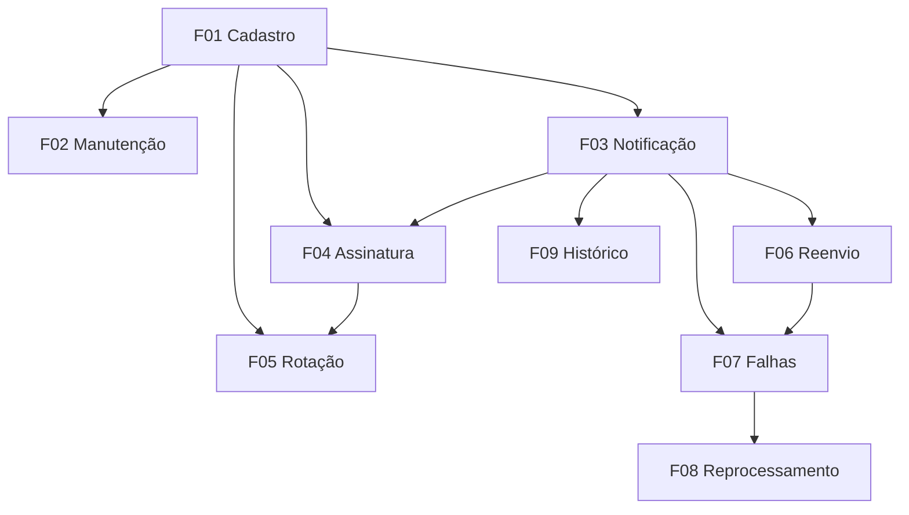

# PRD — Webhooks de notificação de mudança de status de pedidos

**Status:** Em revisão · **Data:** 2026-11-14 · **Autor:** Consolidado com IA a partir da reunião técnica conduzida por Larissa (Tech Lead) · **Revisores:** Marcos (Product Manager), Larissa (Tech Lead), Sofia (Segurança) · **Fontes:** [TRANSCRICAO.md](../TRANSCRICAO.md) e código do OMS · **Documentos relacionados:** [RFC](RFC.md) · [ADRs](adrs/README.md) · [FDD](FDD.md) · [Spec OpenAPI](openapi/webhooks.openapi.yaml) · [Tracker](TRACKER.md)

Convenção: `[hh:mm] Nome` remete à transcrição, e caminhos de arquivo remetem ao código atual. O que a reunião não fixou e o FDD definiu para ser implementável aparece como "proposta P-xx do FDD", listada no [FDD, seção 18.2](FDD.md#182-propostas-do-autor-a-validar-na-revisão). O que este PRD assume sem fonte está marcado como **(PREMISSA)** e listado em [5.3](#53-premissas-e-restrições).

## 1. Resumo e Contexto

O OMS passa a avisar os sistemas dos clientes B2B, por uma chamada HTTP ao endpoint que o cliente cadastrar, sempre que o status de um pedido dele mudar. A feature atende o pedido formal de três clientes, Atlas Comercial, MaxDistribuição e Nova Cargo, que hoje descobrem mudanças consultando a listagem de pedidos de tempos em tempos e querem ser avisados em menos de 10 segundos ([09:00] Marcos, [09:02] Marcos). O fluxo é só de saída: os clientes recebem, não enviam ([09:02] Marcos).

O cliente cadastra pela API um ou mais endpoints `https`, escolhe os status de pedido que quer receber e recebe uma secret para verificar que cada chamada veio do OMS e não foi alterada. Cada mudança para um status escolhido vira uma notificação com os dados principais do pedido naquele momento. Se o endpoint falhar, a notificação é reenviada por quase 15 horas. Esgotadas as tentativas, ela fica guardada para que um administrador a reenvie. O cliente também consulta o histórico das entregas feitas para cada endpoint.

A feature se apoia no ciclo de vida de pedido que já existe: a máquina de estados `PENDING → PAID → PROCESSING → SHIPPED → DELIVERED`, com `CANCELLED` a partir de `PENDING`, `PAID` ou `PROCESSING` (`src/modules/orders/order.status.ts`), e a mudança de status feita por operadores pela API (`src/modules/orders/order.service.ts`, `src/modules/orders/order.routes.ts`). Usa também os perfis de usuário existentes, `ADMIN` e `OPERATOR` (`prisma/schema.prisma`). Hoje o OMS não tem nenhum mecanismo de notificação externa. A proposta de arquitetura está no [RFC](RFC.md), as decisões nos [ADRs](adrs/README.md) e o detalhe de implementação no [FDD](FDD.md).

## 2. Problema e Motivação

### O Problema

**Integração por consulta periódica, lenta e cara para os clientes**
- Atlas, MaxDistribuição e Nova Cargo consultam `GET /orders` de tempos em tempos para saber se algum pedido mudou ([09:00] Marcos).
- Isso deixa a integração lenta e cara para eles ([09:00] Marcos).
- O OMS não tem como avisar: não há eventos, filas, jobs nem processo além da API (`src/server.ts`).

**Risco comercial com prazo**
- Três clientes B2B fizeram pedido formal na semana anterior à reunião ([09:00] Marcos).
- A Atlas sinalizou que pode migrar para um concorrente se a feature não sair até o fim do trimestre ([09:00] Marcos), e pediu entrega até o fim de novembro ([09:45] Marcos).

**A notificação não pode comprometer a operação de pedidos**
- A mudança de status já é uma operação pesada: atualiza o pedido, grava o histórico e mexe no estoque ([09:04] Bruno).
- Chamar o cliente dentro dela faria um cliente lento travar a mudança de status de outros pedidos, e um cliente fora do ar não teria tratamento possível, já que a mudança de status não pode ser desfeita por isso ([09:04] Bruno).

**A notificação precisa ser confiável e verificável**
- Os eventos levam dados de pedidos para fora da infraestrutura, e o cliente precisa confirmar a origem e a integridade de cada chamada ([09:19] Sofia).
- Já houve cliente que vazou secret no próprio log de aplicação ([09:22] Diego).
- Clientes ficam fora do ar de verdade: um deles já teve 2 horas de manutenção planejada ([09:16] Diego).

### A Oportunidade

- **Consulta periódica → aviso ativo.** O cliente recebe a mudança em menos de 10 segundos, só dos status que escolheu, e deixa de depender da consulta periódica (F01, F03).
- **Risco comercial → escopo fechado e prazo curto.** A feature cabe em três sprints, sem infraestrutura nova, com os itens que a reunião adiou fora desta versão (PREM-04, PREM-05, seção 5.2).
- **Operação protegida.** A notificação é registrada junto com a mudança de status e enviada fora dela, então o endpoint do cliente nunca atrasa nem reverte uma mudança (DEC-01, RNF-02).
- **Confiável e verificável.** Cada chamada é assinada com uma secret exclusiva do endpoint, que o cliente pode trocar; falhas são reenviadas por quase 15 horas e, depois disso, ficam guardadas para reprocessamento; o histórico mostra o que foi enviado (F04 a F09).

O ganho para os três clientes é trocar a consulta periódica por um aviso em segundos, com a garantia de que nenhuma mudança de status se perde sem deixar registro.

## 3. Público-alvo e Cenários de Uso

### Usuários

**Integrador do cliente B2B** (time técnico da Atlas, da MaxDistribuição ou da Nova Cargo)
- Expõe um endpoint `https` que recebe as notificações, verifica a assinatura e descarta duplicatas ([09:20] Sofia, [09:23] Sofia, [09:24] Diego).
- Cadastra e mantém os webhooks direto pela API do OMS, com o login de um usuário que representa o cliente ([09:32] Marcos).
- Precisa saber o que foi enviado, o que falhou e quanto o endpoint demorou para responder ([09:34] Marcos).

**Operador do OMS** (perfil `OPERATOR` ou `ADMIN`)
- Muda o status dos pedidos pela API, e é essa ação que gera as notificações ([09:40] Bruno; `src/modules/orders/order.routes.ts`).
- Pode cadastrar e manter webhooks em nome de um cliente, porque nesta fase qualquer usuário autenticado pode fazê-lo ([09:37] Sofia).
- Não pode ter a mudança de status atrasada ou bloqueada por um cliente lento ou fora do ar ([09:04] Bruno).

**Administrador do OMS** (perfil `ADMIN`)
- É o único que reprocessa notificações que esgotaram as tentativas ([09:36] Sofia, [09:36] Larissa).
- Investiga a falha pelo motivo registrado junto com a notificação guardada ([09:18] Diego).
- Tem cada reprocessamento registrado com o seu usuário, para auditoria ([09:36] Sofia).

### Perfil comportamental

Todos usam a feature pela API, sem tela: o painel visual ficou fora desta fase ([09:40] Larissa). Os integradores são times técnicos que trabalham com bibliotecas padrão de HMAC ([09:20] Sofia) e se orientam pelo portal de desenvolvedores, que o Marcos vai atualizar ([09:26] Marcos, [09:40] Marcos).

### Cenários de uso

Os cenários são ilustrativos: usam os nomes dos três clientes para concretizar situações que a reunião citou de forma genérica, sem dizer com qual cliente aconteceram.

1. **Pedido despachado.** A Atlas cadastra um webhook assinando `SHIPPED` e `DELIVERED`, como no exemplo de [09:33] Marcos. Um operador muda um pedido da Atlas de `PROCESSING` para `SHIPPED`. Em menos de 10 segundos, o endpoint da Atlas recebe a notificação com o número do pedido, o status anterior, o novo status e o total; o sistema dela confere a assinatura e atualiza o rastreio sem consultar a API.
2. **Status que o cliente não assinou.** O mesmo pedido tinha passado antes de `PAID` para `PROCESSING`. Como nenhum webhook da Atlas assina `PROCESSING`, nada foi enviado ([09:34] Bruno).
3. **Endpoint em manutenção.** O endpoint da Nova Cargo fica 2 horas fora do ar em manutenção planejada, como já aconteceu com um cliente ([09:16] Diego). As notificações do período falham e são reenviadas nos intervalos previstos. Quando o endpoint volta, ele recebe as pendentes, com o mesmo identificador de evento, e descarta as que já tinha processado.
4. **Falha permanente e reprocessamento.** Um endpoint fica fora por mais de 15 horas ([09:17] Marcos). A notificação esgota as tentativas e fica guardada com o motivo. Depois que o cliente corrige o endpoint, um administrador a reprocessa, e o OMS registra quem fez ([09:18] Diego, [09:36] Sofia).
5. **Secret vazada.** O integrador da MaxDistribuição percebe que a secret apareceu num log do sistema dele, como já aconteceu com um cliente ([09:22] Diego), e pede uma nova. Por 24 horas, as notificações continuam verificáveis com a secret antiga, enquanto ele troca a configuração; depois disso, só a nova vale ([09:21] Sofia).

## 4. Objetivos e Métricas de Sucesso

| ID | Objetivo | Métrica | Linha de base | Meta | Como medir |
| --- | --- | --- | --- | --- | --- |
| OBJ-01 | **Notificar** o cliente em menos de 10 s após a mudança de status | Tempo entre o registro da notificação, na mudança de status, e a entrega confirmada pelo endpoint, contado só nas notificações entregues no primeiro envio e incluindo o tempo de resposta do endpoint | Não existe notificação; o cliente depende do intervalo da própria consulta | Abaixo de 10 s ([09:02] Marcos) em pelo menos 95% dessas entregas **(PREMISSA PREM-07, percentual)**, desde o lançamento | Métrica de latência do primeiro envio, derivada dos logs do processo de entrega (proposta P-12 do FDD; definição no [FDD, 11.1](FDD.md#111-métricas)) |
| OBJ-02 | **Reter** os três clientes que pediram a feature, com a integração em uso | Clientes, entre Atlas, MaxDistribuição e Nova Cargo, com pelo menos um webhook ativo e entregas com sucesso | 0 de 3 | 3 de 3 até o fim do trimestre, prazo citado pela Atlas ([09:00] Marcos) **(PREMISSA PREM-08)** | Webhooks ativos por cliente e histórico de entregas (F02, F09) |
| OBJ-03 | **Entregar** a feature no prazo pedido pela Atlas | Data de liberação em produção, com a revisão de segurança concluída | Não se aplica | Até o fim de novembro ([09:45] Marcos), em três sprints, com pelo menos 2 dias úteis de revisão de segurança ([09:46] Sofia, [09:47] Larissa); prazo ainda a confirmar com a Atlas ([09:47] Marcos; RISCO-01) | Data do deploy e registro da revisão de segurança |
| OBJ-04 | **Garantir** que toda mudança de status assinada gere notificação e nenhuma mudança revertida gere (métrica de guarda) | Mudanças confirmadas para status assinado sem notificação registrada; notificações de mudanças revertidas | Não se aplica (feature nova) | 0 e 0 ([09:06] Diego, [09:40] Bruno) | Conciliação entre o histórico de status dos pedidos dos clientes com webhook ativo e as notificações registradas |
| OBJ-05 | **Reduzir** a consulta periódica de pedidos pelos clientes integrados | Chamadas à listagem de pedidos feitas pelos usuários que representam cada cliente | A medir nos 30 dias anteriores ao lançamento **(PREMISSA PREM-09)**, pelo log `http_request`, que registra caminho e `userId` (`src/middlewares/request-logger.middleware.ts`) | Queda de pelo menos 50% em 60 dias após o cliente ter webhook ativo **(PREMISSA PREM-09)** | O mesmo log, comparando os dois períodos |

## 5. Escopo

### 5.1 Incluso

- Cadastro de webhook com URL `https`, status de interesse e secret gerada pelo OMS (F01)
- Consulta, edição, desativação e remoção de webhooks (F02)
- Notificação de cada mudança de status assinada, com os dados do pedido no momento da mudança, em menos de 10 s (F03)
- Assinatura de cada notificação com a secret do webhook (F04)
- Troca de secret com 24 h de convivência entre a antiga e a nova (F05)
- Reenvio automático das notificações que falharam (F06)
- Guarda das notificações com falha permanente (F07)
- Reprocessamento manual por administrador, com registro de quem fez (F08)
- Histórico das últimas entregas por webhook (F09)

Só mudanças de status de pedidos geram notificação: a reunião não tratou de outros eventos, como a criação de um pedido ([09:00] Marcos, [09:40] Bruno).

### 5.2 Fora de escopo

| ID | Item | Tipo | Motivo | Origem |
| --- | --- | --- | --- | --- |
| FE-01 | Webhooks de entrada, com clientes enviando eventos ao OMS | Descartado | Os clientes querem só receber | [09:02] Marcos |
| FE-02 | Envio da notificação dentro da mudança de status, de forma síncrona | Descartado | Um cliente lento travaria a mudança de status de outros pedidos, e um cliente fora do ar não teria tratamento | [09:04] Bruno, [09:06] Diego |
| FE-03 | Infraestrutura nova de fila, como Redis Streams | Descartado | Exagero para um time pequeno; o MySQL existente resolve | [09:07] Diego |
| FE-04 | Garantia de ordem entre pedidos diferentes | Descartado | Os clientes nunca pediram; a ordem vale só por pedido | [09:13] Larissa, [09:14] Marcos |
| FE-05 | Entrega exatamente uma vez | Descartado | Exige coordenação dos dois lados; entrega pelo menos uma vez com identificador resolve | [09:25] Diego |
| FE-06 | Reenvio sem limite de tentativas | Descartado | A notificação ficaria pendurada para sempre se o cliente sumisse | [09:15] Diego |
| FE-07 | Itens do pedido na notificação | Descartado | Manter a notificação enxuta; quem quiser os itens consulta o pedido | [09:43] Diego, [09:44] Bruno |
| FE-08 | Aviso por e-mail ao cliente quando o webhook falha repetidamente | Adiado | Fica para a próxima fase, depois de medir o impacto | [09:37] Larissa, [09:38] Marcos |
| FE-09 | Limite de taxa de notificações por cliente | Adiado | Observar em produção e decidir depois (QA-01) | [09:39] Diego, [09:39] Larissa |
| FE-10 | Painel visual para o cliente acompanhar os webhooks | Adiado | Projeto separado do time de frontend; nesta fase, só API | [09:40] Larissa |
| FE-11 | Arquivamento das notificações já entregues, depois de cerca de 30 dias | Adiado | Fora do escopo desta feature | [09:08] Diego |
| FE-12 | Mais de um processo de entrega em paralelo | Adiado | Perderia a ordem por pedido; "problema do futuro" | [09:12] Diego, [09:13] Diego |

### 5.3 Premissas e restrições

- **PREM-01:** os clientes usam a API com o login de usuários do OMS que os representam. O usuário não fica vinculado ao cliente no OMS, por isso o cliente é informado no cadastro do webhook ([09:32] Marcos, [09:32] Larissa; `prisma/schema.prisma`, modelo `User`).
- **PREM-02:** os integradores implementam a verificação da assinatura e a deduplicação pelo identificador do evento ([09:24] Diego, [09:26] Marcos).
- **PREM-03:** o volume desta fase é de três clientes, com poucos webhooks cada ([09:00] Marcos). O número de mudanças de status por minuto em pico não foi levantado. Premissa a validar.
- **PREM-04 (restrição):** time pequeno, sem infraestrutura nova: mesmo MySQL e mesma stack da API ([09:07] Diego, [09:11] Diego).
- **PREM-05 (restrição):** três sprints, com pelo menos 2 dias úteis de revisão de segurança da Sofia no fim, antes do deploy ([09:46] Sofia, [09:47] Larissa). A reunião não informou a duração nem o início das sprints (RISCO-01).
- **PREM-06 (restrição):** a feature reusa os padrões do OMS, então o integrador vê erros e autenticação no mesmo formato da API atual ([09:30] Larissa; `src/middlewares/error.middleware.ts`, `src/middlewares/auth.middleware.ts`).
- **PREM-07:** meta de 95% das entregas no primeiro envio abaixo de 10 s. A reunião fixou só os 10 s ([09:02] Marcos). Premissa a validar com o Marcos.
- **PREM-08:** os três clientes com integração ativa até o fim do trimestre é a medida de retenção. A reunião citou o prazo, não a medida ([09:00] Marcos). Premissa a validar com o Marcos.
- **PREM-09:** queda de 50% na consulta à listagem de pedidos em 60 dias, comparada com a linha de base dos 30 dias anteriores ao lançamento, medida pelos usuários que representam cada cliente, cuja lista o Marcos informa, já que o OMS não liga usuário a cliente. Premissa a validar com o Marcos.

## 6. Histórias de Usuário

### F01. Cadastro de webhook
- Como integrador do cliente, quero cadastrar a URL `https` do meu endpoint e os status que me interessam para receber só as mudanças que meu sistema usa
- Como integrador do cliente, quero receber a secret na resposta do cadastro para configurar a verificação de assinatura antes da primeira notificação

### F02. Consulta e manutenção de webhooks
- Como integrador do cliente, quero listar os webhooks do meu cliente para conferir quais endpoints e status estão configurados
- Como integrador do cliente, quero trocar a URL ou os status de um webhook para acompanhar mudanças no meu sistema sem recriar o cadastro
- Como integrador do cliente, quero desativar um webhook durante uma migração para parar os envios sem perder o histórico

### F03. Notificação de mudança de status
- Como integrador do cliente, quero receber uma chamada no meu endpoint quando um pedido meu mudar para um status assinado para atualizar meu sistema em segundos, sem consultar a API
- Como operador do OMS, quero que a mudança de status responda no mesmo tempo de hoje para não depender da disponibilidade dos endpoints dos clientes
- Como integrador do cliente, quero que cada chamada traga um identificador de evento estável para descartar as que eu já processei

### F04. Assinatura das notificações
- Como integrador do cliente, quero verificar a assinatura de cada chamada com a minha secret para rejeitar requisições que não vieram do OMS ou foram alteradas

### F05. Rotação de secret
- Como integrador do cliente, quero pedir uma nova secret quando suspeitar de vazamento para que a antiga deixe de valer sem interromper as notificações

### F06. Reenvio automático
- Como integrador do cliente, quero que as notificações perdidas durante uma manutenção cheguem quando meu endpoint voltar para não precisar reconciliar os pedidos manualmente

### F07. Guarda das falhas permanentes
- Como administrador do OMS, quero que a notificação que esgotou as tentativas fique guardada com o motivo para investigar e decidir o reprocessamento

### F08. Reprocessamento manual
- Como administrador do OMS, quero reenviar uma notificação guardada depois que o cliente corrigiu o endpoint para que ele receba a mudança com o identificador original
- Como administrador do OMS, quero que cada reprocessamento fique registrado com o meu usuário para que a auditoria saiba quem mexeu na entrega

### F09. Histórico de entregas
- Como integrador do cliente, quero ver os últimos envios do meu webhook, com resultado, resposta e tempo de resposta, para diagnosticar falhas do meu endpoint sem abrir chamado

## 7. Requisitos Funcionais

### F01. Cadastro de webhook

**Fornece:**
- Webhook cadastrado, com o cliente dono, a URL, os status de interesse, o estado ativo e o identificador do webhook (usado por F02, F03)
- Secret do webhook (usado por F04, F05)

**Capacidades:**
- Um cliente pode ter vários webhooks, cada um com URL, status de interesse e secret próprios ([09:21] Sofia, [09:44] Sofia).
- A URL precisa usar `https`; URL `http` é recusada no ato, com erro de validação ([09:23] Sofia).
- Os status de interesse são a lista dos status de pedido que o webhook quer receber ([09:33] Marcos), com pelo menos um status e sem repetição (proposta P-27 do [FDD, seção 7.1](FDD.md#71-post-apiv1webhooks); a reunião não fixou essa regra). Valem `PAID`, `PROCESSING`, `SHIPPED`, `DELIVERED` e `CANCELLED`; `PENDING` não entra, porque nenhuma mudança leva a ele (`src/modules/orders/order.status.ts`; proposta P-15 do FDD).
- O cliente é informado no cadastro e não é deduzido do login ([09:32] Larissa).
- A secret é gerada pelo OMS, nunca escolhida pelo cliente, e devolvida na resposta do cadastro ([09:31] Marcos). Depois disso, ela não aparece em nenhuma outra resposta; uma secret nova só sai pela rotação (F05).
- O webhook tem um estado ativo ([09:21] Bruno, [09:21] Sofia) e começa ativo, porque o cadastro existe para passar a receber as notificações ([09:31] Marcos).
- Qualquer usuário autenticado pode cadastrar ([09:32] Marcos, [09:37] Sofia).

**Comportamento observável:** o integrador envia o cliente, a URL e os status de interesse. O OMS valida, grava e responde com o identificador do webhook, os dados cadastrados e a secret. A partir daí, toda mudança de um pedido desse cliente para um dos status escolhidos gera uma notificação (F03).

**Tratamento de erros:**
- URL sem `https`: cadastro recusado com erro de validação que aponta o campo da URL; nada é gravado.
- Cliente inexistente: cadastro recusado como cliente não encontrado.
- Lista de status vazia, repetida ou com `PENDING`: cadastro recusado com erro de validação.
- Requisição sem login válido: recusada como não autenticada, como no resto da API.
- Secret perdida pelo integrador: não há como recuperá-la; ele pede uma nova pela rotação (F05).

*Origem:* [09:21] Bruno; [09:21] Sofia; [09:23] Sofia; [09:31] Marcos; [09:32] Larissa; [09:33] Marcos; [09:37] Sofia; `src/modules/orders/order.status.ts`

### F02. Consulta e manutenção de webhooks

**Consome:**
- F01: webhooks cadastrados do cliente

**Capacidades:**
- Listar os webhooks de um cliente ([09:33] Bruno), com a paginação das listagens atuais (`src/shared/http/response.ts`) e sem a secret, que só sai no cadastro e na rotação ([09:31] Marcos; F01, F05).
- Editar a configuração do webhook ([09:33] Bruno): URL, status de interesse ou estado ativo. Exigir pelo menos um desses campos por edição e deixar cliente e secret fora da edição são a proposta P-27 do [FDD, seção 7.3](FDD.md#73-patch-apiv1webhooksid), que a reunião não fixou; a secret só muda pela rotação (F05).
- A URL editada segue a regra de `https` do cadastro ([09:23] Sofia).
- Uma mudança nos status de interesse vale para as próximas mudanças de status; notificações já registradas não são refiltradas ([09:34] Bruno).
- Uma URL editada vale a partir do próximo envio, inclusive para notificações que estão aguardando reenvio (FDD, seção 6.7).
- Desativar um webhook interrompe o registro de novas notificações para ele; as que estavam pendentes não são enviadas e vão para a guarda de falhas (F07) (proposta P-14 do FDD).
- Remover um webhook remove também as notificações pendentes, as falhas guardadas e o histórico dele (proposta P-13 do FDD).
- Qualquer usuário autenticado pode consultar e manter ([09:37] Sofia).

**Comportamento observável:** a listagem mostra os webhooks do cliente informado. A edição devolve o webhook atualizado, sem a secret. A remoção responde sem conteúdo, e o webhook some da listagem.

**Tratamento de erros:**
- Webhook inexistente na edição ou na remoção: recusado como webhook não encontrado.
- Edição sem nenhum campo, ou com URL `http`: recusada com erro de validação.
- Listagem sem o cliente informado: recusada com erro de validação; cliente inexistente: recusada como cliente não encontrado.
- Remoção apaga o histórico sem possibilidade de recuperação. Para parar os envios e manter o histórico, o caminho é desativar.

*Origem:* [09:23] Sofia; [09:31] Marcos; [09:33] Bruno; [09:34] Bruno; [09:37] Sofia; `src/shared/http/response.ts`

### F03. Notificação de mudança de status

**Consome:**
- F01: URL, status de interesse, estado ativo e identificador de cada webhook do cliente dono do pedido

**Fornece:**
- Notificação registrada, com identificador único de evento e o corpo com os dados do pedido no momento da mudança (usado por F04, F06, F07)
- Resultado de cada envio: sucesso ou falha, status HTTP recebido, motivo da falha, tempo de resposta e início da resposta (usado por F06, F09)

**Capacidades:**
- Gatilho: toda mudança de status de pedido confirmada pela API gera uma notificação para cada webhook ativo do cliente do pedido que assina o novo status ([09:33] Marcos, [09:34] Bruno, [09:40] Bruno). Cada webhook recebe a sua, com identificador próprio (proposta P-05 do FDD).
- Se nenhum webhook do cliente assina o novo status, nada é registrado nem enviado ([09:34] Bruno).
- Toda mudança confirmada para um status assinado gera notificação, e uma mudança revertida não gera ([09:06] Diego, [09:40] Bruno).
- Conteúdo, em JSON: identificador e tipo do evento, momento, identificador e número do pedido, status anterior e novo, cliente e os campos básicos do pedido, sem os itens ([09:43] Diego). Dos campos básicos, só o total entra (proposta P-08 do FDD), e o momento informado no corpo é o da mudança de status, não o do envio (proposta P-18 do FDD). Nomes e formatos dos campos estão no [FDD, seção 7.8](FDD.md#78-chamada-de-saída-post-url-do-webhook).
- Os dados refletem o pedido no momento da mudança, mesmo que ele mude depois ([09:52] Larissa, [09:52] Bruno).
- Cada chamada informa em cabeçalhos o identificador do evento, o webhook que originou o envio, para o cliente que tem vários, e o momento do envio, além da assinatura (F04) ([09:44] Diego, [09:44] Sofia). Nomes e formatos dos cabeçalhos estão no [FDD, seção 7.8](FDD.md#78-chamada-de-saída-post-url-do-webhook).
- O primeiro envio sai em menos de 10 s depois da mudança ([09:02] Marcos), com até 2 s de espera até a notificação ser lida ([09:10] Larissa).
- O endpoint tem 10 s para responder ([09:42] Diego). Resposta 2xx conta como entregue. Qualquer outro resultado conta como falha e segue para o reenvio (F06), inclusive respostas 4xx e redirecionamentos, que não são seguidos (proposta P-09 do FDD).
- A entrega é pelo menos uma vez: a mesma notificação pode chegar mais de uma vez, sempre com o mesmo identificador e o mesmo corpo ([09:24] Diego, [09:25] Diego).
- As notificações de um mesmo pedido para o mesmo webhook chegam na ordem das mudanças, com as ressalvas de RNF-07; não há ordem entre pedidos diferentes ([09:12] Diego, [09:13] Larissa).
- Uma notificação acima de 64KB não é enviada nem truncada e vai para a guarda de falhas (F07) ([09:23] Sofia, [09:24] Larissa; proposta P-04 do FDD).

**Comportamento observável:** o operador muda o status do pedido e recebe a resposta de sempre, sem esperar o cliente. Em até 10 s, o endpoint do cliente recebe um `POST` com o corpo e os cabeçalhos acima. Se o endpoint responde 2xx no prazo, a entrega aparece como sucesso no histórico (F09); se não, aparece como falha, e o reenvio é agendado (F06).

**Tratamento de erros:**
- Falha ao registrar a notificação: a mudança de status inteira é desfeita (status, histórico e estoque voltam ao que eram), e o operador recebe erro interno e pode repetir a operação ([09:40] Bruno, [09:41] Diego).
- Endpoint lento, fora do ar, com erro de rede ou resposta fora de 2xx: o envio conta como falha e segue para o reenvio, sem nenhum efeito sobre a mudança de status já confirmada ([09:04] Bruno, [09:42] Diego).
- Queda do processo de entrega entre o envio e o registro do resultado: a notificação é reenviada com o mesmo identificador, o que a entrega pelo menos uma vez admite ([ADR-006](adrs/ADR-006-entrega-at-least-once-com-x-event-id.md)).
- Webhook desativado com notificações pendentes: elas não são enviadas e vão para a guarda de falhas (F07).

*Origem:* [09:02] Marcos; [09:06] Diego; [09:12] Diego; [09:24] Diego; [09:24] Larissa; [09:33] Marcos; [09:34] Bruno; [09:40] Bruno; [09:42] Diego; [09:43] Diego; [09:44] Diego; [09:44] Sofia; [09:52] Larissa; `src/modules/orders/order.service.ts` (`changeStatus`)

### F04. Assinatura das notificações

**Consome:**
- F01: secret do webhook
- F03: corpo de cada notificação

**Fornece:**
- Assinatura calculada sobre o corpo de cada notificação (usado por F05)

**Capacidades:**
- Toda notificação leva em `X-Signature` a assinatura HMAC-SHA256 do corpo exato enviado, calculada com a secret do webhook ([09:20] Sofia, [09:22] Sofia). O formato do valor está no [FDD, seção 10.3](FDD.md#103-assinatura) (proposta P-07 do FDD).
- A secret é exclusiva de cada webhook: o vazamento de uma não compromete os outros ([09:21] Sofia).
- Reenvios e reprocessamentos levam o mesmo corpo (F03); a assinatura muda se houver rotação da secret entre os envios (proposta P-02 do FDD).
- O cliente verifica com qualquer biblioteca padrão de HMAC-SHA256 ([09:20] Sofia). A verificação é documentada no portal de desenvolvedores ([09:26] Marcos, [09:40] Marcos); o texto-base, com um exemplo de verificação e um vetor de teste, é a proposta P-26 do FDD ([FDD, seção 7.8](FDD.md#78-chamada-de-saída-post-url-do-webhook)).
- A secret não aparece nos logs do OMS (proposta P-24 do FDD).

**Comportamento observável:** o integrador calcula o HMAC-SHA256 do corpo bruto recebido com a sua secret e compara com `X-Signature`. Se confere, a chamada veio do OMS e não foi alterada; se não confere, o integrador a descarta.

**Tratamento de erros:**
- Corpo alterado no caminho: a assinatura não confere, e o cliente rejeita a chamada.
- Verificação feita sobre o JSON reformatado, e não sobre o corpo bruto: a assinatura não confere; o exemplo do portal orienta a usar o corpo bruto.
- Cliente que responde erro ao rejeitar uma chamada: o OMS trata como falha de envio e reenvia (F06).

*Origem:* [09:20] Sofia; [09:21] Sofia; [09:22] Sofia; [09:26] Marcos; [09:40] Marcos

### F05. Rotação de secret

**Consome:**
- F01: secret atual do webhook
- F04: assinatura calculada sobre o corpo de cada notificação

**Capacidades:**
- O cliente pede uma nova secret pela API, a qualquer momento ([09:21] Sofia).
- A nova secret é gerada pelo OMS e devolvida na resposta ([09:21] Sofia, [09:31] Marcos).
- A secret anterior continua válida por 24 h e depois deixa de valer ([09:21] Sofia).
- Durante as 24 h, cada notificação é verificável tanto com a secret nova quanto com a anterior, porque leva uma assinatura de cada (proposta P-02 do FDD; QA-05). O formato está no [FDD, seção 10.3](FDD.md#103-assinatura).
- Só a secret imediatamente anterior convive com a atual: se o cliente pedir outra rotação dentro das 24 h, a secret mais antiga deixa de valer na hora (proposta P-17 do FDD; detalhe no [FDD, seção 6.6](FDD.md#66-rotação-de-secret)).
- Qualquer usuário autenticado pode rotacionar ([09:37] Sofia).

**Comportamento observável:** o integrador pede a rotação e recebe a secret nova e o momento em que a anterior expira. Nas 24 h seguintes, as notificações chegam com duas assinaturas; depois, só com a da secret nova.

**Tratamento de erros:**
- Webhook inexistente: rotação recusada como webhook não encontrado.
- Integrador que não troca a secret em 24 h: as notificações seguintes deixam de conferir com a secret antiga; se o endpoint responde erro, elas entram em reenvio (F06) até a troca ou até esgotar as tentativas.
- Cliente que verifica só uma das assinaturas: pode rejeitar notificações legítimas durante a convivência (RISCO-05).

*Origem:* [09:21] Sofia; [09:22] Sofia; [09:31] Marcos; [09:37] Sofia

### F06. Reenvio automático

**Consome:**
- F03: notificação registrada e resultado de cada envio

**Fornece:**
- Notificação com tentativas esgotadas e o último erro (usado por F07)

**Capacidades:**
- Depois de uma falha, a notificação é reenviada automaticamente, em 5 tentativas, com intervalos de 1 min, 5 min, 30 min, 2 h e 12 h ([09:17] Diego, [09:17] Larissa, [09:48] Larissa).
- A janela entre a primeira falha e a última tentativa é de quase 15 h ([09:17] Diego). Na leitura da proposta P-01 do FDD, ainda aberta na QA-04, as 5 tentativas são 5 reenvios depois do envio inicial, 6 envios no total, o que dá 14 h 36 min.
- Cada reenvio usa o mesmo identificador de evento e o mesmo corpo (F03).
- Para manter a ordem por pedido, o cliente só recebe a notificação seguinte de um pedido depois que a anterior foi entregue ou guardada como falha; notificações de outros pedidos não esperam (proposta P-06 do FDD; mecanismo no [FDD, seção 6.2](FDD.md#62-processamento-pelo-worker)).
- Cada tentativa aparece no histórico (F09).

**Comportamento observável:** o endpoint que estava fora recebe a notificação na primeira tentativa depois de voltar. Até lá, o histórico mostra as tentativas que falharam, com o motivo de cada uma.

**Tratamento de erros:**
- Endpoint volta durante a janela: a tentativa seguinte entrega, e não há novos reenvios.
- Endpoint não volta: depois da última tentativa, a notificação vai para a guarda de falhas (F07).
- Processo de entrega reiniciado no meio de um envio: a notificação não se perde e é enviada de novo, com o mesmo identificador (proposta P-11 do FDD).

*Origem:* [09:15] Diego; [09:16] Diego; [09:17] Diego; [09:17] Larissa; [09:17] Marcos; [09:48] Larissa

### F07. Guarda das falhas permanentes

**Consome:**
- F03: notificação registrada, para os casos de webhook desativado e de corpo acima de 64KB
- F06: notificação com tentativas esgotadas e o último erro

**Fornece:**
- Entrada guardada, com identificador próprio, a notificação original, o motivo e o momento da falha (usado por F08)

**Capacidades:**
- A notificação guardada, numa fila de falhas permanentes (DLQ) separada das notificações em andamento, mantém o corpo original, o motivo da falha e o momento ([09:18] Diego).
- Os motivos são: tentativas esgotadas ([09:15] Diego), corpo acima de 64KB ([09:23] Sofia, [09:24] Larissa; proposta P-04 do FDD) e webhook desativado (proposta P-14 do FDD).
- A notificação guardada sai do ciclo de entrega e só volta por reprocessamento manual (F08) ([09:18] Diego).
- Cada falha permanente gera um aviso para a operação, com o motivo e o identificador da entrada guardada, que é o usado no reprocessamento (proposta P-12 do FDD; detalhe no [FDD, seção 11.2](FDD.md#112-logs)).
- Não há listagem das falhas guardadas pela API nesta versão: a reunião definiu só o reprocessamento pelo identificador da entrada ([09:18] Diego, [09:35] Diego), que a operação obtém pelo aviso acima ([FDD, seção 3](FDD.md#3-escopo-e-exclusões)).

**Comportamento observável:** a operação recebe o aviso com o motivo e o identificador da entrada. O integrador vê no histórico (F09) a última tentativa que falhou e deixa de receber reenvios.

**Tratamento de erros:**
- Falha interna ao guardar a notificação: ela não se perde e é tratada de novo, o que pode gerar um envio a mais, admitido pela entrega pelo menos uma vez ([09:24] Diego; recuperação pela proposta P-11 do FDD).
- Webhook removido: as falhas guardadas dele são removidas junto (F02).

*Origem:* [09:15] Diego; [09:18] Diego; [09:23] Sofia; [09:24] Diego; [09:24] Larissa; [09:35] Diego

### F08. Reprocessamento manual

**Consome:**
- F07: entrada guardada, com identificador próprio e a notificação original

**Capacidades:**
- Só usuários `ADMIN` reprocessam ([09:36] Sofia, [09:36] Larissa), com o controle de perfil que o OMS já tem (`src/middlewares/auth.middleware.ts`, `requireRole`).
- O reprocessamento recoloca a notificação para envio, com o mesmo identificador de evento e o mesmo corpo ([09:18] Diego; [ADR-006](adrs/ADR-006-entrega-at-least-once-com-x-event-id.md)).
- Cada reprocessamento registra o usuário que o fez e o momento ([09:36] Sofia).
- Cada entrada guardada é reprocessada no máximo uma vez; pedidos repetidos são recusados (proposta P-20 do FDD; o tratamento de pedidos simultâneos está no [FDD, seção 6.5](FDD.md#65-replay-manual-da-dlq)).
- A notificação reprocessada recebe um ciclo completo de tentativas (proposta P-17 do FDD).
- A notificação reprocessada pode chegar depois de notificações posteriores do mesmo pedido que já foram entregues, porque volta para a fila de envio só quando o administrador a reprocessa ([09:18] Diego); o identificador do evento e o momento da mudança no corpo (proposta P-18 do FDD) permitem ao cliente identificá-la.

**Comportamento observável:** o administrador informa o identificador da entrada e recebe a confirmação de que a notificação foi aceita para reenvio. Em seguida, o endpoint do cliente recebe a notificação com o identificador original, e o envio aparece no histórico (F09).

**Tratamento de erros:**
- Usuário sem perfil `ADMIN`: recusado por falta de permissão.
- Entrada inexistente: recusada como não encontrada.
- Entrada já reprocessada, inclusive por um pedido simultâneo: recusada como conflito; o resultado se acompanha pelo histórico (proposta P-20 do FDD).
- Webhook desativado: recusado como conflito; é preciso reativar o webhook (F02) e repetir (proposta P-14 do FDD).

*Origem:* [09:18] Diego; [09:35] Diego; [09:36] Sofia; [09:36] Larissa; `src/middlewares/auth.middleware.ts`

### F09. Histórico de entregas

**Consome:**
- F03: resultado de cada envio, inclusive dos reenvios

**Capacidades:**
- Por webhook, mostra os últimos 100 envios ([09:34] Marcos), do mais recente para o mais antigo (proposta P-19 do [FDD, seção 7.6](FDD.md#76-get-apiv1webhooksiddeliveries)), com o tamanho de página da proposta P-19 do FDD.
- Cada envio mostra sucesso ou falha, o corpo enviado, a resposta recebida e o tempo de resposta ([09:34] Marcos), além do status HTTP, do número da tentativa e do motivo da falha (FDD, seção 7.6).
- Da resposta do endpoint, o histórico guarda só o início, até o limite da proposta P-11 do FDD.
- A secret e a assinatura não aparecem no histórico.
- Qualquer usuário autenticado pode consultar ([09:37] Sofia).

**Comportamento observável:** o integrador consulta o histórico de um webhook e vê, para cada envio, quando foi, se deu certo, o que foi enviado, o que o endpoint respondeu e quanto demorou. Um webhook inexistente é recusado como não encontrado.

*Origem:* [09:34] Marcos; [09:37] Sofia

## 8. Requisitos Não Funcionais

| ID | Categoria | Requisito | Critério mensurável | Origem |
| --- | --- | --- | --- | --- |
| RNF-01 | Desempenho | Primeiro envio rápido depois da mudança de status | Menos de 10 s entre a confirmação da mudança e o primeiro envio, com o endpoint respondendo no prazo; até 2 s de espera até a notificação ser lida | [09:02] Marcos, [09:10] Larissa |
| RNF-02 | Desempenho | A mudança de status não depende do endpoint do cliente | Nenhuma chamada ao endpoint do cliente acontece durante a mudança de status; um endpoint lento ou fora do ar não altera a resposta da mudança | [09:04] Bruno |
| RNF-03 | Desempenho | Tempo máximo de espera por endpoint | 10 s por envio; sem resposta nesse prazo, o envio conta como falha e entra em reenvio | [09:42] Diego |
| RNF-04 | Confiabilidade | Consistência entre mudança de status e notificação | 100% das mudanças confirmadas para status assinado têm notificação registrada; 0 notificações de mudanças revertidas | [09:06] Diego, [09:40] Bruno, [09:41] Diego |
| RNF-05 | Confiabilidade | Entrega pelo menos uma vez | Toda notificação termina entregue com 2xx ou guardada como falha permanente; duplicatas trazem o mesmo identificador e o mesmo corpo | [09:24] Diego, [09:25] Diego |
| RNF-06 | Confiabilidade | Tolerância à indisponibilidade do cliente | Um endpoint fora do ar por até quase 15 h desde a primeira falha recebe a notificação quando volta (14 h 36 min na leitura da proposta P-01 do FDD; QA-04) | [09:16] Diego, [09:17] Diego, [09:17] Marcos |
| RNF-07 | Confiabilidade | Ordem por pedido | Notificações de um mesmo pedido para o mesmo webhook chegam na ordem das mudanças, enquanto houver um único processo de entrega; com reenvio, a ordem depende de as notificações seguintes esperarem a anterior (proposta P-06 do FDD); a notificação reprocessada manualmente pode chegar depois de outras posteriores do mesmo pedido (F08); sem garantia entre pedidos | [09:12] Diego, [09:13] Larissa, [09:14] Marcos; proposta P-06 do FDD |
| RNF-08 | Disponibilidade | Entrega independente da API | Reiniciar a API não interrompe as entregas: o processo de entrega é separado e usa o mesmo banco | [09:11] Diego, [09:11] Larissa |
| RNF-09 | Segurança | Autenticidade e integridade das notificações | 100% das notificações assinadas com HMAC-SHA256 do corpo, usando a secret do webhook; uma secret diferente por webhook | [09:21] Sofia, [09:22] Sofia |
| RNF-10 | Segurança | Transporte cifrado | 100% das URLs cadastradas usam `https`; URL `http` é recusada no cadastro e na edição | [09:23] Sofia |
| RNF-11 | Segurança | Proteção da secret | Secret exibida só nas respostas de cadastro e de rotação; 0 ocorrências em listagens, histórico e logs do OMS | [09:21] Sofia, [09:31] Marcos; proposta P-24 do FDD, para os logs |
| RNF-12 | Segurança | Autorização | Reprocessamento restrito ao perfil `ADMIN`; cadastro, manutenção, rotação e histórico liberados a qualquer usuário autenticado | [09:36] Sofia, [09:37] Sofia |
| RNF-13 | Auditoria | Rastro do reprocessamento | 100% dos reprocessamentos registram o usuário, o momento e a notificação reprocessada | [09:36] Sofia |
| RNF-14 | Volume | Tamanho máximo da notificação | 64KB; acima disso, a notificação não é enviada nem truncada e vira falha permanente | [09:23] Sofia, [09:24] Diego, [09:24] Larissa |
| RNF-15 | Observabilidade | Detecção de problemas na entrega | A operação é alertada quando o processo de entrega para, quando o primeiro envio passa de 10 s de forma persistente e a cada falha permanente; os limiares são a proposta P-19 do FDD, detalhada no [FDD, seção 11.4](FDD.md#114-alertas-sugeridos-autor) | [09:02] Marcos; proposta P-19 do FDD |
| RNF-16 | Compatibilidade | Contratos existentes preservados | Nenhum endpoint existente muda de requisição ou resposta; a consulta de pedidos continua disponível para quem não usar webhooks | `src/modules/orders/order.routes.ts`; FDD, seção 14 |
| RNF-17 | Retenção de dados | Histórico disponível | Os últimos 100 envios de cada webhook ficam consultáveis enquanto o webhook existir; nada é expurgado nesta versão, e remover o webhook apaga o histórico dele (F02) | [09:08] Diego, [09:34] Marcos; proposta P-13 do FDD |

## 9. Decisões, Trade-offs e Questões em Aberto

### 9.1 Decisões e trade-offs

| ID | Decisão | Ganho para o produto | Custo aceito | Referência |
| --- | --- | --- | --- | --- |
| DEC-01 | A notificação é registrada junto com a mudança de status e enviada depois, por um processo separado que verifica a cada 2 s | Nenhuma mudança confirmada fica sem notificação, e nenhum cliente lento ou fora do ar afeta os pedidos | Uma falha ao registrar a notificação impede a mudança de status; até 2 s de espera; um processo a mais para operar | [ADR-001](adrs/ADR-001-outbox-no-mysql-na-transacao-de-mudanca-de-status.md), [ADR-002](adrs/ADR-002-worker-em-processo-separado-com-polling-de-2-segundos.md); [09:08] Larissa, [09:10] Larissa |
| DEC-02 | Entrega pelo menos uma vez, com identificador de evento para deduplicação | Nenhuma notificação se perde por falha no meio do envio | O cliente pode receber duplicatas e precisa descartá-las | [ADR-006](adrs/ADR-006-entrega-at-least-once-com-x-event-id.md); [09:26] Larissa |
| DEC-03 | Reenvio em 5 tentativas ao longo de quase 15 h; depois, guarda da falha com reprocessamento manual por `ADMIN` | Cobre manutenções de horas sem deixar notificação pendurada | Depois da janela, o cliente só recebe se um administrador reprocessar, e não é avisado da falha nesta fase | [ADR-003](adrs/ADR-003-retry-com-backoff-exponencial-em-5-tentativas.md), [ADR-004](adrs/ADR-004-dlq-em-tabela-separada-com-replay-manual-por-admin.md); [09:17] Larissa, [09:19] Larissa |
| DEC-04 | Assinatura HMAC-SHA256 com secret exclusiva por webhook e rotação com 24 h de convivência | O cliente verifica origem e integridade, e um vazamento fica restrito a um webhook | O cliente precisa implementar a verificação e trocar a secret em até 24 h | [ADR-005](adrs/ADR-005-assinatura-hmac-sha256-com-secret-por-endpoint-e-rotacao.md); [09:22] Sofia |
| DEC-05 | A notificação leva os dados do pedido no momento da mudança, sem os itens | Notificação leve e fiel ao momento da mudança | Para itens ou para o estado atual, o cliente consulta o pedido | [ADR-008](adrs/ADR-008-payload-do-evento-como-snapshot-na-insercao-da-outbox.md); [09:43] Diego, [09:52] Bruno |
| DEC-06 | Ordem garantida só por pedido, com um único processo de entrega | Nenhuma coordenação entre processos | Sem ordem entre pedidos; escalar a entrega exige nova decisão (FE-12) | [ADR-002](adrs/ADR-002-worker-em-processo-separado-com-polling-de-2-segundos.md); [09:13] Larissa |
| DEC-07 | O filtro de status é aplicado no momento do registro da notificação | Status não assinado não gera nada | Mudar os status de interesse não afeta notificações já registradas | [09:34] Bruno, [09:34] Diego |
| DEC-08 | A feature segue os padrões existentes do OMS, sem dependências novas | O integrador vê erros e autenticação no mesmo formato da API atual | Sem biblioteca de métricas, as métricas saem dos logs (proposta P-12 do FDD) | [ADR-007](adrs/ADR-007-reuso-dos-padroes-existentes-do-projeto-no-modulo-de-webhooks.md); [09:30] Larissa |

### 9.2 Questões em aberto

A numeração das questões é própria deste PRD e não coincide com a do [RFC, seção 8](RFC.md#8-questões-em-aberto); cada item indica a questão correspondente no RFC, quando existe. A QA-02 do RFC, sobre mais de um processo de entrega, aparece aqui como item fora de escopo (FE-12).

- **QA-01:** é preciso limitar a taxa de notificações por cliente? Importa porque um cliente com 50 pedidos mudando de status em um minuto recebe 50 chamadas. Decisão da Larissa, depois de observar em produção. Origem: [09:38] Diego, [09:39] Larissa; [RFC, QA-01](RFC.md#8-questões-em-aberto).
- **QA-02:** o cadastro e a manutenção de webhooks devem exigir um perfil específico? Importa porque hoje qualquer usuário autenticado pode configurar o webhook de qualquer cliente, já que o usuário não está ligado ao cliente. Decisão da Sofia, "mais pra frente". Origem: [09:37] Sofia; [RFC, QA-03](RFC.md#8-questões-em-aberto).
- **QA-03:** o aviso por e-mail ao cliente depois de falhas seguidas entra na próxima fase? Importa porque, nesta fase, o cliente só descobre uma falha permanente pelo histórico. Decisão da Larissa, depois de medir o impacto. Origem: [09:37] Marcos, [09:37] Larissa; [RFC, QA-04](RFC.md#8-questões-em-aberto).
- **QA-04:** "5 tentativas" significa 5 reenvios depois do envio inicial? Importa porque define a janela prometida aos clientes no portal: 14 h 36 min nessa leitura, ou 2 h 36 min com 5 envios no total. O FDD adotou a primeira leitura como proposta. Validação da Larissa e do Diego. Origem: [09:17] Diego, [09:17] Larissa, [09:48] Larissa; proposta P-01 do FDD; sem correspondente no RFC.
- **QA-05:** como o cliente verifica a assinatura durante as 24 h de convivência das secrets? Importa porque muda o código de verificação de todos os integradores. A proposta P-02 do FDD leva uma assinatura de cada secret em cada notificação. Validação da Sofia. Origem: [09:21] Sofia; proposta P-02 do FDD; sem correspondente no RFC.
- **QA-06:** o `X-Timestamp` deve entrar na assinatura? Importa porque, fora dela, o cabeçalho não protege contra reenvio malicioso de uma chamada capturada, e o portal precisa dizer ao cliente como se proteger. A proposta P-22 do FDD deixa o `X-Timestamp` fora da assinatura e orienta o cliente a deduplicar pelo identificador do evento. Decisão na revisão de segurança da Sofia. Origem: [09:44] Diego, [09:22] Sofia; proposta P-22 do FDD; sem correspondente no RFC.

## 10. Dependências

### 10.1 Dependências externas

| ID | Dependência | Tipo | Impacto se indisponível | Origem |
| --- | --- | --- | --- | --- |
| DEP-01 | Endpoints `https` dos três clientes, preparados para verificar a assinatura e deduplicar | Clientes | Sem endpoint, não há para onde notificar; sem deduplicação, o cliente processa a mesma mudança duas vezes | [09:02] Marcos, [09:24] Diego |
| DEP-02 | Documentação no portal de desenvolvedores: integração pela API, verificação da assinatura e deduplicação | Produto (Marcos) | Clientes integram errado ou não deduplicam | [09:26] Marcos, [09:40] Marcos |
| DEP-03 | Revisão de segurança da Sofia, de pelo menos 2 dias úteis, antes do deploy | Segurança | O deploy não pode acontecer | [09:46] Sofia, [09:49] Sofia |
| DEP-04 | Usuários do OMS que representam cada cliente | Cadastro de usuários | O cliente não consegue cadastrar webhooks pela API | [09:32] Marcos; `prisma/schema.prisma` |
| DEP-05 | Banco MySQL existente, compartilhado pela API e pelo processo de entrega | Infraestrutura | A mudança de status falha como hoje, e as entregas param até o banco voltar | [09:07] Diego, [09:11] Diego; `docker-compose.yml` |
| DEP-06 | Implantação e supervisão do novo processo de entrega, com uma única instância | Operação | Sem o processo, as notificações acumulam; com duas instâncias, a ordem por pedido se perde e aumentam as duplicatas | [09:11] Larissa, [09:12] Diego |

### 10.2 Grafo de dependências entre funcionalidades

| # | Funcionalidade | Prioridade | Dependências |
| --- | --- | --- | --- |
| F01 | Cadastro de webhook | 1 | Nenhuma |
| F02 | Consulta e manutenção de webhooks | 2 | F01 |
| F03 | Notificação de mudança de status | 1 | F01 |
| F04 | Assinatura das notificações | 1 | F01, F03 |
| F05 | Rotação de secret | 2 | F01, F04 |
| F06 | Reenvio automático | 1 | F03 |
| F07 | Guarda das falhas permanentes | 1 | F03, F06 |
| F08 | Reprocessamento manual | 2 | F07 |
| F09 | Histórico de entregas | 2 | F03 |

F07 e F08 também interagem com a desativação de webhooks de F02, sem depender dela: um webhook desativado leva as notificações pendentes à guarda de falhas (F07) e faz o reprocessamento ser recusado (F08), mas as duas funcionalidades funcionam sem F02. Por isso, F02 não entra nas dependências delas, e o grafo e as ondas não mudam.

### Ondas de execução

Funcionalidades da mesma onda podem ser construídas em paralelo. Uma onda só começa quando todas as das ondas anteriores estiverem concluídas.

- **Onda 1**: F01
- **Onda 2**: F03, F02
- **Onda 3**: F04, F06, F09
- **Onda 4**: F07, F05
- **Onda 5**: F08

### Níveis de prioridade

- **1** = Essencial: o produto não funciona sem ela
- **2** = Importante: agrega valor significativo
- **3** = Desejável: melhoria incremental

## 11. Riscos e Mitigação

Probabilidade e impacto são avaliação do autor; a reunião não os classificou.

| ID | Risco | Probabilidade | Impacto | Mitigação | Origem |
| --- | --- | --- | --- | --- | --- |
| RISCO-01 | Um atraso na entrega leva a Atlas a migrar para o concorrente. A reunião não informou a duração nem o início das sprints: três sprints só cabem até o fim de novembro se começarem logo, e o Marcos ainda vai confirmar o prazo com a Atlas | Média | Alto | Escopo fechado em três sprints, com a revisão de segurança agendada no fim; Marcos confirma o prazo com a Atlas; os itens adiados (FE-08 a FE-12) não entram nesta versão | [09:00] Marcos, [09:45] Marcos, [09:46] Larissa, [09:47] Larissa, [09:47] Marcos |
| RISCO-02 | O cliente não deduplica e processa a mesma mudança de status duas vezes | Média | Médio | Regra destacada no portal; identificador e corpo iguais em todos os reenvios (F03, F06) | [09:25] Sofia, [09:26] Marcos |
| RISCO-03 | Uma secret vazada no ambiente do cliente permite forjar notificações para aquele endpoint | Média | Médio | Secret exclusiva por webhook; o próprio cliente rotaciona, com 24 h de convivência (F05); secret fora dos logs do OMS | [09:21] Sofia, [09:22] Diego |
| RISCO-04 | Um endpoint lento de um cliente atrasa as notificações dos demais além de 10 s, porque há um único processo de entrega | Média | Alto | Alerta de primeiro envio lento (RNF-15), com o limiar da proposta P-19 do FDD; paralelizar a entrega depende de FE-12 | [09:12] Diego, [09:42] Diego; FDD, seção 17 |
| RISCO-05 | Um cliente que verifica só uma das assinaturas rejeita notificações legítimas durante as 24 h da rotação | Média | Médio | Exemplo de verificação no portal que aceita qualquer assinatura válida do cabeçalho; validar QA-05 com a Sofia antes do lançamento | Proposta P-02 do FDD; [09:21] Sofia |
| RISCO-06 | Uma rajada de mudanças de status sobrecarrega o endpoint de um cliente, porque não há limite de taxa | Média | Médio | Acompanhar a taxa de falhas por webhook, com o alerta de endpoint com problema, cujo limiar é a proposta P-19 do FDD, e reabrir a QA-01 se o alerta disparar | [09:38] Diego, [09:39] Larissa; proposta P-19 do FDD |

## 12. Critérios de Aceitação

### F01. Cadastro de webhook
- [ ] Dado um cliente existente, quando o integrador cadastra uma URL `https` com os status `SHIPPED` e `DELIVERED`, então o webhook é criado ativo, e a resposta traz o identificador do webhook e a secret.
- [ ] Quando a URL usa `http`, o cadastro é recusado com erro de validação que aponta o campo da URL, e nenhum webhook é criado.
- [ ] Quando o cliente não existe, o cadastro é recusado como cliente não encontrado.
- [ ] Quando a lista de status está vazia ou contém `PENDING`, o cadastro é recusado com erro de validação.

### F02. Consulta e manutenção de webhooks
- [ ] A listagem de um cliente com dois webhooks devolve os dois, paginados, e nenhum traz a secret.
- [ ] Depois de trocar os status de interesse de `SHIPPED` para `DELIVERED`, uma mudança para `SHIPPED` não gera notificação, e uma mudança para `DELIVERED` gera.
- [ ] Depois de desativar o webhook, nenhuma mudança de status gera notificação para ele, e as pendentes vão para a guarda de falhas sem chamada ao endpoint.
- [ ] Edição ou remoção de webhook inexistente é recusada como não encontrado; edição sem nenhum campo é recusada com erro de validação.
- [ ] Depois da remoção, o webhook não aparece na listagem, e o histórico dele não é mais consultável.

### F03. Notificação de mudança de status
- [ ] Dado um webhook ativo assinando `SHIPPED`, quando um pedido do cliente passa de `PROCESSING` para `SHIPPED`, então o endpoint recebe, em menos de 10 s, uma chamada com o conteúdo e os cabeçalhos descritos em F03, com o total como dado básico do pedido (proposta P-08 do FDD), o momento da mudança no corpo (proposta P-18 do FDD) e sem os itens; o contrato campo a campo é conferido pelos critérios CA-01 e CA-05 do [FDD, seção 16](FDD.md#16-critérios-de-aceite-técnicos).
- [ ] Quando o pedido muda para um status que nenhum webhook do cliente assina, nenhuma chamada é feita.
- [ ] Com dois webhooks do cliente assinando o mesmo status, cada um recebe a sua notificação, com identificadores de evento diferentes.
- [ ] Quando o registro da notificação falha, a mudança de status é desfeita (status, histórico e estoque como antes), e o operador recebe erro interno.
- [ ] Com o endpoint sem responder por 10 s, a mudança de status responde normalmente, e o envio é registrado como falha por tempo esgotado.
- [ ] Quando o pedido é alterado depois da mudança de status, o corpo enviado, inclusive nos reenvios, mantém os dados do momento da mudança.
- [ ] Uma notificação acima de 64KB não gera chamada e aparece na guarda de falhas com o motivo de tamanho.

### F04. Assinatura das notificações
- [ ] Em 100% das notificações, o HMAC-SHA256 do corpo bruto com a secret do webhook é igual ao valor de `X-Signature`, e o vetor de teste do [FDD, seção 7.8](FDD.md#78-chamada-de-saída-post-url-do-webhook) confere.
- [ ] Com dois webhooks, a assinatura de um não confere com a secret do outro.
- [ ] Depois de cadastro, rotação e envios, nenhuma secret aparece nos logs do OMS.

### F05. Rotação de secret
- [ ] A rotação devolve uma secret nova, diferente da anterior, e o momento em que a anterior expira, cerca de 24 h depois.
- [ ] Nas 24 h seguintes à rotação, cada notificação traz duas assinaturas, uma válida com a secret nova e outra com a anterior; depois das 24 h, só a da nova.
- [ ] A rotação de um webhook inexistente é recusada como não encontrado.

### F06. Reenvio automático
- [ ] Com o endpoint respondendo erro, os reenvios acontecem 1 min, 5 min, 30 min, 2 h e 12 h depois de cada falha, sempre com o mesmo identificador de evento e o mesmo corpo (leitura da proposta P-01 do FDD; QA-04).
- [ ] Quando o endpoint volta antes do terceiro envio, isto é, do segundo reenvio, a notificação é entregue nele, e não há mais reenvios.
- [ ] Enquanto uma notificação de um pedido aguarda reenvio, nenhuma notificação posterior do mesmo pedido para o mesmo webhook é enviada; as de outros pedidos seguem.

### F07. Guarda das falhas permanentes
- [ ] Quando todas as tentativas falham, o envio inicial e os 5 reenvios na leitura da proposta P-01 do FDD (QA-04), a notificação aparece guardada com o motivo de tentativas esgotadas, o corpo original e o momento da falha, e não é mais reenviada sozinha.
- [ ] Toda notificação guardada gera um aviso para a operação, com o identificador da entrada e o motivo (proposta P-12 do FDD).

### F08. Reprocessamento manual
- [ ] Quando um `ADMIN` reprocessa uma entrada guardada, o endpoint recebe a notificação com o identificador de evento original e o mesmo corpo, e o reprocessamento fica registrado com o usuário.
- [ ] Quando um `OPERATOR` tenta reprocessar, o pedido é recusado por falta de permissão.
- [ ] Uma segunda tentativa de reprocessar a mesma entrada, em sequência ou ao mesmo tempo, é recusada como conflito, e o cliente recebe um único reenvio.
- [ ] O reprocessamento de uma entrada inexistente é recusado como não encontrado, e o de um webhook desativado, como conflito.

### F09. Histórico de entregas
- [ ] Com 150 envios para um webhook, o histórico mostra os 100 mais recentes, do mais novo para o mais antigo, cada um com sucesso ou falha, status HTTP, corpo enviado, resposta e tempo de resposta.
- [ ] O histórico de um webhook inexistente é recusado como não encontrado.

### Integração entre funcionalidades
- [ ] F01 → F02: o webhook cadastrado em F01 aparece na listagem de F02 com a mesma URL e os mesmos status.
- [ ] F01 → F03: a notificação de F03 vai para a URL cadastrada em F01, só para os status assinados e só enquanto o webhook estiver ativo.
- [ ] F01 e F03 → F04: a secret devolvida no cadastro de F01 confere a assinatura do corpo que F03 envia.
- [ ] F01 e F04 → F05: depois da rotação, a assinatura de F04 confere com a secret nova e, por 24 h, também com a secret de F01 que foi substituída.
- [ ] F03 → F06: uma falha registrada em F03 agenda o reenvio de F06 com o mesmo identificador de evento e o mesmo corpo.
- [ ] F03 e F06 → F07: a notificação com tentativas esgotadas em F06, a de webhook desativado e a acima de 64KB de F03 aparecem em F07 com o corpo idêntico e o motivo correspondente.
- [ ] F07 → F08: o identificador da entrada guardada em F07 é o aceito por F08, e a notificação reenviada mantém o identificador de evento original.
- [ ] F03 → F09: cada envio de F03, inclusive os reenvios, aparece no histórico de F09 com o número da tentativa.

### Critérios não funcionais
- [ ] RNF-02: com o endpoint do cliente fora do ar ou sem responder, a mudança de status de um pedido desse cliente responde no mesmo tempo que com o endpoint no ar.
- [ ] RNF-08: reiniciar a API durante um lote de envios não interrompe as entregas nem perde notificações.
- [ ] RNF-15: com o processo de entrega parado, o alerta de processo parado dispara dentro do limiar da proposta P-19 do FDD.
- [ ] RNF-16: os testes existentes de pedidos e de autenticação passam sem alteração.

## 13. Estratégia de Testes e Validação

**Níveis de teste.** Os testes seguem as convenções do projeto (`tests/setup.ts`, `vitest.config.ts`) e cobrem a API de webhooks, o processo de entrega e a chamada recebida pelo endpoint do cliente. A regressão roda os testes atuais de pedidos e de autenticação sem alteração (`tests/orders.test.ts`, `tests/auth.test.ts`). Ferramentas, tipos de teste e os 19 cenários técnicos estão no [FDD, seção 15](FDD.md#15-estratégia-de-testes).

**Cenários críticos.**
- Falha ao registrar a notificação desfaz a mudança de status inteira (F03).
- Endpoint lento, fora do ar, com erro de rede ou resposta fora de 2xx (F03, F06).
- Esgotamento das tentativas e guarda da falha com o corpo idêntico (F06, F07).
- Reprocessamento por perfil sem permissão, repetido e simultâneo (F08).
- Duplicata por queda do processo de entrega entre o envio e o registro (F03).
- Dupla assinatura durante a rotação e assinatura única depois das 24 h (F05).
- Ordem por pedido com uma notificação aguardando reenvio (F06).
- Notificação acima de 64KB e webhook desativado (F03, F07).
- Secret ausente de logs, listagens e histórico (RNF-11).

**Validação dos RNFs.**
- RNF-01: latência do primeiro envio medida em homologação e acompanhada em produção pela métrica do OBJ-01.
- RNF-02 e RNF-03: teste com endpoint que não responde, medindo a resposta da mudança de status e o registro da falha em 10 s.
- RNF-04: conciliação do OBJ-04 entre o histórico de status e as notificações registradas.
- RNF-06: reenvios com relógio controlado, conferindo os intervalos e a guarda depois da última tentativa, na contagem da proposta P-01 do FDD (QA-04).
- RNF-08: reinício da API durante um lote de envios.
- RNF-11: busca da secret nos logs gerados pelos testes de cadastro, rotação e envio.
- RNF-15: parada do processo de entrega e conferência do alerta.

**Validação com clientes.** A reunião não definiu piloto nem homologação com os clientes. O Marcos confirma o prazo com a Atlas e atualiza os três clientes ([09:47] Marcos, [09:49] Marcos), e documenta a integração no portal ([09:26] Marcos, [09:40] Marcos).

**Pronto para lançamento.**
- Todos os critérios da seção 12 e os critérios técnicos do [FDD, seção 16](FDD.md#16-critérios-de-aceite-técnicos) passando.
- Revisão de segurança da Sofia concluída, com pelo menos 2 dias úteis ([09:46] Sofia).
- Portal de desenvolvedores com a verificação da assinatura e a deduplicação documentadas ([09:26] Marcos).
- Processo de entrega implantado com uma única instância e com os alertas de RNF-15 ativos.
- QA-04 e QA-05 validadas, porque mudam o que o portal promete aos clientes.

## 14. Rastreabilidade

A localização de cada item com ID deste PRD (funcionalidades, requisitos não funcionais, objetivos, escopo, premissas, decisões, questões, dependências e riscos), de cada critério de aceitação da seção 12 e de cada item da seção 13 está no [TRACKER](TRACKER.md), com IDs `PRD-*`, `PRD-CA-*` e `PRD-TESTE-*`. Cada seção traz também a origem local: a coluna "Origem" nas tabelas e a linha *Origem* ao fim de cada funcionalidade.
