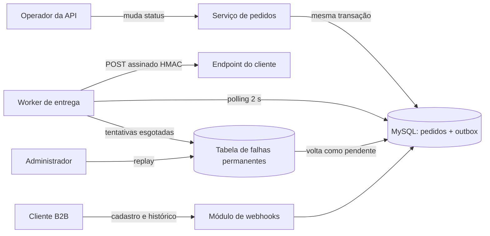

# RFC: Notificação de mudança de status de pedidos por webhooks, com outbox no MySQL e worker de entrega separado

| Campo | Valor |
| --- | --- |
| **Autor** | Larissa (Tech Lead), com texto consolidado por IA a partir da reunião ([09:50] Larissa) |
| **Status e data** | Em revisão · criado em 2026-11-08, versão de 2026-11-14 (histórico no [registro do processo](REGISTRO-PROCESSO.md)) |
| **Revisores e prazo** | Bruno (Pedidos), Diego (Plataforma), Sofia (Segurança) e Marcos (Produto), antes da implementação; a sessão de revisão é com Bruno e Diego ([09:50] Larissa) |
| **Documentos relacionados** | [PRD](PRD.md) · [FDD](FDD.md) · [ADRs](adrs/README.md) · origem de cada item (`RFC-*`) no [Tracker](TRACKER.md) |

## 1. Resumo executivo (TL;DR)

Três clientes B2B fazem polling em `GET /orders` para saber se seus pedidos mudaram de status e pediram aviso em menos de 10 segundos. Propomos webhooks de saída: a mudança de status grava um evento numa outbox do MySQL, na mesma transação, e um worker em processo separado lê a outbox a cada 2 segundos e entrega o evento assinado com HMAC-SHA256, com retentativas e uma fila de falhas permanentes (DLQ). Aceitamos entrega pelo menos uma vez para não coordenar exactly-once com os clientes, e um processo a mais para não subir infraestrutura nova.

## 2. Contexto e problema

Atlas Comercial, MaxDistribuição e Nova Cargo fazem polling em `GET /orders`, o que torna a integração lenta e cara, e querem aviso em menos de 10 segundos, o que para eles já é tempo real ([09:00] Marcos, [09:02] Marcos). A Atlas pode migrar para um concorrente se a entrega passar do fim do trimestre e quer a feature até o fim de novembro ([09:00] Marcos, [09:45] Marcos). O fluxo é só de saída ([09:02] Marcos).

A mudança de status acontece em `OrderService.changeStatus` (`src/modules/orders/order.service.ts`), numa transação que o time já considera pesada: valida a transição, mexe no estoque, atualiza `orders` e insere em `order_status_history` ([09:04] Bruno). A aplicação é um único processo (`src/server.ts`) sobre MySQL com Prisma, e o time, pequeno, não quer subir infraestrutura nova ([09:07] Larissa, [09:07] Diego).

## 3. Objetivos e não objetivos

**Objetivos:** notificar o cliente em menos de 10 segundos após a mudança de status, em operação normal; toda mudança de status assinada por um webhook ativo gera evento, e nenhuma mudança revertida gera evento; a indisponibilidade do endpoint do cliente não afeta a mudança de status; o cliente verifica a origem e a integridade de cada chamada; o cliente gerencia seus webhooks e consulta o histórico de entregas pela API.

**Não objetivos:** webhooks de entrada; ordem global entre pedidos; exactly-once (ALT-09); aviso por e-mail de falhas (QA-04); painel visual para o cliente; arquivamento das linhas entregues da outbox.

## 4. Proposta técnica

### 4.1 Visão geral

A proposta separa o registro do evento da entrega. Na transação de mudança de status, o serviço de pedidos grava na outbox o evento pronto, com o pedido como estava na transição, se algum webhook ativo do cliente assina aquele status; se a gravação falhar, a mudança é revertida. Um worker em processo próprio (`src/worker.ts`), com o mesmo banco e a mesma stack, busca os pendentes mais antigos em lotes pequenos, assina e envia. Sem resposta 2xx em 10 segundos, o evento é retentado; esgotadas as tentativas, vai para a DLQ com o motivo e o momento da falha, e só volta por replay de um `ADMIN`. Cadastro, rotação de secret e histórico de entregas ficam no módulo novo `src/modules/webhooks`. Contratos, payload e erros `WEBHOOK_*` estão no [FDD](FDD.md) e na [spec OpenAPI](openapi/webhooks.openapi.yaml).

### 4.2 Garantias e limites

- Atomicidade entre a mudança de status e o registro do evento
- Entrega pelo menos uma vez, com `X-Event-Id` estável para deduplicação
- Até 2 s até a leitura do evento e timeout de 10 s por chamada
- "5 tentativas" em 1m, 5m, 30m, 2h e 12h, quase 15 h de janela; o FDD lê como 5 retentativas após o envio inicial (P-01, a validar)
- Ordem por pedido e por webhook, com um único worker; com retentativas, depende da retenção proposta na P-06, e um replay pode chegar fora de ordem
- HMAC-SHA256 do corpo, secret por endpoint e 24 h de convivência na rotação; assinar também o `X-Timestamp` fica para a revisão da Sofia (P-22)
- O evento reflete o pedido no momento da transição e não leva os itens

## 5. Alternativas consideradas

Todas discutidas e descartadas na reunião; a argumentação está nos ADRs.

| Alternativa descartada | Custo que levou ao descarte | Decisão |
| --- | --- | --- |
| **ALT-01** · HTTP síncrono na mudança de status | Cliente lento trava a transação; cliente fora do ar exigiria reverter o status | [ADR-001](adrs/ADR-001-outbox-no-mysql-na-transacao-de-mudanca-de-status.md) |
| **ALT-02** · Redis Streams como fila | Infraestrutura nova; overengineering para um time pequeno | [ADR-001](adrs/ADR-001-outbox-no-mysql-na-transacao-de-mudanca-de-status.md) |
| **ALT-03** · Trigger no banco para acordar o worker | O MySQL não notifica processo externo; o polling de 2 s atende | [ADR-002](adrs/ADR-002-worker-em-processo-separado-com-polling-de-2-segundos.md) |
| **ALT-04** · Worker no processo da API | Reiniciar a API derruba as entregas | [ADR-002](adrs/ADR-002-worker-em-processo-separado-com-polling-de-2-segundos.md) |
| **ALT-05** · Retry indefinido | Evento pendurado para sempre se o cliente sumir | [ADR-003](adrs/ADR-003-retry-com-backoff-exponencial-em-5-tentativas.md) |
| **ALT-06** · Três tentativas | Não cobre manutenções de 2 h já vistas em clientes | [ADR-003](adrs/ADR-003-retry-com-backoff-exponencial-em-5-tentativas.md) |
| **ALT-07** · Status `failed` na outbox, sem DLQ | Falhas se acumulam na tabela que o worker lê, sem evidência separada | [ADR-004](adrs/ADR-004-dlq-em-tabela-separada-com-replay-manual-por-admin.md) |
| **ALT-08** · Secret global | Se vaza uma, vaza tudo | [ADR-005](adrs/ADR-005-assinatura-hmac-sha256-com-secret-por-endpoint-e-rotacao.md) |
| **ALT-09** · Exactly-once | Exige coordenação dos dois lados | [ADR-006](adrs/ADR-006-entrega-at-least-once-com-x-event-id.md) |
| **ALT-10** · Renderizar o payload no envio | O evento não refletiria o pedido no momento da transição | [ADR-008](adrs/ADR-008-payload-do-evento-como-snapshot-na-insercao-da-outbox.md) |

## 6. Impacto e riscos

### 6.1 Impacto

- **Código existente:** `changeStatus` (`src/modules/orders/order.service.ts`) grava na outbox; o módulo novo entra em `src/app.ts` e `src/routes/index.ts`; o logger (`src/shared/logger/index.ts`) passa a ocultar a secret.
- **Dados:** tabelas novas de webhooks, outbox, DLQ e histórico (`prisma/schema.prisma` e uma migração nova).
- **Operação:** processo novo, `npm run worker` (`src/worker.ts`, novo, e `package.json`), para implantar e monitorar.
- **Segurança:** secret por endpoint, rotação, replay só para `ADMIN` (`requireRole` de `src/middlewares/auth.middleware.ts`) e revisão de segurança de pelo menos 2 dias úteis.
- **Clientes e custo:** os clientes validam o HMAC e deduplicam por `X-Event-Id`, com documentação no portal; não há infraestrutura nova.

### 6.2 Riscos (probabilidade e impacto avaliados pelo autor)

| Risco | Probabilidade | Impacto | Mitigação |
| --- | --- | --- | --- |
| Perder a Atlas por atraso na entrega | Média | Alto | Três sprints com a revisão de segurança incluída; o Marcos confirma o prazo com a Atlas ([09:47] Marcos) |
| Cliente não deduplica e processa o mesmo evento duas vezes | Média | Médio | Regra destacada no portal de desenvolvedores ([09:26] Marcos) |
| Vazamento de secret de um cliente | Média | Médio | Secret por endpoint e rotação com 24 h de convivência |
| Crescimento contínuo da outbox degrada o polling | Alta | Médio | Leitura indexada por status; arquivamento fora desta feature ([09:08] Diego) |
| Cliente lento segura a fila (um worker, envios em sequência, até 10 s por chamada) | Média | Alto | Lotes pequenos e alerta de primeiro envio lento (FDD); paralelismo depende da QA-02 |

## 7. Plano de entrega

Três sprints pela estimativa da Larissa, com pelo menos dois dias úteis de revisão de segurança da Sofia antes do deploy ([09:46] Larissa, [09:46] Sofia).

## 8. Questões em aberto

Só pontos que a reunião deixou explicitamente para depois; o responsável é sugestão do autor.

| Questão e por que importa | Quando, segundo a reunião | Responsável |
| --- | --- | --- |
| **QA-01** · É preciso limitar a taxa de envio por cliente? 50 mudanças num minuto viram 50 chamadas ao mesmo cliente ([09:38] Diego) | "Observar e decidir depois" ([09:39] Larissa) | Larissa |
| **QA-02** · Como escalar para mais de um worker sem perder a ordem por pedido? Hoje a ordem depende do worker único | "Problema do futuro, não agora" ([09:13] Diego) | Diego |
| **QA-03** · Quando e como restringir o cadastro de webhooks por perfil ou por cliente? Hoje qualquer usuário autenticado configura o webhook de qualquer cliente | "Mais pra frente a gente pode endurecer" ([09:37] Sofia) | Sofia |
| **QA-04** · Em que condição entra o aviso por e-mail ao cliente após 3 falhas seguidas, pedido pelo produto ([09:37] Marcos)? | Próxima fase, depois de medir o impacto ([09:37] Larissa, [09:48] Larissa) | Larissa |

## 9. Decisões relacionadas

[ADR-001](adrs/ADR-001-outbox-no-mysql-na-transacao-de-mudanca-de-status.md) outbox; [ADR-002](adrs/ADR-002-worker-em-processo-separado-com-polling-de-2-segundos.md) worker e polling; [ADR-003](adrs/ADR-003-retry-com-backoff-exponencial-em-5-tentativas.md) retry; [ADR-004](adrs/ADR-004-dlq-em-tabela-separada-com-replay-manual-por-admin.md) DLQ e replay; [ADR-005](adrs/ADR-005-assinatura-hmac-sha256-com-secret-por-endpoint-e-rotacao.md) assinatura HMAC; [ADR-006](adrs/ADR-006-entrega-at-least-once-com-x-event-id.md) at-least-once; [ADR-007](adrs/ADR-007-reuso-dos-padroes-existentes-do-projeto-no-modulo-de-webhooks.md) reuso dos padrões; [ADR-008](adrs/ADR-008-payload-do-evento-como-snapshot-na-insercao-da-outbox.md) payload como snapshot. Os pontos que os ADRs deixam em aberto viram propostas do autor no FDD.
